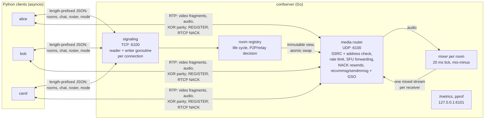
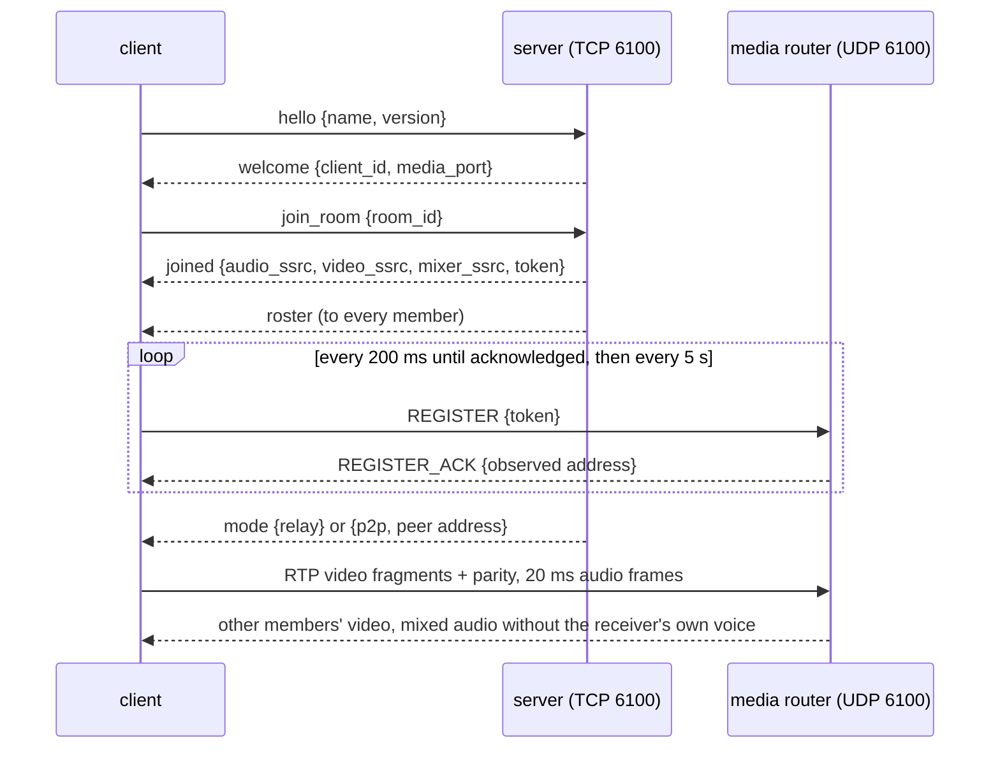
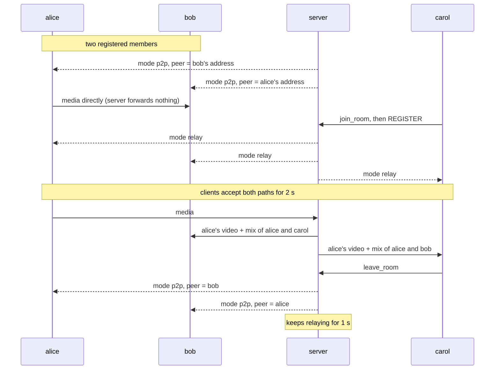

# Real-Time Video Conferencing System

Multi-party video conferencing for the CS305 (Computer Networks, SUSTech) course project.
There is a Go server that handles meetings over TCP and relays media over a single UDP port,
and a Python asyncio client with a split-screen window, chat, and fake camera/microphone input
so it can also run headless.

It covers everything in the course spec: create, join, list, leave and cancel meetings; text
chat with the sender's name and a timestamp; multi-party video and audio; several meetings at
once without leaking media between them; and peer-to-peer media for two people, switching to
the server relay when a third person joins (and back again).

## Background

We first built this in 2024 as a team, in Python on raw sockets. That version is still on the
`main` branch and, unchanged, in [`legacy/`](legacy/), so every comparison below can be rerun
from this repo. In 2026 I rebuilt it on this branch (`v2`) to fix what I didn't like about the
old design: frames sent as one huge UDP datagram, audio that fell further behind with every
extra talker, pickle on the wire, and clients identified only by IP address.

More detail lives in `docs/`:

- [`ENGINEERING_NOTES.md`](docs/ENGINEERING_NOTES.md): each change, why I made it, what I measured, and the trade-off
- [`PROTOCOL.md`](docs/PROTOCOL.md): the wire format (byte layouts and JSON message fields)
- [`BENCHMARKS.md`](docs/BENCHMARKS.md): how the benchmarks work, all results and their caveats

## Results

Everything was measured on one shared 4-vCPU Linux VM, on loopback or in network namespaces,
with three runs per point. The tables show the median with the range of the three runs in round
brackets. B1 is different: it pools the frames of all three runs and shows a Wilson 95%
interval in square brackets. The tables are generated by `bench/render.py`.

### B1: packet loss

Share of video frames that arrive complete within 200 ms, with random loss from the server to
the receiver (1500-byte MTU, sub-millisecond round trip, the same 480x480 JPEG frames for every
system):

<!-- BEGIN GENERATED summary_b1 -->
| Random packet loss | 2024 version | v2 without FEC | v2 with FEC | v2 with NACK | v2 with FEC and NACK |
|---|---|---|---|---|---|
| 1 % | 67.1 % [64.8, 69.2] | 75.6 % [73.5, 77.6] | 99.1 % [98.6, 99.5] | 99.1 % [98.5, 99.4] | 100.0 % [99.8, 100.0] |
| 2 % | 39.0 % [36.8, 41.3] | 59.2 % [56.9, 61.5] | 97.8 % [97.0, 98.4] | 98.9 % [98.3, 99.3] | 100.0 % [99.8, 100.0] |
| 5 % | 13.2 % [11.7, 14.8] | 24.1 % [22.2, 26.2] | 86.4 % [84.7, 87.9] | 98.7 % [98.0, 99.1] | 99.9 % [99.6, 100.0] |
| 10 % | 2.7 % [2.0, 3.6] | 6.1 % [5.0, 7.3] | 57.3 % [55.0, 59.6] | 98.1 % [97.3, 98.6] | 99.3 % [98.7, 99.6] |
<!-- END GENERATED summary_b1 -->

The 2024 version sends each 31 kB frame as one UDP datagram, which IP splits into 21 or 22
fragments, so losing any one fragment loses the whole frame. v2 splits a frame into packets of
at most 1232 bytes, adds one XOR parity packet per four fragments, and a receiver that is still
missing a packet asks the server to resend it (RTCP generic NACK). FEC and NACK together are
the client's default.

With a 50 ms round trip and loss in both directions, NACK helps less, because a repair often
arrives after the next frame is already complete and the receiver drops the older frame:

<!-- BEGIN GENERATED summary_b1_hard -->
| Loss in each direction, +50 ms round trip | v2 with FEC | v2 with NACK | v2 with FEC and NACK |
|---|---|---|---|
| 2 % | 97.9 % [97.1, 98.4] | 90.0 % [88.4, 91.3] | 99.1 % [98.5, 99.4] |
| 5 % | 85.1 % [83.4, 86.7] | 90.9 % [89.5, 92.2] | 95.4 % [94.3, 96.3] |
| 10 % | 57.4 % [55.1, 59.7] | 93.9 % [92.7, 94.9] | 88.7 % [87.1, 90.1] |
<!-- END GENERATED summary_b1_hard -->

### B2: everyone talking at once

<!-- BEGIN GENERATED summary_b2 -->
| | 3 parties, 2024 version | 3 parties, v2 | 5 parties, 2024 version | 5 parties, v2 |
|---|---|---|---|---|
| Capture-to-playout latency, median | 594 ms (589-614) | 119 ms (117-119) | 978 ms (952-1024) | 119 ms (119-124) |
| Audio played, worst talker | 41.3 % (41.3-41.7) | 100.0 % | 15.1 % (15.0-15.7) | 100.0 % |
| Downstream audio per receiver | 525 kbit/s | 415 kbit/s | 1050 kbit/s | 420 kbit/s |
| Video frames processed | 25.0 % | 100.0 % (99.9-100.0) | 8.2 % (7.8-8.8) | 100.0 % |
<!-- END GENERATED summary_b2 -->

The 2024 client plays every talker's audio one after another on a blocking stream, so with two
or more people talking, playback falls behind and the same thread stops reading video. v2 mixes
audio on the server (mix-minus: everyone gets the sum of the others) and sends each receiver a
single stream. Its 119 ms is just the buffering it is set up for: 40 ms of jitter buffer on the
server, 60 ms of playout delay on the client, and up to 20 ms to the next tick on each side.
No audio hardware was available, so both ends are simulated; see
[`BENCHMARKS.md`](docs/BENCHMARKS.md#b2-multi-talker-audio) for what that assumes.

### B3: how many participants one core can relay

Rooms of four, 15 fps per participant, the server pinned to one CPU, on loopback:

<!-- BEGIN GENERATED summary_b3 -->
| Loopback | System | Largest size that passed, per repeat | Server CPU at 128 participants | without the core's softirq | Server CPU-s per participant-minute (16 participants) | core-seconds per participant-minute |
|---|---|---|---|---|---|---|
| MTU 65536 (Linux default) | 2024 version | 448/448/448 (the only size run) | not run | not run | 0.158 (0.152-0.163) | 0.371 (0.331-0.636) |
| MTU 65536 (Linux default) | v2 (batching and GSO, default) | 304/304/272 (first failing: 320/288/288; last pass before the first failure: 304/272/272) | 0.508 (0.496-0.535) | 0.417 (0.402-0.431) | 0.503 (0.479-0.503) | 0.483 (0.475-1.467) |
| MTU 65536 (Linux default) | v2, recvmmsg/sendmmsg without GSO | 192/192/192 (first failing: 208/208/208) | 0.628 (0.607-0.657) | 0.481 (0.473-0.503) | 0.565 (0.552-0.570) | 0.583 (0.506-0.613) |
| MTU 65536 (Linux default) | v2, one system call per datagram | 160/176/192 (first failing: 176/192/208) | 0.680 (0.664-0.685) | 0.491 (0.487-0.506) | 0.597 (0.572-0.613) | 0.573 (0.542-0.652) |
<!-- END GENERATED summary_b3 -->

I profiled the server with pprof first: most of its CPU went to system calls. Batching reads
and writes with `recvmmsg`/`sendmmsg` and then sending each sender's packets to a receiver as one
UDP GSO message raised the largest size that passed in every repeat from 160 to 272
participants. About half of the CPU saving is softirq time of the receivers' loopback receive
path, which the kernel charges to the server's core; without it the server's own CPU went down
about 15%.

This comparison doesn't favour v2: for the same media it sends about 19 times as many packets as
the 2024 version, because loopback's 64 KiB MTU lets the old version's huge datagrams through
without fragmenting. That is the price of packets that are safe on a real 1500-byte path.

## Architecture



- **Control plane:** one TCP port. Every message is a 4-byte length followed by a JSON object.
  The server owns all room state: it hands out participant ids, SSRCs and a random session
  token, stamps chat messages with the sender's name and its own clock, and decides whether a
  room runs peer-to-peer or through the relay.
- **Media plane:** one UDP port for all rooms. A client first sends `REGISTER` with its token
  from its media socket (repeated until acknowledged, a bit like a STUN binding request). After
  that the server only accepts that client's SSRC from that address and only forwards within
  its room, so meetings stay isolated and spoofed packets get dropped. Packets use the RTP
  header, so Wireshark can decode them ("Decode As... RTP").
- **Video:** one JPEG per frame, split into fragments of at most 1200 bytes of JPEG plus one XOR
  parity packet per four fragments. Every UDP payload is at most 1232 bytes, so nothing gets
  IP-fragmented on a 1500-byte path. The server forwards fragments as they are (SFU-style) and
  keeps the last 256 video packets of each sender for retransmission.
- **Audio:** 16 kHz mono PCM in 20 ms frames. Every 20 ms the server mixes all active senders
  and subtracts each receiver's own frame (mix-minus), so a receiver always gets one stream no
  matter how many people talk. The client plays it through a 60 ms jitter buffer with loss
  concealment.
- **Mode switching:** with exactly two registered members the server sends each one the other's
  address and forwards nothing. With three or more it relays. After a switch, clients accept
  media from both paths for 2 s and the server keeps relaying for 1 s, so nothing in flight is
  lost.
- **Hot path:** when rooms change, a separate goroutine rebuilds the routing table and swaps it in
  atomically, so the forwarding goroutine never waits on the registry. Forwarding video takes no
  lock and allocates nothing per packet. On Linux the media socket reads up to 64 datagrams per
  `recvmmsg` and sends with `sendmmsg` and UDP GSO (`server/internal/udpio`); other platforms use
  one system call per datagram.

### Joining a meeting



### Switching between peer-to-peer and relay




## Running it

### Server (Go 1.24+, Linux, macOS or Windows)

```sh
cd server
go build -o bin/confserver ./cmd/confserver      # Windows: go build -o bin\confserver.exe .\cmd\confserver
./bin/confserver                                  # loopback only: 127.0.0.1:6100 (TCP and UDP)
./bin/confserver -control-addr 0.0.0.0:6100 -media-addr 0.0.0.0:6100   # serve a LAN
```

Useful flags (`-h` lists all of them): `-p2p=false` always relays, `-pprof` turns on
`/debug/pprof/` next to `/metrics` (127.0.0.1:6101), `-log-format json` for JSON logs,
`-udp-batch 1` turns batching off, `-udp-gso=false` keeps batching without GSO, and
`-nack-buffer 0` turns off retransmission.

With Docker (static binary, non-root user):

```sh
docker build -t confserver -f server/Dockerfile server
docker run --rm -p 127.0.0.1:6100:6100/tcp -p 127.0.0.1:6100:6100/udp \
  -p 127.0.0.1:6101:6101 confserver
```

The server has no authentication or encryption, so only publish it on a network you trust.

### Client (Python 3.11+, [uv](https://docs.astral.sh/uv/))

```sh
cd client
uv sync                                                   # numpy and Pillow; no OpenCV or PyAudio
uv run confclient --name alice --fake-media --create standup
uv run confclient --name bob --fake-media --join 1
uv run confclient --name carol --fake-media --join 1
```

`--fake-media` swaps the camera for a moving test pattern and the microphone for a tone. For a
real camera and microphone run `uv sync --extra video --extra audio` (OpenCV and PyAudio;
PyAudio needs PortAudio: `brew install portaudio` or `sudo apt install portaudio19-dev`).

Commands at the prompt (or non-interactively with `--script "cmd; cmd"`):

```
list | create [title] | join <id> | leave | cancel | chat <text> | video on|off |
audio on|off | status | sleep <seconds> | help | exit
```

With two people the client prints `* media mode: peer-to-peer with ...`. When the third joins,
everyone switches to `* media mode: server relay`.

## Network limits

I developed this on a shared campus network, so everything binds to loopback by default and
every part has a traffic cap:

| Part | Default limit | Flags |
|---|---|---|
| Server sockets | 127.0.0.1 only | `-control-addr`, `-media-addr` |
| Media in, per client | 8 Mbit/s including headers (token bucket); the excess is dropped and counted | `-max-ingress-kbps`, `-ingress-burst-kib` |
| Retransmissions | 8 Mbit/s per requesting client, from a separate budget; a NACK must come from the requester's own address and name video in its room | `-max-rtx-kbps`, `-nack-buffer` |
| Media bindings | an address is only bound after it echoes a server nonce; `REGISTER`s limited per member, per source and in total | `-max-registers-per-sec`, `-binding-timeout` |
| Control plane | 16 per room, 256 rooms, 1024 clients; 50 frames/s per connection; timeouts for `hello` and idle connections | `-max-room-size`, `-max-rooms`, `-max-clients`, `-control-rate`, ... |
| Client upload | 6000 kbit/s of video and audio; feedback packets have their own small budget | `--max-send-kbps` |
| Load generator | loopback only unless `-allow-remote`; caps on total Mbit/s, packets/s, participants and run length | `-allow-remote`, `-max-mbps`, `-max-pps`, ... |

The benchmarks run entirely inside network namespaces on one machine.

## Tests

```sh
make test     # gofmt, go vet, staticcheck, ruff, mypy, then go test -race and pytest
make fuzz     # 30 s of Go fuzzing per decoder
make ci       # the same steps as the CI workflow's Linux jobs (run it in a fresh clone)
```

- **Go:** table-driven unit tests (room state machine, mode decisions, mixer, FEC recovery,
  NACK budgets), eight fuzz targets for the decoders, and integration tests that start the
  server in-process and drive fake clients through the whole meeting life cycle, P2P to relay
  and back, meeting isolation and spoofed packets.
- **Python:** unit tests for the packetizer, FEC, frame assembly under loss and reordering, the
  audio jitter buffer and rate limits, plus end-to-end tests (`pytest -m e2e`) that start the Go
  server and run three headless clients.
- **Shared test vectors:** Go and Python both check against the same 63 golden vectors in
  `protocol-testdata/vectors.json`, so the two sides can't drift apart.
- **CI:** [`.github/workflows/ci.yml`](.github/workflows/ci.yml) runs lint, the Go race tests,
  short fuzzing, one run of every benchmark, the client tests on Python 3.11 and 3.13, the Go
  and Python tests on macOS and Windows, and a build and smoke test of the Docker image.

Testing on more than one OS found real bugs. On Windows a datagram longer than the read buffer
comes back as an error instead of being truncated, and the media router backed off on it, so
anyone sending oversized packets could stall forwarding on a Windows server. Separately, the
client couldn't register its media on Python 3.11 at all until the 3.11 job caught it.

## Benchmarks

Each experiment is one command and writes JSON to `bench/results/`. B1 to B3 need root for
network namespaces and nftables. Timing-sensitive steps take a lock file
(`${XDG_RUNTIME_DIR:-/tmp}/cs305-bench.lock`, or `BENCH_LOCK`) so they don't overlap with other
jobs on the machine.

```sh
sudo bench/run_b1.sh            # B1 packet loss
sudo bench/run_b2.sh            # B2 multi-talker audio
sudo bench/run_b3.sh            # B3 relay capacity
sudo bench/profile_b3.sh        # CPU profiles at 128 participants
bench/run_micro.sh              # Go microbenchmarks
(cd client && uv run --group bench python ../bench/render.py)   # tables and plots
```

The 2024 code runs unmodified: `bench/legacy_harness/` provides stand-ins for its camera,
PyAudio and pyautogui imports and forces relay mode.

## Limitations

- I had no camera, microphone or speaker while building this. The OpenCV and PyAudio adapters
  are thin and haven't been tested with real hardware; all tests and benchmarks use synthetic
  media.
- Video is one JPEG per frame. Simple and loss-tolerant, but about 4 Mbit/s for 480x480 at
  15 fps, much more than a real video codec would need.
- No encryption. A member's media binding only moves after the new address echoes a server
  nonce, so an off-path attacker can't redirect it, but someone who can read the traffic can.
- P2P uses the address the server sees, with no ICE/STUN/TURN, so it only works on a LAN or
  behind permissive NATs. Otherwise run the server with `-p2p=false`.
- No congestion control or adaptive bitrate, audio isn't retransmitted, and the retry interval
  is fixed at 30 ms.
- The host role isn't handed over when the host leaves; the room closes once it is empty.
- All benchmarks ran on one shared VM with emulated loss and delay, not a real network.

## Repository layout

```
server/            Go module: cmd/confserver, cmd/loadgen, internal/{protocol,room,signaling,media,udpio,metrics,app,client}
client/            Python package confclient (uv project) and its tests
protocol-testdata/ golden vectors shared by the Go and Python tests
bench/             benchmark scripts, the legacy harness, results and plots
docs/              PROTOCOL.md, ENGINEERING_NOTES.md, BENCHMARKS.md
legacy/            the 2024 course version, unchanged (same as main)
```

## License

MIT, see [LICENSE](LICENSE).
