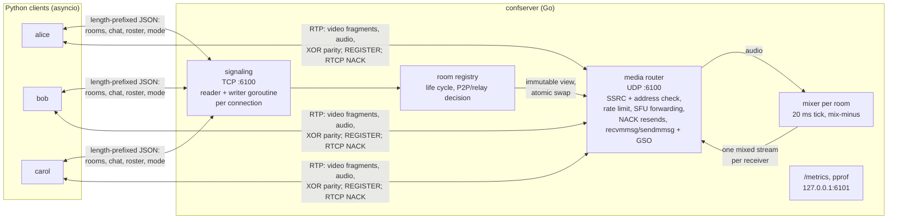
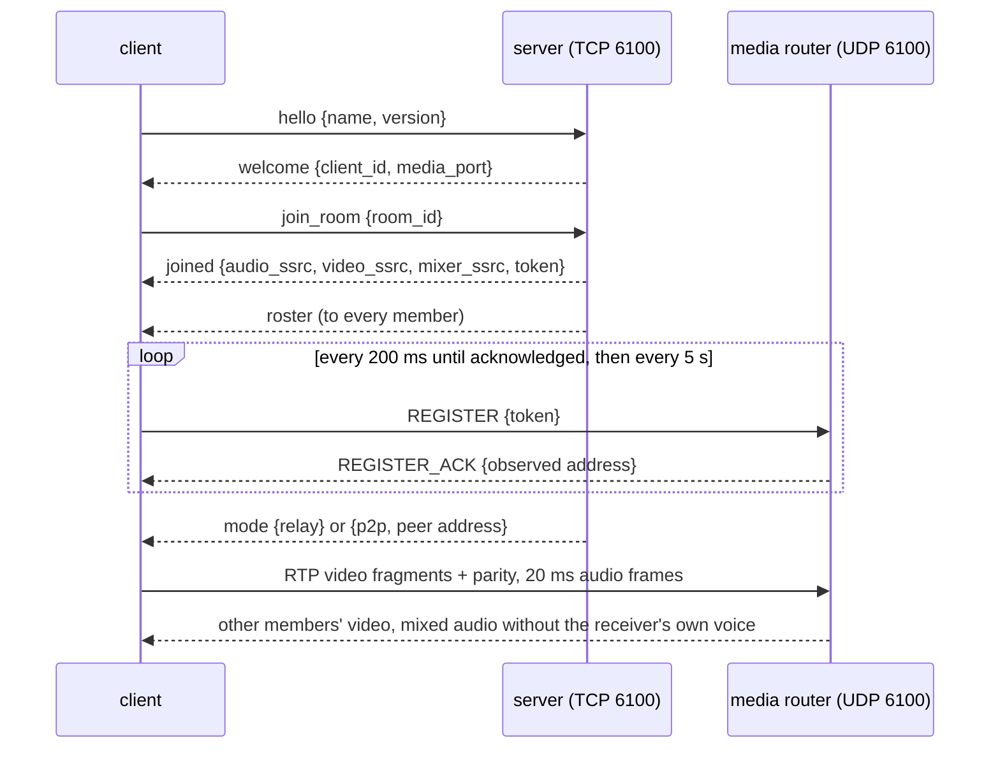
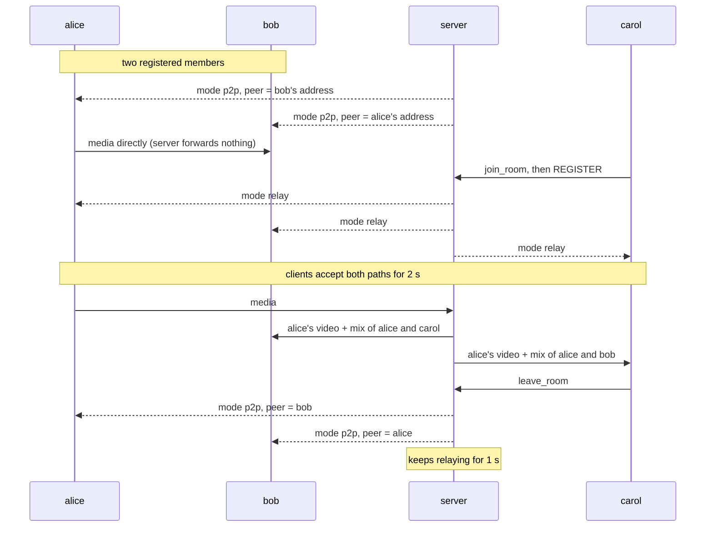

# Real-Time Video Conferencing System

A multi-party video conferencing system: a Go server that handles meetings over TCP and
relays media over one UDP port (SFU-style video forwarding with FEC and NACK
retransmission, server-side audio mixing, batched UDP I/O with GSO), and a Python
asyncio client with a split-screen window, chat and synthetic
media for headless use. It implements the CS305 (Computer Networks, SUSTech) course
project specification: create, join, list, leave and cancel meetings; text chat with
the sender's name and a timestamp; multi-party video and server-mixed audio; several
isolated meetings at once; peer-to-peer media for two participants with automatic
switching to the relay and back.

This branch (`v2`) is a rewrite of the original course project, which is kept unchanged
in [`legacy/`](legacy/) so that every comparison below can be reproduced from this
repository. [`docs/ENGINEERING_NOTES.md`](docs/ENGINEERING_NOTES.md) explains each
change (problem, measurement, fix, trade-off), [`docs/PROTOCOL.md`](docs/PROTOCOL.md)
specifies the wire format byte by byte, and [`docs/BENCHMARKS.md`](docs/BENCHMARKS.md)
has the methodology and full results.

## Results at a glance

All numbers were measured on one shared 4-vCPU Linux virtual machine, on loopback or
in network namespaces, with three runs per point: tables give the median and, in round
brackets, the range of the three runs, except B1's, which pool the frames of the three
runs and give a Wilson 95 % interval in square brackets.
[`docs/BENCHMARKS.md`](docs/BENCHMARKS.md) has the methodology, the result file and run
ID behind every number, and the caveats.

**Loss resilience (B1).** Video frames delivered complete within 200 ms over a link
with random packet loss from the server to the receiver (1500-byte MTU, sub-millisecond
round trip, same 480x480 JPEG frames for all systems, 1 740-1 748 frames per cell):

<!-- BEGIN GENERATED summary_b1 -->
| Random packet loss | legacy (original) | v2 without FEC | v2 with FEC | v2 with NACK | v2 with FEC and NACK |
|---|---|---|---|---|---|
| 1 % | 67.1 % [64.8, 69.2] | 75.6 % [73.5, 77.6] | 99.1 % [98.6, 99.5] | 99.1 % [98.5, 99.4] | 100.0 % [99.8, 100.0] |
| 2 % | 39.0 % [36.8, 41.3] | 59.2 % [56.9, 61.5] | 97.8 % [97.0, 98.4] | 98.9 % [98.3, 99.3] | 100.0 % [99.8, 100.0] |
| 5 % | 13.2 % [11.7, 14.8] | 24.1 % [22.2, 26.2] | 86.4 % [84.7, 87.9] | 98.7 % [98.0, 99.1] | 99.9 % [99.6, 100.0] |
| 10 % | 2.7 % [2.0, 3.6] | 6.1 % [5.0, 7.3] | 57.3 % [55.0, 59.6] | 98.1 % [97.3, 98.6] | 99.3 % [98.7, 99.6] |
<!-- END GENERATED summary_b1 -->

The same for v2 with loss in both directions and a 50 ms round trip (a userspace relay
drops datagrams independently each way, so NACKs and retransmissions can be lost too),
pooled frames with the Wilson 95 % interval:

<!-- BEGIN GENERATED summary_b1_hard -->
| Loss in each direction, +50 ms round trip | v2 with FEC | v2 with NACK | v2 with FEC and NACK |
|---|---|---|---|
| 2 % | 97.9 % [97.1, 98.4] | 90.0 % [88.4, 91.3] | 99.1 % [98.5, 99.4] |
| 5 % | 85.1 % [83.4, 86.7] | 90.9 % [89.5, 92.2] | 95.4 % [94.3, 96.3] |
| 10 % | 57.4 % [55.1, 59.7] | 93.9 % [92.7, 94.9] | 88.7 % [87.1, 90.1] |
<!-- END GENERATED summary_b1_hard -->

The original sends each 31 kB frame as one UDP datagram, which the network splits into
21 or 22 IP fragments; losing any fragment loses the frame, and under sustained loss the
receiver's IP reassembly queue fills to its limit, so it does worse than independent
loss would predict (68.0 % of frames over a 300 s run at 1 % loss, where the model gives
80.5 %). v2 sends fragments of at most 1200 bytes and one XOR parity packet per four
fragments, and a receiver that still misses a packet asks for it again with an RTCP
generic NACK; the server resends it from a buffer of each sender's last 256 video
packets. FEC and NACK together, the client's default, cost repaired frames time: p99
frame latency 39.4 ms at 10 % loss against 3.0 ms with FEC alone on the sub-millisecond
path. With a 50 ms round trip a repair arrives about when the next frame does, and the
receiver's newest-wins frame assembler then often drops the repaired frame, which is
why retransmission does much worse there and NACK alone even improves with more loss
([`docs/ENGINEERING_NOTES.md`](docs/ENGINEERING_NOTES.md#211-nack-retransmission-for-video-b1)).

**Multi-talker audio (B2).** Everybody talks and sends video:

<!-- BEGIN GENERATED summary_b2 -->
| | 3 parties, legacy (original) | 3 parties, v2 | 5 parties, legacy (original) | 5 parties, v2 |
|---|---|---|---|---|
| Capture-to-playout latency, median | 594 ms (589-614) | 119 ms (117-119) | 978 ms (952-1024) | 119 ms (119-124) |
| Audio played, worst talker | 41.3 % (41.3-41.7) | 100.0 % | 15.1 % (15.0-15.7) | 100.0 % |
| Downstream audio per receiver | 525 kbit/s | 415 kbit/s | 1050 kbit/s | 420 kbit/s |
| Video frames processed | 25.0 % | 100.0 % (99.9-100.0) | 8.2 % (7.8-8.8) | 100.0 % |
<!-- END GENERATED summary_b2 -->

The original plays every talker's chunks one after another on a blocking audio stream,
so with two or more talkers playback falls behind real time and the same thread stops
reading video. Both ends are simulated (synthetic tones as microphones, stand-in
speakers; no audio hardware was available), and the original's numbers assume a sound
card whose `write()` blocks while the previous chunk plays (see
[`docs/BENCHMARKS.md`](docs/BENCHMARKS.md#b2-multi-talker-audio)). v2 mixes on the
server (mix-minus) and sends each receiver one stream.

**Relay capacity (B3).** Rooms of four, 15 fps per participant, the server pinned to
one CPU, on loopback:

<!-- BEGIN GENERATED summary_b3 -->
| Loopback | System | Largest size that passed, per repeat | Server CPU at 128 participants | Server CPU-s per participant-minute (16 participants) |
|---|---|---|---|---|
| MTU 65536 (Linux default) | legacy (original) | 448/448/448 (the only size run) | not run | 0.158 (0.152-0.163) |
| MTU 65536 (Linux default) | v2 (batching and GSO, default) | 304/304/272 (first failing: 320/288/288) | 0.51 (0.50-0.53) | 0.503 (0.479-0.503) |
| MTU 65536 (Linux default) | v2, recvmmsg/sendmmsg without GSO | 192/192/192 (first failing: 208/208/208) | 0.63 (0.61-0.66) | 0.565 (0.552-0.570) |
| MTU 65536 (Linux default) | v2, one system call per datagram | 160/176/192 (first failing: 176/192/208) | 0.68 (0.66-0.69) | 0.597 (0.572-0.613) |
<!-- END GENERATED summary_b3 -->

This comparison does not favour v2: for the same media it sends about 19 times as many
packets as the original (26 MTU-sized fragments and 7 parity packets per frame and 75
audio packets per second, against one datagram per frame or audio chunk, because
loopback's 64 KiB MTU never fragments the original's 31 kB datagrams), and the kernel's
per-packet work is what costs CPU. The original passed at 448 participants, the only
size it was run at; v2 is CPU-bound well before that. On one v2 binary, at 128
participants, `recvmmsg`/`sendmmsg` batching (18.6 times fewer system calls in the CPU
profiles) cut the server's CPU by 7.6 %, and sending each sender's datagrams for one
receiver as UDP GSO messages (7 times fewer messages down the send path) by a further
19.1 %; the size that every repeat passed rose from 160 to 272 participants. These are
loopback numbers, in which the receivers' receive path is charged to the server;
[`docs/BENCHMARKS.md`](docs/BENCHMARKS.md#b3-relay-capacity) explains the setup (lo
splits each GSO message before the receive path, as in front of a NIC without
segmentation offload), the profiles and an earlier result at Ethernet MTU. v2 trades
server CPU for loss resilience and MTU safety.

## Architecture



- **Control plane.** One TCP port; each message is a 4-byte length and a JSON object.
  The server owns all room state: it assigns participant ids, SSRCs and a random
  session token, stamps chat messages with the sender's name and its own clock, and
  decides each room's media mode.
- **Media plane.** One UDP port for every room. A client first sends `REGISTER` with its
  token from its media socket (repeated until acknowledged, like a STUN binding
  request); after that the server accepts an SSRC only from that address and forwards
  only within the sender's room, so meetings are isolated, spoofed packets are dropped,
  and several clients can share one host. Packets use the RTP header (Wireshark can
  decode them with "Decode As... RTP").
- **Video** is JPEG, one independent image per frame, split into fragments of at most
  1200 bytes (no IP fragmentation on a 1500-byte path), with one XOR parity packet per
  four fragments. The server forwards fragments unchanged to the other members (SFU)
  and keeps each sender's last 256 video packets; in relay mode a receiver that is still
  missing a packet at least 5 ms after the gap sends an RTCP generic NACK (RFC 4585) and gets that
  packet again, to itself only.
- **Audio** is 16 kHz mono 16-bit PCM in 20 ms frames. The server keeps a small jitter
  buffer per sender, and every 20 ms sums all active senders once and subtracts each
  receiver's own frame (mix-minus), so every receiver gets one stream whatever the
  number of talkers. Clients play it through a 60 ms jitter buffer with loss
  concealment.
- **Modes.** Exactly two registered members talk peer-to-peer: the server sends each
  the other's observed address and forwards nothing. With three or more it relays.
  Clients accept media from both paths for 2 s after a switch and the server keeps
  relaying for 1 s, so switching loses nothing in flight.
- **Hot path.** On control-plane changes a separate goroutine rebuilds the routing
  table and swaps it in atomically, so the forwarding goroutine never waits for the
  registry. Forwarding video takes no lock (the rate limiters belong to the forwarding
  goroutine) and allocates nothing per packet (`bench/results/micro.json`); an audio
  packet takes its sender's jitter-buffer lock, which the room's mixer goroutine
  shares. On 64-bit Linux the media socket
  reads up to 64 datagrams per `recvmmsg` and sends all copies of a read with one
  `sendmmsg`, packing each sender's consecutive fragments for one receiver into a UDP GSO
  message, so the kernel's IP stack runs once per message instead of once per datagram
  (`server/internal/udpio`; one system call per datagram elsewhere).

### Joining a meeting



### Switching between peer-to-peer and relay



## Running it

### Server (Go 1.24+; Linux, macOS or Windows)

```sh
cd server
go build -o bin/confserver ./cmd/confserver      # Windows: go build -o bin\confserver.exe .\cmd\confserver
./bin/confserver                                  # loopback only: 127.0.0.1:6100 (TCP and UDP)
./bin/confserver -control-addr 0.0.0.0:6100 -media-addr 0.0.0.0:6100   # serve a LAN
```

`./bin/confserver -h` lists the limits (room size, rooms, clients, per-sender rate,
relay grace period), `-p2p=false` forces relay mode, `-pprof` adds `/debug/pprof/` to
the metrics address (127.0.0.1:6101 by default), and `-log-format json` switches to
structured JSON logs. `-udp-batch 1` turns system-call batching off, `-udp-gso=false`
keeps batching but sends every datagram as its own message, and `-nack-buffer 0`
disables retransmission. `/metrics` counts packets by kind and drop reason,
retransmissions (`kind="video_rtx"`) and the read and send system calls.

With Docker (a static binary on an empty base image, running as a non-root user):

```sh
docker build -t confserver -f server/Dockerfile server
docker run --rm -p 127.0.0.1:6100:6100/tcp -p 127.0.0.1:6100:6100/udp \
  -p 127.0.0.1:6101:6101 confserver                       # reachable from this host only
docker run --rm -p 192.0.2.10:6100:6100/tcp -p 192.0.2.10:6100:6100/udp \
  -p 127.0.0.1:6101:6101 confserver -p2p=false            # serve a LAN on 192.0.2.10
```

Inside the container the server listens on all interfaces, so the `-p` options decide
who can reach it; the server has no authentication or encryption, so publish it on a
LAN address only on a network you trust. Flags after the image name are appended to
the server's own (`-p2p=false`, `-log-format json`, ...). The image's `HEALTHCHECK`
runs `confserver -healthcheck 127.0.0.1:6100`, which connects to the control port and
completes a `hello`, so a dead control plane shows as unhealthy even while `/metrics`
still answers.

### Client (Python 3.11+, [uv](https://docs.astral.sh/uv/))

```sh
cd client
uv sync              # runtime: numpy and Pillow (plus the dev tools); no OpenCV or PyAudio
uv run confclient --name alice --fake-media               # synthetic camera and tone
uv run confclient --name bob --fake-media --headless --join 1
```

`--fake-media` replaces the camera with a moving test pattern and the microphone with a
tone, so the client runs anywhere. For a real camera, microphone and speaker install the
optional extras: `uv sync --extra video --extra audio` (OpenCV and PyAudio). PyAudio
needs the PortAudio library: on macOS `brew install portaudio`, on Debian or Ubuntu
`sudo apt install portaudio19-dev`; on Windows the PyAudio wheels from PyPI include it.
The window shows every participant's video as a tile in one split-screen grid.

Commands at the client prompt (also usable non-interactively with `--script "cmd; cmd"`):

```
list | create [title] | join <id> | leave | cancel | chat <text> | video on|off |
audio on|off | status | sleep <seconds> | help | exit
```

Three people on one machine, each in its own terminal:

```sh
uv run confclient --name alice --fake-media --create standup
uv run confclient --name bob --fake-media --join 1
uv run confclient --name carol --fake-media --join 1
```

With two participants the client prints `* media mode: peer-to-peer with ...`; when the
third joins every client switches to `* media mode: server relay`.

## Network usage limits

Everything defaults to loopback, and every component has explicit, configurable caps
so that it cannot flood a shared network by accident:

| Component | Default limit | Flag |
|---|---|---|
| Server sockets | bind to 127.0.0.1 only | `-control-addr`, `-media-addr` |
| Server, media per client | 8 Mbit/s of media and NACKs in, IP/UDP headers included (token bucket, 256 KiB burst); excess is dropped and counted; 0 = unlimited | `-max-ingress-kbps`, `-ingress-burst-kib` |
| Server, retransmissions | 8 Mbit/s of retransmitted video per requesting client, from its own bucket (finite even when the ingress limit is 0); a NACK must come from the requester's registered address and may only name other members' video in its room; 256 packets kept per sender | `-max-rtx-kbps`, `-nack-buffer` |
| Server, media bindings | an address is bound only after it echoes a server nonce; `REGISTER`s limited per member (10/s), per source IP and port (20/s) and in total (2000/s); a binding without keepalive for 15 s is dropped | `-max-registers-per-sec`, `-binding-timeout` |
| Server, control plane | 16 members per room, 256 rooms, 1024 clients, 1088 open connections; 50 frames/s per connection (burst 100), charged before decoding; 10 s from connect to `hello`, 60 s idle; a connection closes when `hello` is refused because the server is full, or after 3 malformed frames in a row | `-max-room-size`, `-max-rooms`, `-max-clients`, `-max-conns`, `-control-rate`, `-control-burst`, `-hello-timeout`, `-idle-timeout` |
| Metrics and pprof | 127.0.0.1:6101; pprof off | `-metrics-addr`, `-pprof` |
| Client, media | 6000 kbit/s upload of video and audio with their parity (token bucket); a frame that does not fit is skipped whole; 1 to 10^6 kbit/s, no cap only with `--no-send-cap` (which warns) | `--max-send-kbps`, `--no-send-cap` |
| Client, feedback | NACKs and `REGISTER`s share their own budget of 128 kbit/s and 200 packets/s; NACKs over it are not sent, while `REGISTER`s (one per 200 ms until acknowledged, then one per 5 s, and challenge answers) are always sent and charged | `MediaConfig.feedback_kbps`, `feedback_pps` (no CLI flag) |
| Load generator (`server/cmd/loadgen`) | refuses non-loopback targets unless `-allow-remote`; caps its estimated total wire traffic, both directions with all headers, parity and the fan-out to each room: on loopback 2000 Mbit/s and 400 000 packets/s by default (at most 16 000 Mbit/s and 2 000 000 packets/s), otherwise 25 Mbit/s and 2500 packets/s (at most 100 Mbit/s and 5000 packets/s), with rooms of at most 16 and at most 64 participants; at most 512 participants and 10 min per run (warm-up, window and grace together) | `-allow-remote`, `-max-mbps`, `-max-pps`, `-participants`, `-room-size`, `-duration` |

The benchmarks run entirely inside network namespaces on one machine.

## Tests

```sh
make test          # the linters (gofmt, go vet, staticcheck, ruff, mypy), then go test -race and pytest
make fuzz          # 30 s of native Go fuzzing per decoder
make ci            # every step of the CI workflow's Linux jobs; run it in a fresh clone (see Makefile)
```

The Makefile runs staticcheck 2025.1.1 with `go run`, as CI does; `go install
honnef.co/go/tools/cmd/staticcheck@2025.1.1` installs the same version (then pass
`STATICCHECK=staticcheck`). mypy checks the client, its tests and `bench/` in strict mode
for Python 3.11, the oldest version the client supports.

- Go: table-driven unit tests (room state machine, mode decisions, mixer saturation and
  mix-minus, FEC recovery of any single lost packet, header round trips), fuzz tests
  for every decoder with a committed seed corpus, and integration tests that start the
  server in-process and drive fake clients through create/join/list/chat/leave/cancel,
  P2P -> relay -> P2P, meeting isolation, spoofed SSRCs and mixed-audio content.
- Python: unit tests against the same golden vectors as the Go code
  (`protocol-testdata/vectors.json`), packetizer and FEC, frame assembly with loss,
  reordering and duplicates, audio jitter buffer and concealment, rate limiting, the
  media session against a fake server, and end-to-end tests (`pytest -m e2e`) that build
  and start the Go server and run three headless clients with synthetic media.
- CI: a GitHub Actions workflow ([`.github/workflows/ci.yml`](.github/workflows/ci.yml);
  verified locally, not yet run on GitHub) with lint, the Go race tests, short fuzzing,
  every benchmark run once, the client's tests on Python 3.11 and 3.13 on Linux
  (end-to-end tests included) and unit tests on macOS and Windows, the Go tests on macOS
  and Windows, and a build and smoke test of the container image. Every step of its
  Linux jobs passed with `make ci` in a fresh clone of this branch; the macOS and
  Windows jobs have not run anywhere. The first local run of the Python 3.11 job found a
  bug that had made the client unusable on 3.11 (the media session never registered;
  fixed in `fix(client): register media on Python 3.11`).

## Benchmarks

Each experiment is one command and writes JSON to `bench/results/` from the raw files
of that one invocation (`bench/tmp/<benchmark>/<run ID>/`), with the build record of
the binaries it ran. B1-B3 need root for network namespaces and nftables, and create
only namespaces named after their own invocation. Timing-sensitive steps run under
`flock` on `${XDG_RUNTIME_DIR:-/tmp}/cs305-bench.lock` (set `BENCH_LOCK` to share a
lock with other jobs on the machine), in chunks of at most 12 minutes so other jobs
can take the lock in between; Ctrl-C stops a run, and the same `CS305_RUN_ID` resumes
it. `docs/BENCHMARKS.md` has the method and every result.

```sh
sudo bench/run_b1.sh      # B1 loss resilience: 3 repeats per point, two loss conditions, one long run
sudo bench/run_b2.sh      # B2 multi-talker audio: 3 and 5 parties, 3 repeats
sudo bench/run_b3.sh      # B3 relay capacity: v2 with and without GSO / batching, and the original
sudo MTU=1500 bench/run_b3.sh                  # the same at Ethernet MTU
sudo bench/profile_b3.sh                       # CPU profiles of the v2 variants at 128 participants
bench/run_micro.sh                             # Go microbenchmarks (the send ones use loopback receivers)
LABEL=after bench/run_churn.sh                 # forwarding latency while the control plane churns
LABEL=after bench/run_jitter.sh                # server and client jitter buffers, simulated time
python3 bench/b1_lost_frames.py bench/tmp/b1/<run ID>   # which NACK frames were lost, and why
(cd client && uv run --group bench python ../bench/render.py)   # tables and plots
```

The original code runs unmodified in these benchmarks: `bench/legacy_harness/` installs
stand-ins for its device libraries (camera, PyAudio, pyautogui) and overrides its
configured IP address before importing it.

## Limitations

- No camera, microphone or speaker existed where this was developed. The device
  adapters (OpenCV capture and window, PyAudio input and output) are thin and were not
  tested with real hardware; all tests and benchmarks use synthetic media.
- Video is one JPEG per frame: simple and loss-tolerant, but about 4 Mbit/s for a
  480x480 stream at 15 fps, far more than an inter-frame codec would need.
- No encryption or message integrity: control messages and media are plaintext. A
  REGISTER from a new address moves a member's media binding only after that address
  echoes a server nonce, and a binding without keepalives for 15 s stops receiving, so
  an off-path sender cannot redirect a room's media. An attacker who can read the token
  on the path, or spoof the member's own address, still can.
- P2P uses the address the server observed, with no ICE/STUN/TURN, so it works on a LAN
  or through permissive NATs only; otherwise rooms of two must run with `-p2p=false`.
- Loss repair is XOR parity (one loss per group of four fragments) plus NACK
  retransmission of video in relay mode only; audio is not retransmitted, P2P rooms have
  FEC only, the retry interval is fixed (30 ms) rather than derived from the round trip,
  and there is no congestion control or adaptive bitrate. The receiver's newest-wins
  frame assembler gives up a frame whose repair is still on its way once a newer frame
  completes, so retransmission helps little when the round trip approaches the frame
  interval: with a 50 ms round trip and 10 % loss in each direction, FEC and NACK
  delivered 88.7 % of frames (B1).
- The host role is not transferred when the host leaves; such a room closes when it
  becomes empty.
- Benchmarks ran on one shared 4-CPU virtual machine over loopback and veth links, with
  simulated devices at both ends; the loss and delay are emulated (nftables drops and a
  userspace relay), not a real network. See `docs/BENCHMARKS.md` for the conditions of
  each number.

## Repository layout

```
server/            Go module: cmd/confserver, cmd/loadgen, internal/{protocol,room,signaling,media,udpio,metrics,app,client}
client/            Python package confclient (uv project) and its tests
protocol-testdata/ golden vectors shared by the Go and Python tests
bench/             benchmark scripts, the legacy harness, results and plots
docs/              PROTOCOL.md, ENGINEERING_NOTES.md, BENCHMARKS.md
legacy/            the original course implementation, unchanged
```

## License

MIT, see [LICENSE](LICENSE).
