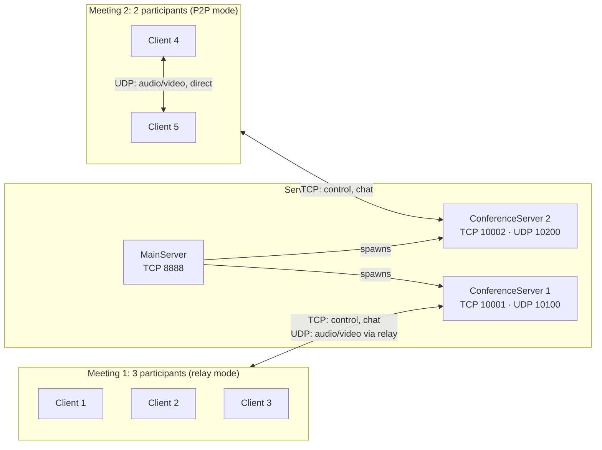
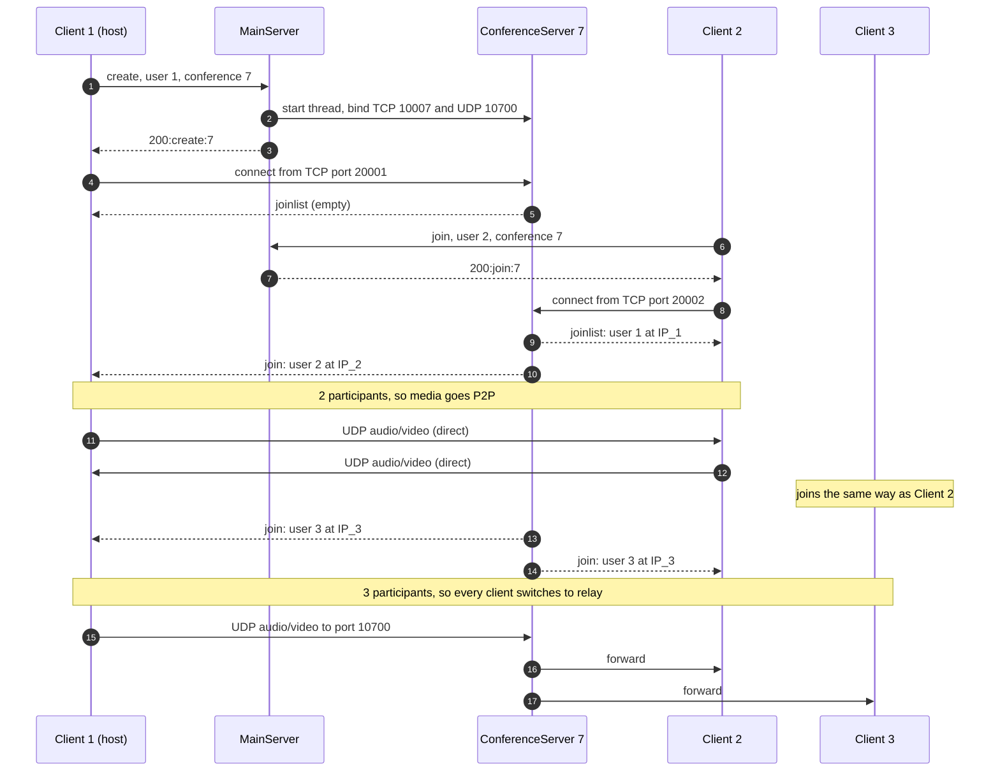

# Real-Time Video Conferencing System


A multi-party video conferencing system built directly on TCP and UDP sockets in Python. It supports real-time video, audio, and text chat, runs several meetings at once with fully isolated streams, and switches automatically between **peer-to-peer** and **server-relay** transport as people join and leave.

There's no WebRTC, RTP library, or media server underneath. The application-layer protocol, meeting management, and media transport are all implemented directly on sockets.


## Highlights

- **Custom application-layer protocol.** TCP carries meeting control, roster updates, and chat. UDP carries audio and video.
- **Full meeting lifecycle.** Users can create, join, quit, and cancel meetings. A meeting ends automatically when its last participant leaves.
- **Parallel, isolated meetings.** Each meeting runs in its own `ConferenceServer` thread on its own TCP and UDP ports. Meetings start and end independently, and no meeting can receive another meeting's media.
- **Adaptive P2P / relay switching.** In a two-person call, media goes straight between the peers and the server forwards nothing. When a third person joins, every client switches to the server relay, and they all switch back when the meeting drops to two.
- **Concurrent client pipeline.** Capture and send, receive and playback, video rendering, signaling, and mode selection each run on their own thread, so a blocking call in one never stalls the others.
- **Lightweight media path.** Camera frames are JPEG-compressed with Pillow before sending, and audio is streamed as raw 16 kHz PCM chunks through PyAudio.

## Architecture



The server has two layers:

| Component | Role |
|---|---|
| **`MainServer`** | Listens on TCP 8888 and handles out-of-meeting requests (`create`, `join`). On `create`, it spawns a new `ConferenceServer` thread. |
| **`ConferenceServer`** | One per meeting. Its TCP port accepts participants, sends roster updates, and broadcasts chat and lifecycle events. Its UDP port relays media between participants when the meeting is in relay mode. |

### Meeting flow



## Protocol design

### Why TCP for control and UDP for media

- **Control and chat use TCP.** Losing a "join", "quit", or chat message would leave clients with inconsistent state, so these messages need reliable, in-order delivery.
- **Audio and video use UDP.** For real-time media, a late frame is worth nothing. Under TCP, one lost segment would hold back everything behind it (head-of-line blocking) while it is retransmitted. Over UDP, a lost datagram costs one frame or one audio chunk, and the stream continues.

### Port scheme and identity

Every port is derived from an ID, which keeps signaling minimal:

| Endpoint | Transport | Port |
|---|---|---|
| `MainServer` | TCP | `8888` |
| `ConferenceServer` control | TCP | `10000 + conf_id` |
| `ConferenceServer` media relay | UDP | `10000 + 100 × conf_id` |
| Client control socket (bound source port) | TCP | `20000 + user_id` |
| Client media socket | UDP | `20000 + 100 × user_id` |

Each client binds its control connection to source port `20000 + user_id`. As a result:

- The conference server reads a participant's user ID straight from the TCP source port, so no separate "hello" message is needed.
- A roster entry is just `(user_id, ip)`. Any client can compute a peer's media address as `(ip, 20000 + 100 × user_id)` and start sending to it directly. This is what makes P2P mode work without an extra round of signaling.

### Control messages (TCP)

**MainServer.** A request is three fixed-width, 10-byte, space-padded fields: the command, the user ID, and the conference ID. The reply has the form `200:<op>:<conf_id>` on success or `400:<op>:<conf_id>` on failure.

**ConferenceServer:**

| Message | Direction | Meaning |
|---|---|---|
| `joinlist:<id>#<ip>:<id>#<ip>:…` | server → new member | Snapshot of the current roster |
| `join:<id>#<ip>` | server → existing members | A new participant joined |
| `send:<text>(<YYYY-MM-DD HH:MM:SS>)` | client → server → all | Chat message, timestamped by the sender |
| `quit:<id>` | client → server → all | A participant left. The meeting ends when the last one leaves. |
| `cancel` / `exit` | host → server, then server → all | The host cancels the meeting and everyone is removed |

### Media packets (UDP)

Each datagram carries one serialized tuple `(sender_id, media_type, payload)`:

| `media_type` | Payload |
|---|---|
| `1`: video | One JPEG-compressed camera frame (480 × 480 requested, quality 85) |
| `2`: audio | 1,024 samples of 16 kHz mono 16-bit PCM (about 64 ms) |

The receiver uses `sender_id` to separate the streams. Each sender's latest frame is kept in its own buffer and drawn in its own window, and audio chunks go straight to the output stream.

## Adaptive P2P / relay switching

Each client keeps the roster that its `ConferenceServer` pushes over TCP. A monitor thread checks it every 300 ms:

- **2 participants → P2P.** The client sends each media packet directly to the other peer. The server's relay port receives nothing.
- **3 or more participants → relay.** The client sends one copy of each packet to the conference's UDP relay port, and the server forwards it to everyone else in that meeting.

Every client gets the same `join` and `quit` events, so they all switch together, and a console pop-up announces each switch.

**Why switch at three?** With N participants:

| | P2P mesh | Server relay |
|---|---|---|
| Copies each client uploads per packet | N − 1 | 1 |
| Network hops from sender to receiver | 1 | 2 |
| Server bandwidth used | none | N − 1 copies out per packet in |

With two people, P2P sends just one copy anyway, saves a hop, and uses no server bandwidth. Beyond that, a full mesh makes each client's upload grow linearly with meeting size, and a client's uplink is usually the bottleneck. The relay keeps it at one stream no matter how many people join.

**Checking it yourself.** Capture with Wireshark using the filter `udp.port == 10100` (the relay port for meeting 1). There is no traffic while two people are talking, and traffic appears as soon as a third person joins.

## Concurrency model

The system uses one thread per connection, implemented with Python's `threading` module.

**Server**

- `MainServer`: an accept loop, plus one handler thread for each connected client.
- Each `ConferenceServer` is itself a thread with an accept loop, one control handler thread per participant, and one UDP relay thread.

**Client**

| Thread | Responsibility |
|---|---|
| `sending` | Parse user commands and send requests to `MainServer` |
| `listening` | Handle `MainServer` replies and enter the meeting on success |
| `conf_sending` | Timestamp and send chat messages |
| `conf_listening` | Apply roster updates, show chat, and handle cancellation |
| `keep_share` | Capture camera and microphone, JPEG-encode frames, and send over P2P or the relay |
| `keep_recv` | Receive datagrams, decode frames, and play audio |
| `videoplayer` | Show the local preview and each participant's video |
| `auto_mode_switch` | Choose P2P or relay based on the roster size |

## Getting started

### Requirements

- Python 3.8+
- **Clients:** Windows (chat messages and notifications open in new console windows), a webcam, and a microphone.
- All machines must be on the same LAN. There is no NAT traversal.

Install the dependencies on every machine, including the server, which shares `util.py` with the client:

```bash
pip install opencv-python pyaudio pillow numpy pyautogui
```

### Configure

In [`config.py`](config.py), set `SERVER_IP` to the LAN IP of the machine that will run the server. Use the same `config.py` on every machine.

### Run

```bash
# On the server machine
python my_server.py

# On each client machine
python my_client.py
```

When the client asks for a name, enter a **numeric user ID** that is unique within the meeting (from 1 to 455, so that its ports stay valid). Conference IDs are also numbers, from 1 to 555.

> Run each client on its own machine. In relay mode, the server identifies the sender by IP address and doesn't forward a packet to any participant with that same IP, so two clients on one host would not see each other.

### Commands

| Command | Effect |
|---|---|
| `create`, then enter a conference ID | Create a meeting and join it as the host |
| `join <conf_id>` | Join an existing meeting |
| `send:<message>` | Send a timestamped chat message to everyone in the meeting |
| `switch video` / `switch audio` | Turn the camera or microphone on or off |
| `quit` | Leave the meeting. The others continue. |
| `cancel` | (Host only) End the meeting for everyone |
| `?` | Show help |

### Example session

1. **Client 1:** `create`, then `7`. A local preview window opens.
2. **Client 2:** `join 7`. Both clients see each other's video, and media flows peer-to-peer.
3. **Client 3:** `join 7`. All three clients show a "mode switches" pop-up, and media now goes through the relay.
4. **Client 3:** `quit`. The two remaining clients switch back to P2P.
5. **Client 1:** `cancel`. Everyone is removed from meeting 7.

## Project structure

```
.
├── my_server.py   # MainServer (meeting management) and ConferenceServer (per-meeting control + UDP relay)
├── my_client.py   # ConferenceClient: CLI, signaling, media capture/playback, P2P/relay switching
├── config.py      # Server address, ports, audio and video parameters
├── util.py        # Camera/mic capture, JPEG encode/decode, status-code helpers
└── LICENSE
```

## Known limitations and future work

- **Audio mixing.** When several people talk at once, their audio chunks are played one after another in arrival order instead of being mixed. Next step: sum the PCM from each sender (with clipping) before playback.
- **Packet loss and jitter.** Packets carry no sequence numbers, there's no jitter buffer, and there's no forward error correction (FEC), so a lost datagram is simply dropped. Adding RTP-style sequence numbers and timestamps would allow reordering and a playout buffer.
- **Message framing.** Control messages over TCP depend on `recv()` boundaries. Prefixing each message with its length would keep them intact under load.
- **Serialization.** Media packets are serialized with `pickle`, which is unsafe on untrusted networks. A fixed binary header built with `struct` would be safer and smaller.
- **Network scope.** The system only works on a LAN. Ports are derived from IDs and peers are reached by private IP, so it can't cross NAT (that would need STUN/TURN). Nothing is encrypted.
- **Client UI.** Notifications use Windows console pop-ups, and each video stream opens its own OpenCV window. A single GUI with a grid view would be cleaner.

## License

[MIT](LICENSE)
