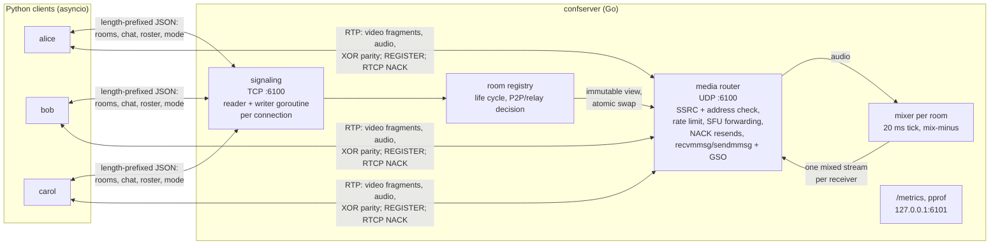
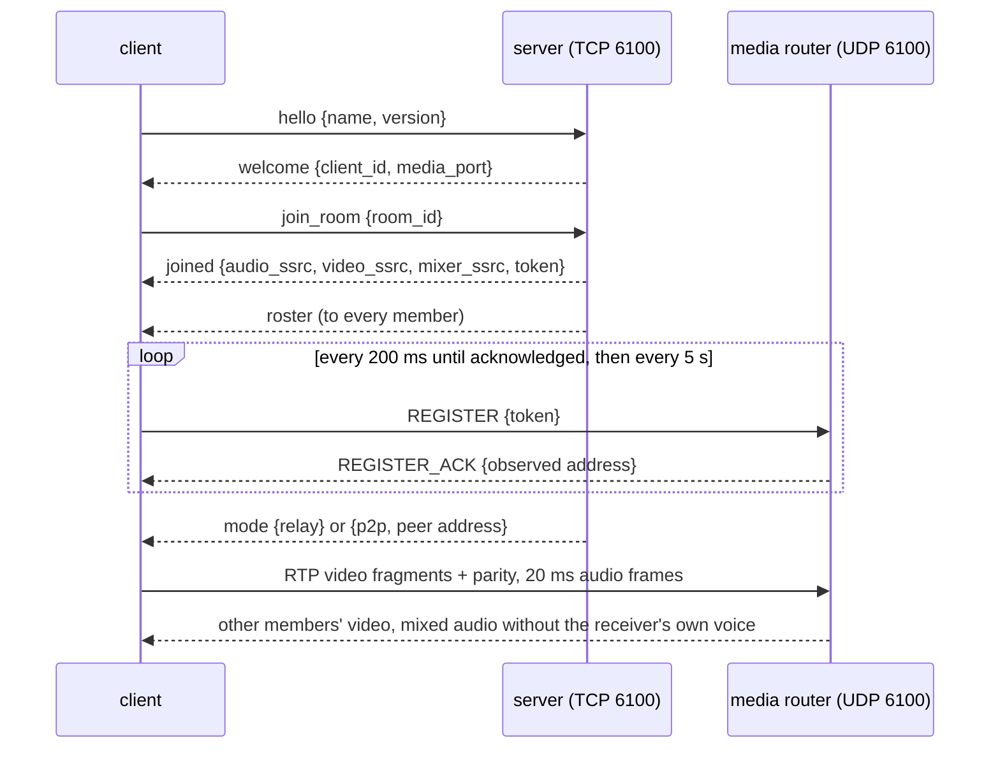
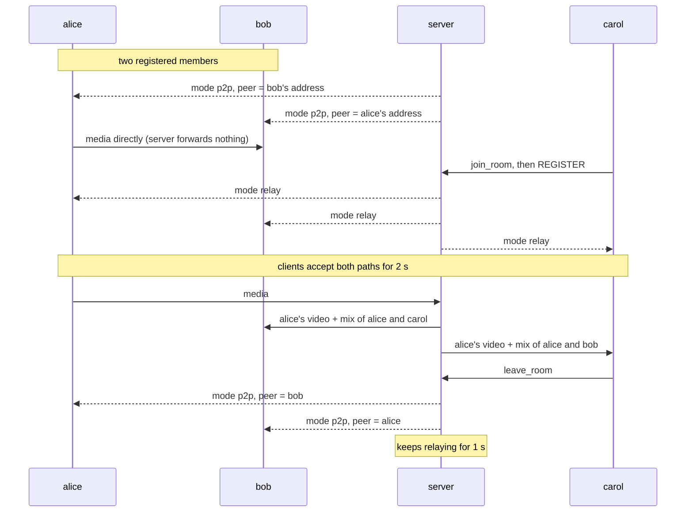

# Real-Time Video Conferencing System

A multi-party video conferencing system: a Go server that handles meetings over TCP and
relays media over one UDP port (SFU-style video forwarding with FEC and NACK
retransmission, server-side audio mixing, batched UDP I/O with GSO), and a Python
asyncio client with a split-screen window, chat and synthetic
media for headless use. It implements the CS305 (Computer Networks, SUSTech) course
project specification: create, join, list, leave and cancel meetings; text chat with
the sender's name and a timestamp; multi-party video and server-mixed audio; several
isolated meetings at once; peer-to-peer media for two participants with automatic
switching to the relay and back.

This branch (`v2`) is a rewrite of the original course project, which is kept unchanged
in [`legacy/`](legacy/) so that every comparison below can be reproduced from this
repository. [`docs/ENGINEERING_NOTES.md`](docs/ENGINEERING_NOTES.md) explains each
change (problem, measurement, fix, trade-off), [`docs/PROTOCOL.md`](docs/PROTOCOL.md)
specifies the wire format byte by byte, and [`docs/BENCHMARKS.md`](docs/BENCHMARKS.md)
has the methodology and full results.

## Results at a glance

All numbers were measured on one shared 4-vCPU Linux virtual machine, on loopback or
in network namespaces, with three runs per point: tables give the median and, in
brackets, the range of the three runs. [`docs/BENCHMARKS.md`](docs/BENCHMARKS.md) has
the methodology, the result file and run ID behind every number, and the caveats.

**Loss resilience (B1).** Video frames delivered complete within 200 ms over a link
with random packet loss (1500-byte MTU, same 480x480 JPEG frames for all systems):

<!-- BEGIN GENERATED summary_b1 -->
| Random packet loss | legacy (original) | v2 without FEC | v2 with FEC | v2 with NACK | v2 with FEC and NACK |
|---|---|---|---|---|---|
| 1 % | 65.5 % | 78.0 % | 99.5 % | 99.1 % | 100.0 % |
| 2 % | 36.0 % | 58.8 % | 97.3 % | 98.5 % | 100.0 % |
| 5 % | 11.9 % | 29.7 % | 88.7 % | 98.5 % | 100.0 % |
| 10 % | 3.6 % | 5.5 % | 57.8 % | 98.6 % | 99.7 % |
<!-- END GENERATED summary_b1 -->

The original sends each 31 kB frame as one UDP datagram, which the network splits into
21 or 22 IP fragments; losing any fragment loses the frame, and the kernel's reassembly queue
fills up under sustained loss, so it does worse than independent loss would predict.
v2 sends fragments of at most 1200 bytes and one XOR parity packet per four fragments,
and a receiver that still misses a packet asks for it again with an RTCP generic NACK;
the server resends it from a buffer of each sender's last 256 video packets. FEC and
NACK together, the client's default, cost repaired frames a few milliseconds (p99 frame
latency 17.0 ms at 10 % loss against 2.6 ms with FEC alone, on a sub-millisecond round
trip). NACK alone misses losses at the end of a frame, which show only when the next
frame arrives ([`docs/ENGINEERING_NOTES.md`](docs/ENGINEERING_NOTES.md#211-nack-retransmission-for-video-b1)).

**Multi-talker audio (B2).** Everybody talks and sends video:

<!-- BEGIN GENERATED summary_b2 -->
| | 3 parties, legacy (original) | 3 parties, v2 | 5 parties, legacy (original) | 5 parties, v2 |
|---|---|---|---|---|
| Audio latency, median | 593 ms | 119 ms | 999 ms | 131 ms |
| Audio played, worst talker | 41.4 % | 100.0 % | 15.2 % | 100.0 % |
| Downstream audio per receiver | 525 kbit/s | 415 kbit/s | 1050 kbit/s | 420 kbit/s |
| Video frames processed | 25.0 % | 100.0 % | 8.1 % | 100.0 % |
<!-- END GENERATED summary_b2 -->

The original plays every talker's chunks one after another on a blocking audio stream,
so with two or more talkers playback falls behind real time and the same thread stops
reading video. These numbers assume a sound card whose `write()` blocks while the
previous chunk plays (a stand-in device, see [`docs/BENCHMARKS.md`](docs/BENCHMARKS.md#b2-multi-talker-audio));
no real audio hardware was available. v2 mixes on the server (mix-minus) and sends each
receiver one stream.

**Relay capacity (B3).** Rooms of four, 15 fps per participant, the server pinned to
one CPU, on loopback:

<!-- BEGIN GENERATED summary_b3 -->
| Loopback MTU | System | Participants sustained (largest size swept that passed) | Server CPU-seconds per participant-minute (16 participants) |
|---|---|---|---|
| MTU 65536 (Linux default) | legacy (original) | 448 (every size swept passed) | 0.138 |
| MTU 65536 (Linux default) | v2 | 256 (fails at 320) | 0.464 |
| MTU 65536 (Linux default) | v2, one system call per datagram | 192 (fails at 224) | 0.552 |
| MTU 1500 (Ethernet) | legacy (original) | 448 (every size swept passed) | 0.190 |
| MTU 1500 (Ethernet) | v2 | 256 (fails at 320) | 0.437 |
<!-- END GENERATED summary_b3 -->

This comparison does not favour v2: for the same media it sends about 19 times as many
packets as the original (26 MTU-sized fragments and 7 parity packets per frame and 75
audio packets per second, against one datagram per frame or audio chunk, because
loopback's 64 KiB MTU never fragments the original's 31 kB datagrams), and the kernel's
per-packet work is what costs CPU. A CPU profile at 128 participants showed that
cutting system calls alone (`recvmmsg`/`sendmmsg`, 20-90 datagrams per call) saved 4 %
of the server's CPU, while sending each sender's fragments for one receiver as UDP GSO
messages cut the packets going through the IP stack 10-fold and saved 29 %. On the same
binary that raised capacity from 192 to 256 participants (the "one system call per
datagram" row). With a 1500-byte loopback MTU the original's datagrams are fragmented
as well and its CPU per participant-minute rises from 0.138 to 0.190 s, still below
v2's; [`docs/BENCHMARKS.md`](docs/BENCHMARKS.md#b3-relay-capacity) explains where the
kernel charges fragmentation and reassembly on loopback, and the profiles. v2 trades
server CPU for loss resilience and MTU safety.

## Architecture



- **Control plane.** One TCP port; each message is a 4-byte length and a JSON object.
  The server owns all room state: it assigns participant ids, SSRCs and a random
  session token, stamps chat messages with the sender's name and its own clock, and
  decides each room's media mode.
- **Media plane.** One UDP port for every room. A client first sends `REGISTER` with its
  token from its media socket (repeated until acknowledged, like a STUN binding
  request); after that the server accepts an SSRC only from that address and forwards
  only within the sender's room, so meetings are isolated, spoofed packets are dropped,
  and several clients can share one host. Packets use the RTP header (Wireshark can
  decode them with "Decode As... RTP").
- **Video** is JPEG, one independent image per frame, split into fragments of at most
  1200 bytes (no IP fragmentation on a 1500-byte path), with one XOR parity packet per
  four fragments. The server forwards fragments unchanged to the other members (SFU)
  and keeps each sender's last 256 video packets; in relay mode a receiver that is still
  missing a packet at least 5 ms after the gap sends an RTCP generic NACK (RFC 4585) and gets that
  packet again, to itself only.
- **Audio** is 16 kHz mono 16-bit PCM in 20 ms frames. The server keeps a small jitter
  buffer per sender, and every 20 ms sums all active senders once and subtracts each
  receiver's own frame (mix-minus), so every receiver gets one stream whatever the
  number of talkers. Clients play it through a 60 ms jitter buffer with loss
  concealment.
- **Modes.** Exactly two registered members talk peer-to-peer: the server sends each
  the other's observed address and forwards nothing. With three or more it relays.
  Clients accept media from both paths for 2 s after a switch and the server keeps
  relaying for 1 s, so switching loses nothing in flight.
- **Hot path.** The routing table is rebuilt on control-plane changes and swapped
  atomically; forwarding takes no lock except the sender's rate limiter and allocates
  nothing per packet (`bench/results/micro.json`). On 64-bit Linux the media socket
  reads up to 64 datagrams per `recvmmsg` and sends all copies of a read with one
  `sendmmsg`, packing each sender's consecutive fragments for one receiver into a UDP GSO
  message, so the kernel's IP stack runs once per message instead of once per datagram
  (`server/internal/udpio`; one system call per datagram elsewhere).

### Joining a meeting



### Switching between peer-to-peer and relay



## Running it

### Server (Go 1.24+; Linux, macOS or Windows)

```sh
cd server
go build -o bin/confserver ./cmd/confserver      # Windows: go build -o bin\confserver.exe .\cmd\confserver
./bin/confserver                                  # loopback only: 127.0.0.1:6100 (TCP and UDP)
./bin/confserver -control-addr 0.0.0.0:6100 -media-addr 0.0.0.0:6100   # serve a LAN
```

`./bin/confserver -h` lists the limits (room size, rooms, clients, per-sender rate,
relay grace period), `-p2p=false` forces relay mode, `-pprof` adds `/debug/pprof/` to
the metrics address (127.0.0.1:6101 by default), and `-log-format json` switches to
structured JSON logs. `-udp-batch 1` turns system-call batching off, `-udp-gso=false`
keeps batching but sends every datagram as its own message, and `-nack-buffer 0`
disables retransmission. `/metrics` counts packets by kind and drop reason,
retransmissions (`kind="video_rtx"`) and the read and send system calls.

With Docker (a static binary on an empty base image, running as a non-root user):

```sh
docker build -t confserver -f server/Dockerfile server
docker run --rm -p 127.0.0.1:6100:6100/tcp -p 127.0.0.1:6100:6100/udp \
  -p 127.0.0.1:6101:6101 confserver                       # reachable from this host only
docker run --rm -p 192.0.2.10:6100:6100/tcp -p 192.0.2.10:6100:6100/udp \
  -p 127.0.0.1:6101:6101 confserver -p2p=false            # serve a LAN on 192.0.2.10
```

Inside the container the server listens on all interfaces, so the `-p` options decide
who can reach it; the server has no authentication or encryption, so publish it on a
LAN address only on a network you trust. Flags after the image name are appended to
the server's own (`-p2p=false`, `-log-format json`, ...). The image's `HEALTHCHECK`
runs `confserver -healthcheck 127.0.0.1:6100`, which connects to the control port and
completes a `hello`, so a dead control plane shows as unhealthy even while `/metrics`
still answers.

### Client (Python 3.11+, [uv](https://docs.astral.sh/uv/))

```sh
cd client
uv sync                                                   # numpy and Pillow only
uv run confclient --name alice --fake-media               # synthetic camera and tone
uv run confclient --name bob --fake-media --headless --join 1
```

`--fake-media` replaces the camera with a moving test pattern and the microphone with a
tone, so the client runs anywhere. For a real camera, microphone and speaker install the
optional extras: `uv sync --extra video --extra audio` (OpenCV and PyAudio). PyAudio
needs the PortAudio library: on macOS `brew install portaudio`, on Debian or Ubuntu
`sudo apt install portaudio19-dev`; on Windows the PyAudio wheels from PyPI include it.
The window shows every participant's video as a tile in one split-screen grid.

Commands at the client prompt (also usable non-interactively with `--script "cmd; cmd"`):

```
list | create [title] | join <id> | leave | cancel | chat <text> | video on|off |
audio on|off | status | sleep <seconds> | help | exit
```

Three people on one machine, each in its own terminal:

```sh
uv run confclient --name alice --fake-media --create standup
uv run confclient --name bob --fake-media --join 1
uv run confclient --name carol --fake-media --join 1
```

With two participants the client prints `* media mode: peer-to-peer with ...`; when the
third joins every client switches to `* media mode: server relay`.

## Network usage limits

Everything defaults to loopback, and every component has explicit, configurable caps
so that it cannot flood a shared network by accident:

| Component | Default limit | Flag |
|---|---|---|
| Server sockets | bind to 127.0.0.1 only | `-control-addr`, `-media-addr` |
| Server, per sender | 8 Mbit/s media ingress (token bucket, 256 KiB burst); excess is dropped and counted | `-max-ingress-kbps`, `-ingress-burst-kib` |
| Server, per receiver | retransmissions on NACK capped by a second token bucket of the same size; NACKs count against the requester's ingress limit, must come from its registered address and may only name other members' streams in its room | `-max-ingress-kbps`, `-ingress-burst-kib`, `-nack-buffer` |
| Server | 16 members per room, 256 rooms, 1024 clients; 50 control requests/s per connection; 2000 REGISTERs/s in total | `-max-room-size`, `-max-rooms`, `-max-clients` |
| Metrics and pprof | 127.0.0.1:6101; pprof off | `-metrics-addr`, `-pprof` |
| Client | 6000 kbit/s total upload (token bucket); whole video frames are skipped when over budget | `--max-send-kbps` |
| Load generator (`server/cmd/loadgen`) | refuses non-loopback targets; at most 512 participants, 4000 Mbit/s offered and 10 min per run (1500 Mbit/s unless raised) | `-allow-remote`, `-participants`, `-max-mbps`, `-duration` |

The benchmarks run entirely inside network namespaces on one machine.

## Tests

```sh
make test          # everything below
cd server && go vet ./... && staticcheck ./... && go test -race ./...
cd client && uv run ruff check . && uv run ruff format --check . && uv run mypy && uv run pytest
make fuzz          # 30 s of native Go fuzzing per decoder
```

- Go: table-driven unit tests (room state machine, mode decisions, mixer saturation and
  mix-minus, FEC recovery of any single lost packet, header round trips), fuzz tests
  for every decoder with a committed seed corpus, and integration tests that start the
  server in-process and drive fake clients through create/join/list/chat/leave/cancel,
  P2P -> relay -> P2P, meeting isolation, spoofed SSRCs and mixed-audio content.
- Python: unit tests against the same golden vectors as the Go code
  (`protocol-testdata/vectors.json`), packetizer and FEC, frame assembly with loss,
  reordering and duplicates, audio jitter buffer and concealment, rate limiting, the
  media session against a fake server, and end-to-end tests (`pytest -m e2e`) that build
  and start the Go server and run three headless clients with synthetic media.
- CI: [`.github/workflows/ci.yml`](.github/workflows/ci.yml) runs the same commands, short
  fuzzing, and builds and smoke-tests the container image.

## Benchmarks

Each experiment is one command and writes JSON to `bench/results/` from the raw files
of that one invocation (`bench/tmp/<benchmark>/<run ID>/`), with the build record of
the binaries it ran. B1-B3 need root for network namespaces and nftables, and create
only namespaces named after their own invocation. Timing-sensitive steps run under
`flock` on `${XDG_RUNTIME_DIR:-/tmp}/cs305-bench.lock` (set `BENCH_LOCK` to share a
lock with other jobs on the machine), in chunks of at most 12 minutes so other jobs
can take the lock in between; Ctrl-C stops a run, and the same `CS305_RUN_ID` resumes
it. `docs/BENCHMARKS.md` has the method and every result.

```sh
sudo bench/run_b1.sh      # B1 loss resilience: 3 repeats per point, two loss conditions, one long run
sudo bench/run_b2.sh      # B2 multi-talker audio: 3 and 5 parties, 3 repeats
sudo bench/run_b3.sh      # B3 relay capacity: v2 with and without GSO / batching, and the original
sudo MTU=1500 bench/run_b3.sh                  # the same at Ethernet MTU
sudo bench/profile_b3.sh                       # CPU profiles of the v2 variants at 128 participants
bench/run_micro.sh                             # Go microbenchmarks (the send ones use loopback receivers)
LABEL=after bench/run_churn.sh                 # forwarding latency while the control plane churns
LABEL=after bench/run_jitter.sh                # server and client jitter buffers, simulated time
python3 bench/b1_lost_frames.py bench/tmp/b1/<run ID>   # which NACK frames were lost, and why
(cd client && uv run --group bench python ../bench/render.py)   # tables and plots
```

The original code runs unmodified in these benchmarks: `bench/legacy_harness/` installs
stand-ins for its device libraries (camera, PyAudio, pyautogui) and overrides its
configured IP address before importing it.

## Limitations

- No camera, microphone or speaker existed where this was developed. The device
  adapters (OpenCV capture and window, PyAudio input and output) are thin and were not
  tested with real hardware; all tests and benchmarks use synthetic media.
- Video is one JPEG per frame: simple and loss-tolerant, but about 4 Mbit/s for a
  480x480 stream at 15 fps, far more than an inter-frame codec would need.
- No encryption: control messages and media are plaintext, and the session token only
  binds a participant to a UDP address.
- P2P uses the address the server observed, with no ICE/STUN/TURN, so it works on a LAN
  or through permissive NATs only; otherwise rooms of two must run with `-p2p=false`.
- Loss repair is XOR parity (one loss per group of four fragments) plus NACK
  retransmission of video in relay mode only; audio is not retransmitted, P2P rooms have
  FEC only, the retry interval is fixed (30 ms) rather than derived from the round trip,
  and there is no congestion control or adaptive bitrate.
- The host role is not transferred when the host leaves; such a room closes when it
  becomes empty.
- Benchmarks ran on one shared 4-CPU virtual machine over loopback and veth links, with
  simulated devices at both ends; the loss and delay are emulated (nftables drops and a
  userspace relay), not a real network. See `docs/BENCHMARKS.md` for the conditions of
  each number.

## Repository layout

```
server/            Go module: cmd/confserver, cmd/loadgen, internal/{protocol,room,signaling,media,udpio,metrics,app,client}
client/            Python package confclient (uv project) and its tests
protocol-testdata/ golden vectors shared by the Go and Python tests
bench/             benchmark scripts, the legacy harness, results and plots
docs/              PROTOCOL.md, ENGINEERING_NOTES.md, BENCHMARKS.md
legacy/            the original course implementation, unchanged
```

## License

MIT, see [LICENSE](LICENSE).
