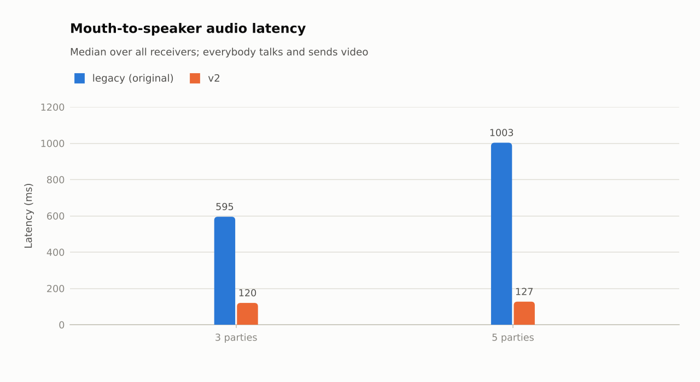
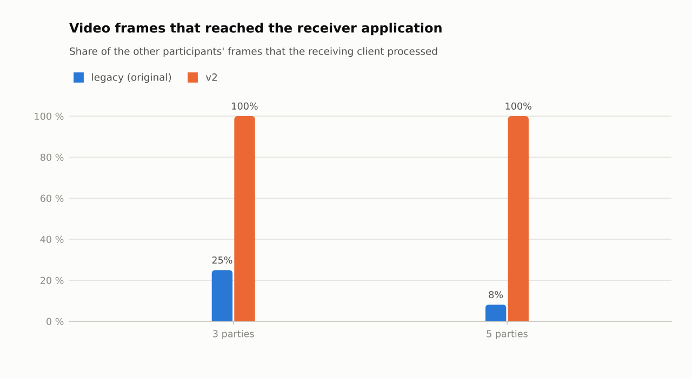
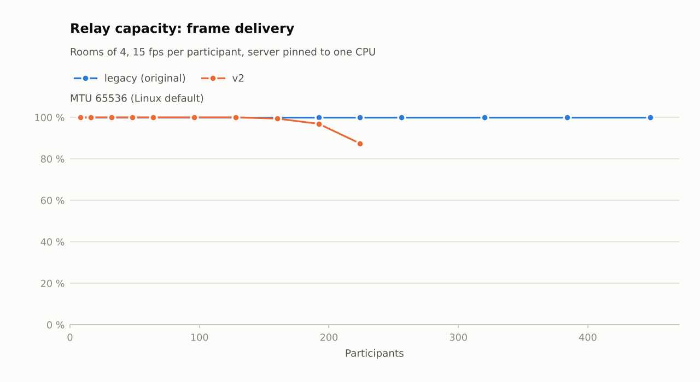
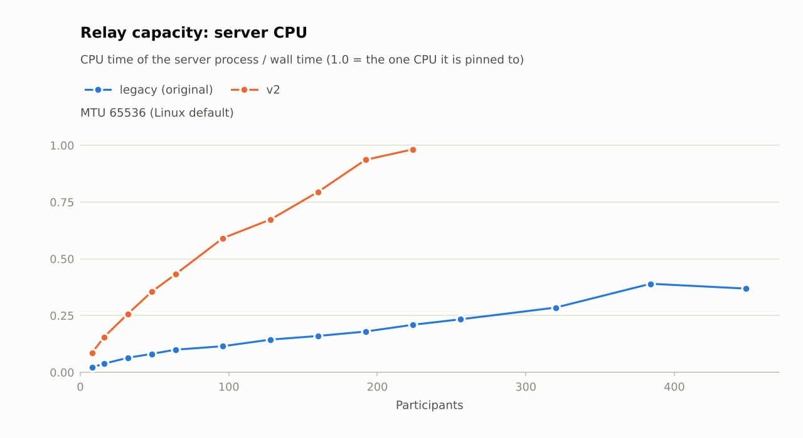

# Benchmarks

Four experiments compare the original course implementation (`legacy/`, run unmodified
through `bench/legacy_harness/`) with v2. Each one is a single command, writes JSON to
[`bench/results/`](../bench/results/), and `bench/render.py` turns the JSON into the
tables and plots below. The tables between `BEGIN GENERATED` and `END GENERATED` markers
are written by that script; do not edit them by hand.

| Experiment | Command | Result file | Takes |
|---|---|---|---|
| B1 loss resilience | `sudo bench/run_b1.sh` | `bench/results/b1_loss.json` | about 11 min |
| B2 multi-talker audio | `sudo bench/run_b2.sh` | `bench/results/b2_audio.json` | about 5 min |
| B3 relay capacity | `sudo bench/run_b3.sh` and `sudo MTU=1500 bench/run_b3.sh` | `bench/results/b3_capacity.json`, `bench/results/b3_capacity_mtu1500.json` | 10-15 min each |
| Go microbenchmarks | `bench/run_micro.sh` | `bench/results/micro.json` (raw: `micro.txt`) | about 1.5 min |
| Tables and plots | `(cd client && uv run --group bench python ../bench/render.py)` | `bench/results/plots/`, `bench/results/tables.md` | seconds |

B1-B3 need root (network namespaces and nftables). Every script runs its timing-sensitive
part under `flock /home/user/work/bench.lock` (override with `BENCH_LOCK=...`), so only
one benchmark runs on the machine at a time, and removes its namespaces (and with them
the nftables rules) on exit.

## Environment

All results were measured in one container: Linux 6.18, 4 vCPUs (Intel Xeon @ 2.10 GHz),
Go 1.24.7, Python 3.13. Other jobs ran on the machine at the same time (the bench lock
only serialises benchmarks), so treat small differences as noise. Each point is a single
run; there are no repetitions or confidence intervals. The `environment` object in each
JSON file records the kernel, CPU, versions, git commit and any uncommitted paths at the
time the results were written.

## Test media

`bench/gen_frames.py` renders 1000 frames of a moving synthetic test pattern at the
original client's settings (480x480, Pillow JPEG quality 85) into `bench/data/frames/`;
every system sends exactly these bytes. Sizes (`bench/results/frames.json`): mean
31 090 bytes, minimum 29 752, median 31 197, maximum 32 327. In v2 that is 26 fragments
of at most 1200 bytes at the median (27 at most). Each frame carries a tag in a JPEG
comment segment (frame index, sender, send time) that the receivers read back.

Audio is a tone per talker. Each talker also writes a tag (talker, sequence number, send
time) into four reserved samples of every frame, at a position that only that talker
uses, so the tags survive the server's mix and the receiver can tell which talker's
frame it is playing and how old it is.

## B1: loss resilience

**Setup.** Three network namespaces (sender, server, receiver) connected by two veth
pairs with MTU 1500. In the receiver's namespace an nftables rule drops UDP packets at
random, `numgen random mod 1000 < N`, in a prerouting chain at priority -500, which is
before IPv4 defragmentation (-400), so individual IP fragments are lost as on a lossy
link. Only the server -> receiver direction is impaired; TCP is not. The receiver creates
a meeting, the sender joins and sends the corpus at 15.625 fps (one frame per 1024-sample
audio chunk, the original client's loop rate) plus audio, for 41 s per run.

Systems: the original relay and the original client media threads; v2 without FEC
(client `--video-fec-k 0 --audio-fec-k 0`, server `-audio-fec-k 0`); v2 with FEC (video
k = 4, audio k = 2). P2P is disabled on the v2 server so both systems relay.

**Metrics.** A video frame is delivered when the receiver had the complete frame within
200 ms of the sender handing it to the socket; frames sent in the first second and the
last 1.5 s are not counted. Audio lost is the share of the talker's frames whose tag
never reached the receiver's speaker (the original's frames are 64 ms chunks, v2's are
20 ms frames). The "model" value is the delivery that independent packet loss at the
configured rate would give for the same frame sizes (`model_ratio` in
`bench/analyze_b1.py`). "Measured UDP loss" is the nftables drop counter divided by its
match counter.

<picture>
  <source media="(prefers-color-scheme: dark)" srcset="../bench/results/plots/b1_video_delivery_dark.png">
  
</picture>

<picture>
  <source media="(prefers-color-scheme: dark)" srcset="../bench/results/plots/b1_audio_loss_dark.png">
  
</picture>

<!-- BEGIN GENERATED b1 -->
<!-- END GENERATED b1 -->

**Reading the results.**

- v2 without FEC follows the independent-loss model closely: fragmenting at the
  application layer does not by itself make a frame of 26 packets more likely to arrive
  than a datagram of 22 IP fragments.
- FEC is what changes the picture: with one parity packet per four fragments, 99.0 % of
  frames arrive at 1 % loss and 86.1 % at 5 %. XOR parity repairs one loss per group, so
  at 10 % loss (56.0 %) two losses in a group become common.
- The original does worse than its own independent-loss model, and worse in the second
  half of each run than in the first (80.7 % against 57.2 % at 1 % loss). The receiver
  counted IP reassembly failures in every lossy run. Incomplete datagrams keep their
  fragments in the kernel's reassembly queue for `ipfrag_time` (30 s); once the queue
  memory reaches `ipfrag_high_thresh` (4 MiB per namespace), new fragments are dropped,
  including fragments of audio datagrams (2 IP fragments each), which is why 14.5 % of
  the original's audio was lost at 1 % packet loss. The peak-memory column comes from
  sampling `/proc/net/sockstat` in the receiver's namespace during the run.
- Latency of the frames that did arrive was about 1 ms for every system (the
  `latency_ms` fields in the JSON); loss, not delay, is what differs.

## B2: multi-talker audio

**Setup.** One network namespace; the server and 3 or 5 participants on its loopback
interface (each original participant on its own 127.0.0.x address, because the original
relay skips receivers with the sender's IP). Everybody talks and sends video (corpus at
15.625 fps) for the whole run. The measurement window starts 2.5 s after the last
participant joined and lasts about 61 s.

The original participants run the original `keep_share` and `keep_recv` threads. Their
sound card is a stand-in (`bench/legacy_harness/stubs.py`) that models a blocking audio
device: `read(1024)` returns when 1024 samples of real time have passed, and `write()`
returns only once the previous chunk has finished playing, so a receiver that is handed
more than real time of audio blocks in `write()` for one chunk duration per chunk. That
is how PyAudio's blocking stream behaves once its buffer is full, and it is the
assumption behind the original's numbers here. v2 participants run the real client with
the server's mix-minus stream and the client's 60 ms jitter buffer; their speaker is a
thread that pulls one 20 ms frame every 20 ms.

**Metrics.** Audio latency: from the end of a frame's capture at the talker to the
moment the receiver's (fake) sound card starts playing it. Audio delivered: share of
each talker's frames that were played, worst talker shown. Downstream audio: IP-level
bit rate into each receiver (original: nftables counters on the receiver's port for
datagrams under 4000 bytes; v2: client receive counters plus 28 bytes of IP and UDP
header per packet). Video frames processed: frames of the other participants that the
receiving application got (original: stored after decompression; v2: completed by the
frame assembler), against frames sent. Video frozen: per sender, the time covered by gaps
longer than 0.5 s between consecutive frames, as a share of the window.

<picture>
  <source media="(prefers-color-scheme: dark)" srcset="../bench/results/plots/b2_audio_latency_dark.png">
  
</picture>

<picture>
  <source media="(prefers-color-scheme: dark)" srcset="../bench/results/plots/b2_downstream_audio_dark.png">
  
</picture>

<picture>
  <source media="(prefers-color-scheme: dark)" srcset="../bench/results/plots/b2_video_shown_dark.png">
  
</picture>

<!-- BEGIN GENERATED b2 -->
<!-- END GENERATED b2 -->

**Reading the results.**

- The original receiver has to play (n - 1) x real time of audio. Its receive thread
  blocks in `write()`, the socket buffer fills (the kernel counted 7 521 receive-buffer
  drops in the 3-party run and 34 280 in the 5-party run), and latency settles at the
  depth of that buffer: a median of 595 ms with three parties and 1 003 ms with five,
  while 41-59 % (three parties) and 63-85 % (five parties) of each talker's audio is
  never played.
- Because video arrives on the same socket and thread, video stalls with it: with five
  parties each receiver processed 6.6-9.7 % of the others' frames, and some senders'
  video never reached some receivers during the whole window.
- v2's median latency (120 ms with three parties, 127 ms with five) is what its
  configured buffers add up to: 40 ms in the server's per-sender jitter buffer, up to
  20 ms of mixer tick phase, the client's 60 ms jitter buffer and up to 20 ms of device
  period. It does not grow with the number of talkers, and neither does the downstream
  audio rate, because every receiver gets one mixed stream.
- v2's video costs more bandwidth than the original's: 20 587 kbit/s against
  15 570 kbit/s per receiver with five parties (the `downstream_video` fields), from FEC
  (25 %) and per-fragment headers.

## B3: relay capacity

**Setup.** One network namespace; the server and `server/cmd/loadgen` on its loopback
interface, the server pinned to CPU 1 and the load generator to CPUs 2 and 3 with
`taskset`. The load generator runs N participants in rooms of four; each sends corpus
frames at 15 fps and 256 kbit/s of audio, in each system's own wire format (v2: RTP
fragments with FEC k = 4 and audio k = 2 after a REGISTER; original: pickled datagrams,
byte-identical to CPython's, from one 127.1.x.y address per participant, using the
original port scheme). Each point: 5 s warm-up, 20 s measurement window, 1 s grace.
Participant counts are swept upwards until two consecutive sizes fail.

**Metrics.** Frame delivery: frames received complete by every other member of the
sender's room / (frames sent in the window x 3). The load generator does not repair
frames with FEC, so v2's delivery is a lower bound. Latency: send to complete receipt.
A size passes with delivery >= 99 % and p99 latency < 100 ms. Server CPU: utime + stime
of the server process from `/proc/<pid>/stat` over the window, divided by the window
(1.0 = the one CPU it is pinned to); CPU seconds per participant-minute come from a
separate 60 s run at 16 participants. Load generator CPU is recorded the same way, to
show that it was not the bottleneck.

The loopback interface's MTU matters for the original, which sends each frame as one
31 kB datagram: with Linux's default loopback MTU of 65 536 that datagram is never
fragmented, so the original sends 26 times fewer packets than v2, which keeps every
packet under 1232 bytes for real networks. The second set of runs uses MTU 1500, where
the kernel fragments the original's datagrams as it would on Ethernet.

<picture>
  <source media="(prefers-color-scheme: dark)" srcset="../bench/results/plots/b3_delivery_dark.png">
  
</picture>

<picture>
  <source media="(prefers-color-scheme: dark)" srcset="../bench/results/plots/b3_p99_latency_dark.png">
  
</picture>

<picture>
  <source media="(prefers-color-scheme: dark)" srcset="../bench/results/plots/b3_server_cpu_dark.png">
  
</picture>

<!-- BEGIN GENERATED b3 -->
<!-- END GENERATED b3 -->

## Go microbenchmarks

`go test -bench . -benchmem -count 5 -cpu 1`, pinned to one CPU; the table shows the
median of the five runs. `BenchmarkForwardVideo` includes three real `sendto` system
calls on loopback per operation (one full-size fragment to each other member of a
four-member room); the others do no I/O.

<!-- BEGIN GENERATED micro -->
<!-- END GENERATED micro -->
