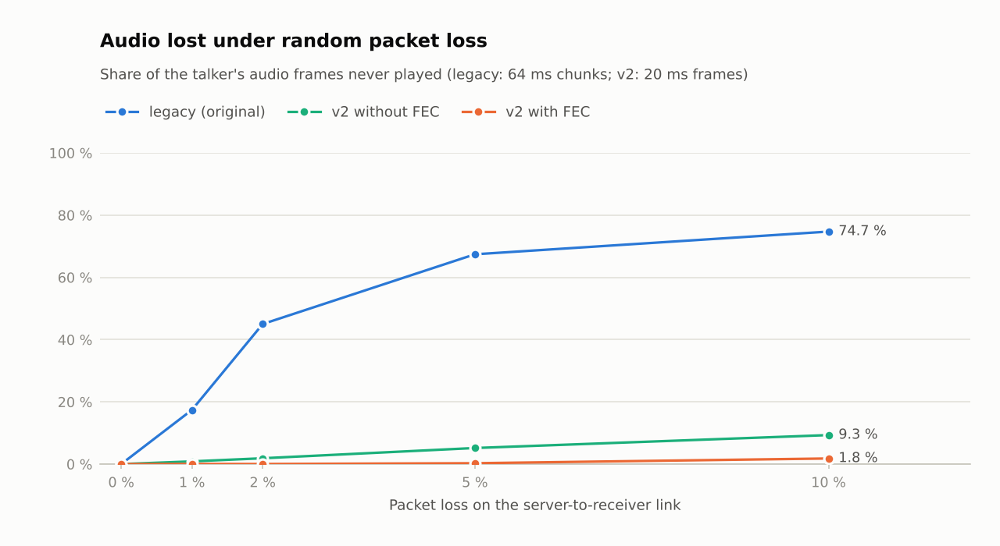

# Benchmarks

Seven experiments compare the original course implementation (`legacy/`, run unmodified
through `bench/legacy_harness/`) with v2, or v2 before and after a fix. Each one is a
single command that writes JSON to [`bench/results/`](../bench/results/);
`bench/render.py` turns the JSON into the tables and plots below. The tables between
`BEGIN GENERATED` and `END GENERATED` markers are written by that script; do not edit
them by hand. Every number in the prose below comes from one of the files named next
to it.

| Experiment | Command | Result file | Size of the run below |
|---|---|---|---|
| B1 loss resilience | `sudo bench/run_b1.sh` | `b1_loss.json` | 111 runs of 41 s (75 in one condition, 36 in the other) and one of 300 s |
| B1 lost frames (after B1) | `python3 bench/b1_lost_frames.py bench/tmp/b1/<run ID>` | `b1_lost_frames.txt` | post-processing |
| B1 relay diagnosis | `sudo RELAY_LOG=1 CONDITIONS=both-rtt50 HARD_SYSTEMS="v2-fec-nack v2-nack" HARD_LOSSES=50 REPEATS=1 bench/run_b1.sh`, then `python3 bench/b1_relay_diag.py bench/tmp/b1/<run ID>` | `b1_rtt50_relay_diag.txt` | 2 runs of 41 s |
| B2 multi-talker audio | `sudo bench/run_b2.sh` | `b2_audio.json` | 12 runs of 60 s |
| B3 relay capacity | `sudo bench/run_b3.sh` | `b3_capacity.json` | 80 sweep points of 20 s and 12 fixed-load runs of 60 s |
| CPU profiles under the B3 load | `sudo bench/profile_b3.sh` | `pprof_<variant>.{json,txt,pb.gz,metrics}` | 3 profiles of 15 s |
| Forwarding under control-plane churn | `LABEL=after bench/run_churn.sh` (and `LABEL=before` on the code before the fix, with `churn_before_harness.patch`) | `churn_before.json`, `churn_after.json` | 3 runs of 4 configurations x 20 s each |
| Jitter buffers, simulated time | `LABEL=after bench/run_jitter.sh` (and `LABEL=before` on the code before the fix) | `jitter_before.json`, `jitter_after.json` | simulated time (no lock) |
| Go microbenchmarks | `bench/run_micro.sh` | `micro.json` (raw: `micro.txt`) | 5 runs of each benchmark |
| Tables and plots | `(cd client && uv run --group bench python ../bench/render.py)` | `plots/`, `tables.md` | post-processing |

B1-B3 and the profiles need root (network namespaces and nftables).

## How these numbers were made

**Machine.** One shared virtual machine: Linux 6.18, 4 vCPUs (Intel Xeon @ 2.10 GHz),
Go 1.24.7, Python 3.13. Other agents' jobs ran on it at the same time. Timing-sensitive
steps of every benchmark here, and of the other jobs that measure time, take one lock
(`flock` on `$BENCH_LOCK`, default `${XDG_RUNTIME_DIR:-/tmp}/cs305-bench.lock`), so no
two measurements overlap; builds, tests and other work did run during measurements, at
`nice -n 19`, mostly on CPU 0 (B3 and the profiles pin the server to CPU 1 and the load
generator to CPUs 2-3). Each result records the load average when it was written.
The kernel accounts CPU time by tick (`CONFIG_TICK_CPU_ACCOUNTING=y`, `CONFIG_HZ=250`)
without IRQ time accounting (`CONFIG_IRQ_TIME_ACCOUNTING=n`): softirq work is charged
to whichever process was running when it ran, which matters on loopback (B3).

**One invocation, one set of files.** Each invocation gets a run ID
(`CS305_RUN_ID`, UTC time plus PID), builds its binaries into `bench/tmp/build/<run ID>/`
with a build record (`build.json`: commit, uncommitted paths and a hash of their diff,
SHA-256 of each binary), creates network namespaces named after its own invocation
only, and writes raw files to `bench/tmp/<benchmark>/<run ID>/`. The result JSON is made
from that directory only and names it (`raw_files`), along with the exact command
(`command`, also in `command.txt`), the build record (`environment.build`) and the
state of the tree when the JSON was written (`environment`). The command is recorded
with every setting spelled out, in the form a user would type it (`sudo ...`); the
runs here were started as root through a wrapper that only set `BENCH_LOCK` to the
lock file this machine's jobs share. A run whose processes
failed is listed under `failed_runs` and left out. Long benchmarks run in chunks of at
most 12 minutes under the lock and release it in between; Ctrl-C stops a run, and
running the same command with the same `CS305_RUN_ID` resumes it with the same binaries
and settings. Raw directories are not committed (`bench/tmp/` is ignored); the result
JSON keeps the per-run values.

**Repeats and statistics.** Every point of B1, B2 and B3 was run three times, with the
repeats interleaved (all points of repeat 1, then repeat 2, ...), so a slow drift of the
machine's load hits every system alike. Tables give the median of the repeats and their
range (min-max); with three runs the range is not a confidence interval, only the spread
seen. B1 also pools the frames of its three runs and gives a Wilson 95 % score interval
for the delivery ratio. That interval treats frames as independent; losses that come in
bursts (the original's reassembly queue, below) make it too narrow, so read it together
with the run-to-run range. The CPU profiles are one 15 s window per server variant, and
the microbenchmarks five runs each.

**Earlier results.** The first results of each benchmark, from before this round of
fixes, are kept in [`bench/results/v1/`](../bench/results/v1/). They were made with one
run per point and, for B3 and the profiles, with loopback carrying whole UDP GSO
messages (see B3); they are not used below.

## Test media

`bench/gen_frames.py` renders 1000 frames of a moving synthetic test pattern at the
original client's settings (480x480, Pillow JPEG quality 85) into `bench/data/frames/`;
every system sends exactly these bytes. Sizes (`bench/results/frames.json`): mean
31 090 bytes, minimum 29 752, median 31 197, maximum 32 327. In v2 that is 26 fragments
of at most 1200 bytes at the median (27 at most). Each frame carries a tag in a JPEG
comment segment (frame index, sender, send time) that the receivers read back.

Audio is a tone per talker. Each talker also writes a tag (talker, sequence number, send
time) into four reserved samples of every frame, at a position that only that talker
uses, so the tags survive the server's mix and the receiver can tell which talker's
frame it is playing and how old it is.

## B1: loss resilience

**Setup.** Three network namespaces (sender, server, receiver) connected by two veth
pairs with MTU 1500. In the receiver's namespace an nftables rule drops UDP packets at
random, `numgen random mod 1000 < N`, in a prerouting chain at priority -500, which is
before IPv4 defragmentation (-400), so individual IP fragments are lost as on a lossy
link. Only the server -> receiver direction is impaired; TCP is not. The v2 server sends
forwarded video as UDP GSO messages of up to 64 datagrams, which veth would carry into
the receiver's namespace whole, so that the rule would drop a whole message at a time;
the server's end of the veth pair is set to `gso_max_segs 1`, which makes the kernel
split each message into its datagrams as it transmits them, as a real NIC would. In the
loss-free v2-with-FEC run the rule matched 23 848 datagrams, exactly the receiver's UDP
`InDatagrams`, while the server's namespace counted 4 649 UDP sends
(`bench/results/b1_v2-fec-0.net.json`, copied from that run's raw files). The receiver creates
a meeting, the sender joins and sends the corpus at 15.625 fps (one frame per 1024-sample
audio chunk, the original client's loop rate) plus audio, for 41 s per run.

Systems: the original relay and the original client media threads; v2 without FEC
(client `--video-fec-k 0 --audio-fec-k 0`, server `-audio-fec-k 0`); v2 with FEC (video
k = 4, audio k = 2); and both v2 settings again with NACK retransmission of video (client
`--nack`; the server keeps each sender's last 256 video packets, its default). P2P is
disabled on the v2 server so every system relays. Because only the server -> receiver
direction loses packets, NACKs always reach the server while retransmissions can be lost
again, and the round trip between the namespaces is well under a millisecond: these runs
show NACK on a short path. On a longer one every repaired frame arrives one round trip
later, and the client's fixed 30 ms retry interval assumes a round trip shorter than
that.

**Metrics.** A video frame is delivered when the receiver had the complete frame within
200 ms of the sender handing it to the socket; frames sent in the first second and the
last 1.5 s are not counted. Audio lost is the share of the talker's frames whose tag
never reached the receiver's speaker (the original's frames are 64 ms chunks, v2's are
20 ms frames). The "model" value is the delivery that independent packet loss at the
configured rate would give for the same frame sizes (`model_ratio` in
`bench/analyze_b1.py`); for the NACK systems it gives every packet four independent
tries (the original and three retransmissions), ignores FEC and assumes every loss is
noticed in time. "Measured UDP loss" is the nftables drop counter divided by its match
counter.

<picture>
  <source media="(prefers-color-scheme: dark)" srcset="../bench/results/plots/b1_video_delivery_dark.png">
  
</picture>

<picture>
  <source media="(prefers-color-scheme: dark)" srcset="../bench/results/plots/b1_audio_loss_dark.png">
  
</picture>

<!-- BEGIN GENERATED b1 -->
| Packet loss | legacy (original): video frames on time (model) | v2 without FEC: video frames on time (model) | v2 with FEC: video frames on time (model) | v2 with NACK: video frames on time (model) | v2 with FEC and NACK: video frames on time (model) |
|---|---|---|---|---|---|
| 0 % | 100.0 % (100.0 %) | 100.0 % (100.0 %) | 100.0 % (100.0 %) | 100.0 % (100.0 %) | 100.0 % (100.0 %) |
| 1 % | 65.5 % (80.5 %) | 78.0 % (76.6 %) | 99.5 % (99.4 %) | 99.1 % (100.0 %) | 100.0 % (100.0 %) |
| 2 % | 36.0 % (64.7 %) | 58.8 % (58.6 %) | 97.3 % (97.5 %) | 98.5 % (100.0 %) | 100.0 % (100.0 %) |
| 5 % | 11.9 % (33.1 %) | 29.7 % (25.7 %) | 88.7 % (86.3 %) | 98.5 % (100.0 %) | 100.0 % (100.0 %) |
| 10 % | 3.6 % (10.3 %) | 5.5 % (6.2 %) | 57.8 % (57.7 %) | 98.6 % (99.7 %) | 99.7 % (99.7 %) |

| Packet loss | legacy (original): audio lost | v2 without FEC: audio lost | v2 with FEC: audio lost | v2 with NACK: audio lost | v2 with FEC and NACK: audio lost | measured UDP loss |
|---|---|---|---|---|---|---|
| 0 % | 0.00 % | 0.00 % | 0.00 % | 0.00 % | 0.00 % | 0.00 % / 0.00 % / 0.00 % / 0.00 % / 0.00 % |
| 1 % | 20.00 % | 0.70 % | 0.00 % | 0.64 % | 0.05 % | 1.03 % / 0.98 % / 0.91 % / 0.90 % / 1.03 % |
| 2 % | 46.90 % | 1.77 % | 0.05 % | 2.20 % | 0.05 % | 1.79 % / 1.94 % / 2.01 % / 2.12 % / 1.91 % |
| 5 % | 69.14 % | 4.18 % | 0.64 % | 4.78 % | 0.48 % | 4.95 % / 4.79 % / 4.95 % / 5.02 % / 4.75 % |
| 10 % | 74.35 % | 10.18 % | 1.93 % | 10.02 % | 2.36 % | 9.69 % / 10.81 % / 9.93 % / 10.34 % / 10.02 % |

| System | Packet loss | Video frames on time, first half | second half | IP reassembly failures | peak reassembly memory |
|---|---|---|---|---|---|
| legacy (original) | 0 % | 100.0 % | 100.0 % | 0 | 0.00 MiB |
| legacy (original) | 1 % | 80.7 % | 50.3 % | 2444 | 4.00 MiB |
| legacy (original) | 2 % | 58.6 % | 13.4 % | 5982 | 4.00 MiB |
| legacy (original) | 5 % | 13.8 % | 10.0 % | 8429 | 4.00 MiB |
| legacy (original) | 10 % | 3.1 % | 4.1 % | 8824 | 4.00 MiB |
| v2 without FEC | 0 % | 100.0 % | 100.0 % | 0 | 0.00 MiB |
| v2 without FEC | 1 % | 78.1 % | 78.0 % | 0 | 0.00 MiB |
| v2 without FEC | 2 % | 60.3 % | 57.4 % | 0 | 0.00 MiB |
| v2 without FEC | 5 % | 27.1 % | 32.3 % | 0 | 0.00 MiB |
| v2 without FEC | 10 % | 6.2 % | 4.8 % | 0 | 0.00 MiB |
| v2 with FEC | 0 % | 100.0 % | 100.0 % | 0 | 0.00 MiB |
| v2 with FEC | 1 % | 99.7 % | 99.3 % | 0 | 0.00 MiB |
| v2 with FEC | 2 % | 97.6 % | 96.9 % | 0 | 0.00 MiB |
| v2 with FEC | 5 % | 87.0 % | 90.4 % | 0 | 0.00 MiB |
| v2 with FEC | 10 % | 59.9 % | 55.7 % | 0 | 0.00 MiB |
| v2 with NACK | 0 % | 100.0 % | 100.0 % | 0 | 0.00 MiB |
| v2 with NACK | 1 % | 99.3 % | 99.0 % | 0 | 0.00 MiB |
| v2 with NACK | 2 % | 99.0 % | 97.9 % | 0 | 0.00 MiB |
| v2 with NACK | 5 % | 97.6 % | 99.3 % | 0 | 0.00 MiB |
| v2 with NACK | 10 % | 98.3 % | 99.0 % | 0 | 0.00 MiB |
| v2 with FEC and NACK | 0 % | 100.0 % | 100.0 % | 0 | 0.00 MiB |
| v2 with FEC and NACK | 1 % | 100.0 % | 100.0 % | 0 | 0.00 MiB |
| v2 with FEC and NACK | 2 % | 100.0 % | 100.0 % | 0 | 0.00 MiB |
| v2 with FEC and NACK | 5 % | 100.0 % | 100.0 % | 0 | 0.00 MiB |
| v2 with FEC and NACK | 10 % | 99.7 % | 99.7 % | 0 | 0.00 MiB |

| System | Packet loss | NACK packets sent | Packets requested (with repeats) | Received or rebuilt after a request | Given up | Video frames on time | p99 frame latency |
|---|---|---|---|---|---|---|---|
| v2 without FEC | 0 % | 0 | 0 | 0 | 0 | 100.0 % | 1.8 ms |
| v2 without FEC | 1 % | 0 | 0 | 0 | 0 | 78.0 % | 1.2 ms |
| v2 without FEC | 2 % | 0 | 0 | 0 | 0 | 58.8 % | 1.6 ms |
| v2 without FEC | 5 % | 0 | 0 | 0 | 0 | 29.7 % | 1.6 ms |
| v2 without FEC | 10 % | 0 | 0 | 0 | 0 | 5.5 % | 2.8 ms |
| v2 with FEC | 0 % | 0 | 0 | 0 | 0 | 100.0 % | 2.3 ms |
| v2 with FEC | 1 % | 0 | 0 | 0 | 0 | 99.5 % | 2.0 ms |
| v2 with FEC | 2 % | 0 | 0 | 0 | 0 | 97.3 % | 1.6 ms |
| v2 with FEC | 5 % | 0 | 0 | 0 | 0 | 88.7 % | 2.1 ms |
| v2 with FEC | 10 % | 0 | 0 | 0 | 0 | 57.8 % | 2.6 ms |
| v2 with NACK | 0 % | 0 | 0 | 0 | 0 | 100.0 % | 1.7 ms |
| v2 with NACK | 1 % | 144 | 155 | 153 | 0 | 99.1 % | 16.5 ms |
| v2 with NACK | 2 % | 283 | 357 | 350 | 0 | 98.5 % | 43.5 ms |
| v2 with NACK | 5 % | 494 | 873 | 832 | 0 | 98.5 % | 79.5 ms |
| v2 with NACK | 10 % | 747 | 1911 | 1713 | 1 | 98.6 % | 79.7 ms |
| v2 with FEC and NACK | 0 % | 0 | 0 | 0 | 0 | 100.0 % | 1.7 ms |
| v2 with FEC and NACK | 1 % | 44 | 53 | 53 | 0 | 100.0 % | 3.1 ms |
| v2 with FEC and NACK | 2 % | 102 | 125 | 125 | 0 | 100.0 % | 11.0 ms |
| v2 with FEC and NACK | 5 % | 212 | 335 | 323 | 0 | 100.0 % | 16.0 ms |
| v2 with FEC and NACK | 10 % | 485 | 1061 | 1004 | 1 | 99.7 % | 17.0 ms |
<!-- END GENERATED b1 -->

**Reading the results.**

- v2 without FEC follows the independent-loss model closely (78.0 % of frames at 1 %
  loss against a model 76.6 %, 5.5 % at 10 % against 6.2 %): fragmenting at the
  application layer does not by itself make a frame of 26 packets more likely to arrive
  than a datagram of 22 IP fragments.
- FEC changes the picture: with one parity packet per four fragments, 99.5 % of frames
  arrive at 1 % loss and 88.7 % at 5 %. XOR parity repairs one loss per group, so at
  10 % loss (57.8 %) two losses in a group become common.
- NACK on top of FEC repairs what parity cannot: 100.0 % of frames at 1, 2 and 5 % loss
  and 99.7 % at 10 %. At 10 % loss the receiver sent 485 NACK packets asking for 1 061
  packets (counting repeated requests); 1 004 of those were then received or rebuilt from
  parity, and one packet was given up. The price is latency for the frames that needed a retransmission: p99 17.0 ms
  at 10 % loss against 2.6 ms with FEC alone (medians 1.3 ms for both), mostly the
  client's 5 ms wait and 10 ms request interval on this sub-millisecond round trip.
- NACK without FEC reaches only 98.5-99.1 % at every loss rate, where its model predicts
  99.7 % or more, and its p99 latency is 79.5-79.7 ms at 5 and 10 % loss. A loss at the
  end of a frame shows only when the next frame's first packet arrives, one frame
  interval (64 ms) later; if that frame is complete before the retransmission arrives,
  the receiver's newest-wins assembler discards the older one. In all 31 frames that
  NACK alone lost the next frame arrived complete, in 28 cases within 0.6 ms of its first
  fragment, so without needing any retransmission
  ([`bench/results/b1_lost_frames.txt`](../bench/results/b1_lost_frames.txt), from
  `bench/b1_lost_frames.py`). With FEC, the parity packet after a frame's last fragment
  both reveals and repairs a lost tail.
- The original does worse than its own independent-loss model, and worse in the second
  half of each run than in the first (80.7 % against 50.3 % at 1 % loss). The receiver
  counted IP reassembly failures in every lossy run. Incomplete datagrams keep their
  fragments in the kernel's reassembly queue for `ipfrag_time` (30 s); once the queue
  memory reaches `ipfrag_high_thresh` (4 MiB per namespace; the peak sampled in every
  lossy run was 4.00 MiB), new fragments are dropped, including fragments of audio
  datagrams (2 IP fragments each), which is why 20.0 % of the original's audio was lost
  at 1 % packet loss. The peak-memory column comes from sampling `/proc/net/sockstat` in
  the receiver's namespace during the run.
- Frames that arrived without needing a retransmission took about 1 ms for every system
  (the `latency_ms` fields in the JSON); without NACK, loss, not delay, is what differs.

## B2: multi-talker audio

**Setup.** One network namespace; the server and 3 or 5 participants on its loopback
interface (each original participant on its own 127.0.0.x address, because the original
relay skips receivers with the sender's IP). Everybody talks and sends video (corpus at
15.625 fps) for the whole run. The measurement window starts 2.5 s after the last
participant joined and lasts 60 s; each configuration runs three times.

Both ends are simulated: the microphones are synthetic tones and the speakers are
stand-ins, and these stand-ins decide the original's numbers. The original participants
run the original `keep_share` and `keep_recv` threads, and their sound card is
`bench/legacy_harness/stubs.py`, a blocking device with room for one chunk: `read(1024)`
returns when 1024 samples of real time have passed, and `write()` returns only once the
previous chunk has finished playing. That is how PyAudio's blocking stream behaves once
its buffer is full; a receiver handed more than real time of audio blocks in `write()`
for one chunk duration per chunk, and the datagrams queue in its socket's receive
buffer, whose size is this host's default (`net.core.rmem_default`, 212 992 bytes; the
original sets only `SO_SNDBUF`). v2 participants run the real client with the server's
mix-minus stream and the client's 60 ms jitter buffer; their speaker is a thread that
takes one 20 ms frame every 20 ms.

**Metrics.** Capture-to-playout latency: from the end of a frame's capture at the
talker to the moment the receiver's stand-in sound card starts playing it (median over
all frames played in the window, then the median of the three runs). Audio delivered:
share of each talker's frames that were played, worst and best talker shown. Downstream
audio: IP-level bit rate into each receiver (original: nftables counters on the
receiver's port for datagrams under 4000 bytes; v2: client receive counters plus
28 bytes of IP and UDP header per packet). Video frames processed: frames of the other
participants that the receiving application got in the window (original: stored after
decompression; v2: completed by the frame assembler), against frames sent in the
window; a frame sent just before the window and received in it makes the ratio exceed
100 % by one frame. Rise over the window: the receiver's median latency over the last
5 s of the window minus that over the first 5 s. The JSON also has, per receiver, the
longest gap between two frames of one sender (`longest_gap_s`), the share of the window
covered by gaps longer than 0.5 s (`stalled_fraction`) and the latency series
(`capture_to_playout_series`, 0.5 s bins).

<picture>
  <source media="(prefers-color-scheme: dark)" srcset="../bench/results/plots/b2_audio_latency_dark.png">
  
</picture>

<picture>
  <source media="(prefers-color-scheme: dark)" srcset="../bench/results/plots/b2_downstream_audio_dark.png">
  
</picture>

<picture>
  <source media="(prefers-color-scheme: dark)" srcset="../bench/results/plots/b2_video_shown_dark.png">
  
</picture>

<!-- BEGIN GENERATED b2 -->
| System | Parties | Runs | Capture-to-playout p50 (ms) | p95 (ms) | Rise over the window (ms) | Worst talker's audio played | Video frames processed | Downstream audio per receiver (kbit/s) |
|---|---|---|---|---|---|---|---|---|
| legacy (original) | 3 | 3 | 594 (589-614) | 682 (665-684) | 3 (-7 to 5) | 41.3 % (41.3-41.7) | 25.0 % | 525 |
| legacy (original) | 5 | 3 | 978 (952-1024) | 1199 (1190-1204) | 364 (157-395) | 15.1 % (15.0-15.7) | 8.2 % (7.8-8.8) | 1050 |
| v2 | 3 | 3 | 119 (117-119) | 128 (126-128) | 0 | 100.0 % | 100.0 % (99.9-100.0) | 415 |
| v2 | 5 | 3 | 119 (119-124) | 135 (131-135) | 0 | 100.0 % | 100.0 % | 420 |
<!-- END GENERATED b2 -->

**Reading the results.** Numbers from `b2_audio.json` (run 20261119T115303Z-29601,
built at 4fe5eca); medians of three runs with the range in brackets.

- The original receiver has to play (n - 1) x real time of audio through a speaker
  that plays one. Its receive thread blocks in `write()`, the socket's receive buffer
  fills (the kernel counted 7 522-7 533 receive-buffer drops per 3-party run and
  34 125-34 382 per 5-party run, `Udp.RcvbufErrors` under `kernel`), and
  capture-to-playout latency sits at the depth of that buffer: a median of 594 ms
  (589-614) with three parties and 978 ms (952-1024) with five. With three parties it
  is flat over the window (3 ms, -7 to 5); with five it was still rising at the end of
  the window, by 364 ms (157-395). Of each talker's audio, 41.3-58.7 % was played with
  three parties and 15.0-38.2 % with five (every receiver, talker and run); the rest
  was never played.
- Video arrives on the same socket and thread, so it stalls with the audio: each
  receiver processed 25 % of the others' frames with three parties and 6.5-11.9 % with
  five, and in 14 of the 15 five-party receiver runs one sender's video did not arrive
  at all during the 62 s window (`longest_gap_s` 62 s).
- v2 played every talker's audio in every run (100.0 %), with a median
  capture-to-playout latency of 119 ms with three parties (117-119) and with five
  (119-124), flat over the window. That is about the sum of its configured buffering:
  40 ms in the server's per-sender jitter buffer, up to 20 ms of mixer tick phase, the
  client's 60 ms jitter buffer and up to 20 ms of device period (a sum from the
  configuration, not a per-stage measurement). Neither the latency nor the downstream
  audio rate (415 and 420 kbit/s per receiver, FEC included) grows with the number of
  talkers, because every receiver gets one mixed stream; the original's rate doubles
  from three parties to five (525 and 1050 kbit/s).
- v2's video costs more bandwidth than the original's: 20 580-20 590 kbit/s against
  15 565-15 576 kbit/s per receiver with five parties (`downstream_video`), from FEC
  (one parity packet per group of up to four fragments) and per-fragment headers.

## B3: relay capacity

**Setup.** One network namespace; the server and `server/cmd/loadgen` on its loopback
interface, the server pinned to CPU 1 and the load generator to CPUs 2 and 3 with
`taskset`. The load generator runs N participants in rooms of four; each sends corpus
frames at 15 fps and 256 kbit/s of audio, in each system's own wire format (v2: RTP
fragments with FEC k = 4 and audio k = 2 after a REGISTER; original: pickled datagrams,
byte-identical to CPython's, from one 127.1.x.y address per participant, using the
original port scheme). Each point: a fresh server, 5 s warm-up, 20 s measurement
window, 1 s grace.

Four systems: v2 as shipped (`recvmmsg`/`sendmmsg` batching plus UDP GSO), the same
binary with `-udp-gso=false` (batching only) and with `-udp-batch=1` (one system call
per datagram), and the original relay. The v2 variants are swept over 128-320
participants in steps of 16; within one repeat a variant stops after two consecutive
failing sizes. The original is run at 448
participants only, the most its port scheme allows (UDP port 20000 + 100 x ID); it
passed every size from 8 to 448 in both v1 sweeps (MTU 65 536 and 1500). Three repeats, interleaved by
repeat, size and system. A separate fixed-load run of 60 s at 16 participants, three
times per system, gives CPU time per participant-minute.

**Loopback and UDP GSO.** Loopback has no NIC. A UDP GSO message sent to lo would go up
the receivers' IP stack whole and be split only at the receiving socket, a receive path
no real network offers, and on loopback that receive work runs in softirq on the
sending CPU, so it is charged to the server. The namespace's lo therefore has
`gso_max_segs 1`: the kernel splits every GSO message into datagrams before lo, as it
does in front of a NIC without UDP segmentation offload, and every variant's datagrams
take the same receive path (`bench/lib/gso_split.py` checks this at the start of each
run; `lo_gso_check.json`). The receivers' receive path is still charged to the server's
CPU for every variant, because that is where loopback runs it; the share of the server
core's busy time spent in softirq is recorded per point (`server_core_softirq_share`).
So B3's CPU numbers are loopback numbers: on a real network the server would pay for
its own receive path and not for its receivers'. The v1 results were made with lo's
default (whole GSO messages), which flattered GSO.

**Metrics.** Frame delivery: frames received complete by every other member of the
sender's room / (frames sent in the window x 3). The load generator does not repair
frames with FEC, so v2's delivery is a lower bound. Latency: send to complete receipt.
A size passes with delivery >= 99 % and p99 latency < 100 ms; a repeat's capacity is its
largest passing size. Server CPU: utime + stime of the server process from
`/proc/<pid>/stat` over the window, divided by the window (1.0 = the one CPU it is
pinned to); the load generator's CPU is recorded the same way, to show that it was not
the bottleneck. The batching counters come from the server's `/metrics` after each
point: datagrams per read call, video datagrams per send call and per GSO message.

The loopback interface's MTU is the Linux default, 65 536. The original sends each
frame as one 31 kB datagram, which is never fragmented on that MTU; v2 keeps every
packet under 1232 bytes for real networks, so it sends far more packets (counted
below). `MTU=1500 bench/run_b3.sh` repeats the experiment at Ethernet MTU, where the
kernel fragments the original's datagrams; it was not re-run in this round (the v1
result is in `bench/results/v1/b3_capacity_mtu1500.json`).

<picture>
  <source media="(prefers-color-scheme: dark)" srcset="../bench/results/plots/b3_delivery_dark.png">
  
</picture>

<picture>
  <source media="(prefers-color-scheme: dark)" srcset="../bench/results/plots/b3_p99_latency_dark.png">
  
</picture>

<picture>
  <source media="(prefers-color-scheme: dark)" srcset="../bench/results/plots/b3_server_cpu_dark.png">
  
</picture>

<!-- BEGIN GENERATED b3 -->
| Loopback | System | Server flags | Largest size that passed, per repeat | Server CPU-s per participant-minute at 16 participants | Server CPU at 16 participants |
|---|---|---|---|---|---|
| MTU 65536 (Linux default) | legacy (original) |  | 448/448/448 (the only size run) | 0.158 (0.152-0.163) | 0.042 (0.041-0.044) |
| MTU 65536 (Linux default) | v2 (batching and GSO, default) | (defaults) | 304/304/272 (first failing: 320/288/288) | 0.503 (0.479-0.503) | 0.134 (0.128-0.134) |
| MTU 65536 (Linux default) | v2, recvmmsg/sendmmsg without GSO | `-udp-gso=false` | 192/192/192 (first failing: 208/208/208) | 0.565 (0.552-0.570) | 0.151 (0.147-0.152) |
| MTU 65536 (Linux default) | v2, one system call per datagram | `-udp-batch=1` | 160/176/192 (first failing: 176/192/208) | 0.597 (0.572-0.613) | 0.159 (0.152-0.163) |

| Loopback | System | Participants | Runs passed | Frame delivery, median (lowest) | p99 latency, median (highest) | Server CPU | Softirq share of the server's core | Datagrams per read call | per send call | per GSO message |
|---|---|---|---|---|---|---|---|---|---|---|
| MTU 65536 (Linux default) | legacy (original) | 448 | 3/3 | 100.00 % (100.00 %) | 1.7 (7.0) ms | 0.39 (0.38-0.40) | 19 % (16-21) | n/a | n/a | n/a |
| MTU 65536 (Linux default) | v2 (batching and GSO, default) | 128 | 3/3 | 100.00 % (100.00 %) | 2.2 (3.2) ms | 0.51 (0.50-0.53) | 20 % (20-21) | 19.4 (18.9-20.1) | 83.9 (81.6-89.2) | 10.1 (10.1-10.3) |
| MTU 65536 (Linux default) | v2 (batching and GSO, default) | 144 | 3/3 | 100.00 % (100.00 %) | 2.2 (3.4) ms | 0.54 (0.54-0.55) | 21 % (20-22) | 20.5 (20.5-20.9) | 85.9 (85.7-87.5) | 10.2 (10.1-10.3) |
| MTU 65536 (Linux default) | v2 (batching and GSO, default) | 160 | 3/3 | 100.00 % (100.00 %) | 2.8 (8.6) ms | 0.59 (0.57-0.61) | 20 % (17-21) | 20.7 (16.6-21.4) | 86.3 (71.9-91.1) | 10.1 (9.6-10.3) |
| MTU 65536 (Linux default) | v2 (batching and GSO, default) | 176 | 3/3 | 100.00 % (99.98 %) | 5.8 (6.5) ms | 0.62 | 21 % (20-21) | 21.4 (21.3-21.9) | 88.7 (88.6-92.6) | 10.2 (10.2-10.3) |
| MTU 65536 (Linux default) | v2 (batching and GSO, default) | 192 | 3/3 | 99.98 % (99.90 %) | 6.7 (29.2) ms | 0.67 (0.67-0.69) | 20 % (16-21) | 22.0 (18.3-22.2) | 88.0 (76.4-91.4) | 10.3 (9.8-10.3) |
| MTU 65536 (Linux default) | v2 (batching and GSO, default) | 208 | 3/3 | 100.00 % (99.95 %) | 14.8 (25.1) ms | 0.71 (0.70-0.73) | 20 % (18-20) | 24.0 (19.0-25.0) | 94.7 (79.3-107.2) | 10.4 (10.0-10.6) |
| MTU 65536 (Linux default) | v2 (batching and GSO, default) | 224 | 3/3 | 100.00 % (100.00 %) | 11.4 (17.6) ms | 0.74 (0.73-0.75) | 19 % (19-21) | 26.1 (25.1-26.1) | 107.7 (103.7-109.3) | 10.6 (10.6-10.7) |
| MTU 65536 (Linux default) | v2 (batching and GSO, default) | 240 | 3/3 | 99.81 % (99.73 %) | 17.7 (18.7) ms | 0.79 (0.78-0.80) | 18 % (18-19) | 26.2 (24.3-30.6) | 100.2 (98.3-123.8) | 10.6 (10.5-10.7) |
| MTU 65536 (Linux default) | v2 (batching and GSO, default) | 256 | 3/3 | 99.64 % (99.57 %) | 20.7 (21.8) ms | 0.84 (0.82-0.85) | 19 % (14-19) | 29.6 (28.3-30.1) | 111.2 (106.2-116.5) | 10.7 (10.7-10.9) |
| MTU 65536 (Linux default) | v2 (batching and GSO, default) | 272 | 3/3 | 99.57 % (99.28 %) | 20.7 (22.0) ms | 0.87 (0.86-0.87) | 18 % (15-18) | 38.5 (30.4-43.8) | 130.4 (113.1-152.9) | 10.9 (10.8-10.9) |
| MTU 65536 (Linux default) | v2 (batching and GSO, default) | 288 | 1/3 | 98.83 % (96.89 %) | 24.1 (35.2) ms | 0.90 (0.88-0.90) | 17 % (16-18) | 45.1 (39.5-47.1) | 151.2 (136.7-156.9) | 10.9 (10.8-10.9) |
| MTU 65536 (Linux default) | v2 (batching and GSO, default) | 304 | 2/3 | 99.07 % (97.70 %) | 35.0 (35.6) ms | 0.92 (0.92-0.94) | 18 % (16-19) | 46.4 (41.9-49.4) | 147.3 (137.6-150.4) | 10.9 |
| MTU 65536 (Linux default) | v2 (batching and GSO, default) | 320 | 0/2 | 98.84 % (98.69 %) | 48.2 (60.6) ms | 0.96 | 18 % (18-19) | 50.8 (47.5-54.1) | 152.5 (146.1-159.0) | 11.0 (10.9-11.0) |
| MTU 65536 (Linux default) | v2, recvmmsg/sendmmsg without GSO | 128 | 3/3 | 100.00 % (100.00 %) | 6.4 (16.3) ms | 0.63 (0.61-0.66) | 25 % (24-25) | 22.0 (22.0-22.5) | 90.9 (90.3-91.2) | 1.0 |
| MTU 65536 (Linux default) | v2, recvmmsg/sendmmsg without GSO | 144 | 3/3 | 100.00 % (100.00 %) | 6.1 (12.9) ms | 0.67 (0.66-0.68) | 25 % | 24.1 (22.4-24.5) | 95.1 (90.1-96.4) | 1.0 |
| MTU 65536 (Linux default) | v2, recvmmsg/sendmmsg without GSO | 160 | 3/3 | 100.00 % (99.43 %) | 9.9 (29.9) ms | 0.73 (0.73-0.76) | 26 % (24-26) | 25.2 (25.0-25.8) | 97.9 (97.9-98.6) | 1.0 |
| MTU 65536 (Linux default) | v2, recvmmsg/sendmmsg without GSO | 176 | 3/3 | 99.97 % (99.95 %) | 17.1 (17.6) ms | 0.81 (0.79-0.82) | 23 % (23-24) | 27.7 (26.6-32.6) | 101.9 (99.1-118.8) | 1.0 |
| MTU 65536 (Linux default) | v2, recvmmsg/sendmmsg without GSO | 192 | 3/3 | 99.49 % (99.39 %) | 28.5 (30.8) ms | 0.86 (0.86-0.92) | 24 % | 33.1 (29.5-49.6) | 113.0 (104.8-160.0) | 1.0 |
| MTU 65536 (Linux default) | v2, recvmmsg/sendmmsg without GSO | 208 | 0/3 | 98.93 % (97.67 %) | 32.6 (35.3) ms | 0.95 | 23 % (21-23) | 51.2 (48.7-51.4) | 150.4 (149.9-153.6) | 1.0 |
| MTU 65536 (Linux default) | v2, recvmmsg/sendmmsg without GSO | 224 | 0/3 | 98.08 % (97.91 %) | 36.2 (43.6) ms | 0.98 (0.95-0.98) | 23 % (21-25) | 60.5 (43.3-60.7) | 165.7 (135.6-165.9) | 1.0 |
| MTU 65536 (Linux default) | v2, one system call per datagram | 128 | 3/3 | 100.00 % (99.90 %) | 6.3 (26.6) ms | 0.68 (0.66-0.69) | 27 % (27-28) | 1.0 | 1.0 | 1.0 |
| MTU 65536 (Linux default) | v2, one system call per datagram | 144 | 3/3 | 100.00 % (99.97 %) | 13.3 (15.0) ms | 0.73 (0.72-0.75) | 27 % (26-28) | 1.0 | 1.0 | 1.0 |
| MTU 65536 (Linux default) | v2, one system call per datagram | 160 | 3/3 | 100.00 % (99.93 %) | 8.8 (22.9) ms | 0.78 (0.77-0.79) | 25 % (25-27) | 1.0 | 1.0 | 1.0 |
| MTU 65536 (Linux default) | v2, one system call per datagram | 176 | 2/3 | 99.07 % (98.55 %) | 38.2 (42.3) ms | 0.82 (0.82-0.85) | 25 % | 1.0 | 1.0 | 1.0 |
| MTU 65536 (Linux default) | v2, one system call per datagram | 192 | 1/3 | 98.53 % (97.07 %) | 36.5 (38.3) ms | 0.89 (0.88-0.91) | 24 % (23-24) | 1.0 | 1.0 | 1.0 |
| MTU 65536 (Linux default) | v2, one system call per datagram | 208 | 0/2 | 97.58 % (97.38 %) | 34.0 (34.1) ms | 0.96 | 24 % (22-26) | 1.0 | 1.0 | 1.0 |
| MTU 65536 (Linux default) | v2, one system call per datagram | 224 | 0/1 | 91.32 % (91.32 %) | 36.1 (36.1) ms | 0.99 | 22 % | 1.0 | 1.0 | 1.0 |
<!-- END GENERATED b3 -->

**Reading the results.** Numbers from `b3_capacity.json` (run 20261119T110241Z-2243,
built at 472e0e5); CPU figures are medians of three runs with the range in brackets.

- v2 is CPU-bound and the original is not. Every repeat of v2 as shipped passed up to
  272 participants (delivery 99.57 %, lowest run 99.28 %; p99 20.7 ms); its repeats'
  largest passing sizes were 304, 304 and 272, and they failed at 320, 288 and 288, with
  the server process at 0.90 (288), 0.92 (304) and 0.96 (320) of the CPU it is pinned
  to. Every failing point failed on delivery; no point reached the latency limit
  (highest p99 60.6 ms). The original passed at 448 participants in all three repeats
  (100 % delivery, p99 1.7 ms) with its server at 0.39 (0.38-0.40) of a CPU. 448 is the
  most its port scheme allows (UDP port 20000 + 100 x ID) and the only size it was run
  at in this round, so its capacity here is "at least 448".
- The difference is packet count. In each 66 s fixed-load run with 16 participants the
  load generator sent 609 296 packets for v2 and 32 340 for the original (18.8 times as
  many; `packets_sent` of the fixed runs). v2 sends each frame as about 26 fragments of
  at most 1200 bytes plus 7 parity packets, and audio as 50 frames plus 25 parity
  packets a second, so that no packet is IP-fragmented on a real network; the original
  sends one datagram per frame and per 1024-sample audio chunk, and on loopback's
  64 KiB MTU its 31 kB frame datagram crosses the kernel once. At that load v2's server
  used 0.503 (0.479-0.503) CPU-seconds per participant-minute and the original's 0.158
  (0.152-0.163): 3.2 times as much for v2.
- System-call batching and UDP GSO, compared on one binary with server flags. At 128
  participants, where every variant passed every repeat, the server used 0.680
  (0.664-0.685) of its CPU with one system call per datagram, 0.628 (0.607-0.657) with
  `recvmmsg`/`sendmmsg` (7.6 % less) and 0.508 (0.496-0.535) with GSO as well (19.1 %
  less than batching alone, 25.3 % less than one call per datagram). At the fixed load
  of 16 participants the three used 0.597, 0.565 and 0.503 CPU-seconds per
  participant-minute (5.3 % and 11.1 % less; 15.8 % in all). Capacity follows: every
  repeat passed up to 160, 192 and 272 participants respectively (largest passing sizes
  per repeat 160/176/192, 192/192/192 and 304/304/272). The profiles below show where
  the saving comes from.
- These are loopback numbers. The receivers' receive path runs in softirq on the
  sending CPU and is charged to the server: 17-27 % of the server core's busy time was
  softirq at the sweep points (medians per point, `server_core_softirq_share`). On a
  real network the server would pay for its own receive path instead, and for none of
  its receivers'.
- The ranges are the spread of three runs. The original's code did not change between
  its runs, yet its fixed-load CPU ranged over 0.152-0.163 CPU-seconds per
  participant-minute, 7 %; differences of that size are noise on this shared machine.

**Ethernet MTU (v1 only).** `MTU=1500` was not re-run in this round. In the v1 sweep
(`bench/results/v1/b3_capacity_mtu1500.json`: one run per point, lo passing whole GSO
messages, so its v2 numbers are not comparable with the ones above) the original's
frame datagrams were split into 21 or 22 IP fragments and it still passed every size up
to 448: 99.85 % delivery and p99 14.5 ms at 448, with its server at 0.70 of a CPU (0.37
at MTU 65 536 in the same set). On loopback, IP fragmentation runs in the sending
process's system call and reassembly in the softirq on the sender's CPU, so that 0.70
covers fragmenting the three copies of each frame the server sends and its receivers'
reassembly of them, but not the reassembly of the frames it receives (charged to the
load generator). A real server would pay for the reassembly of its own incoming frames
and not for its receivers'.

### Where the v2 server's CPU goes

CPU profiles of the three v2 variants under the B3 load at 128 participants
(`bench/profile_b3.sh`: the same namespace setup as B3, lo with `gso_max_segs 1`, the
server pinned to CPU 1 and the load generator to CPUs 2-3; 15 s of
`/debug/pprof/profile` per variant, all three in one hold of the lock), summarised by
`bench/analyze_pprof.py`. Each profile has a provenance file next to it
(`pprof_<variant>.json`: run ID, command, server flags, build record with binary
hashes, the load generator's result and the server's counters). The code-path columns
are cumulative shares of the profiled CPU time (paths nest, so they do not add up); the
system-call columns come from the server's own counters over the whole run. A profile
is a single 15 s window per variant, so read its CPU column next to the B3 sweeps at the
same size, which have three repeats.

<!-- BEGIN GENERATED b3_profile -->
| Server | Server CPU | p99 latency | Forwarding | Reading | Audio mixers | of which mixer sends | All system calls | Datagrams per read call | Copies per send call | Datagrams per message | Built from | Files |
|---|---|---|---|---|---|---|---|---|---|---|---|---|
| `-udp-batch=1` | 0.698 | 4.9 ms | 75.9 % | 13.4 % | 5.4 % | 3.1 % | 84.6 % | 1.0 | 1.0 | 1.0 | `4fe5eca` | `pprof_v2-unbatched.{json,txt,pb.gz}` |
| `-udp-gso=false` | 0.645 | 7.2 ms | 70.8 % | 9.1 % | 10.1 % | 5.8 % | 84.7 % | 23.0 | 95.0 | 1.0 | `4fe5eca` | `pprof_v2-sendmmsg.{json,txt,pb.gz}` |
| defaults (batching + GSO) | 0.522 | 3.0 ms | 58.6 % | 19.9 % | 8.2 % | 4.0 % | 82.1 % | 18.9 | 80.6 | 10.1 | `4fe5eca` | `pprof_v2-gso.{json,txt,pb.gz}` |
<!-- END GENERATED b3_profile -->

- With one system call per datagram (`-udp-batch=1`), 84.6 % of the profiled time is
  under `Syscall6`, and the forwarding path (one `sendto` per copy) has 75.9 %.
- `recvmmsg`/`sendmmsg` read 23.0 datagrams per call and send 95.0 per call, so the
  server made 18.6 times fewer system calls (6 351 179 against 341 580 over each
  server's run, counting one per audio and control datagram, which are still sent one
  at a time). Its CPU fell only from 0.698 to 0.645 of a core, 7.6 %, and the time under
  `Syscall6` stayed at 84.7 %: it is the kernel's per-packet work below the system call,
  which batching does not reduce. The B3 sweeps at 128 participants agree: medians
  0.680 and 0.628 (ranges 0.664-0.685 and 0.607-0.657, three repeats each), also 7.6 %.
- With GSO as well, each sender's consecutive datagrams for one receiver go down the
  UDP/IP send path as one message (10.1 datagrams per message): 7.05 times fewer
  messages (4 652 553 against 659 489). The server's CPU fell to 0.522, 19.0 % below
  `sendmmsg` alone and 25.1 % below one call per datagram; the sweeps give 0.508
  (0.496-0.535), 19.1 % and 25.3 %. Of the 25.1 % of the one-call-per-datagram CPU that
  batching and GSO save together in the profiles, 7.6 points come from batching and 17.5
  from GSO.
- What that saving is: lo here splits every GSO message into datagrams before the
  receive path, so every datagram is still received one by one (and on loopback that
  receive work is charged to the server); GSO saves the per-datagram work of the send
  path above the device (UDP and IP headers, routing, netfilter), and segmentation
  happens once per message. The v1 profiles, made with lo passing whole GSO messages,
  gave GSO 0.48 of a core, partly because the receivers then skipped their per-datagram
  receive work.
- The server core's busy time (`server_core` in the provenance files) was 0.69, 0.61
  and 0.84 of the core for the three profiles, against the server process's 0.70, 0.65
  and 0.52. During the GSO profile something else also ran on CPU 1: the gap is far
  more than the core's softirq time (1.38 s of 14.26 s busy), and the B3 points at 128
  participants show no such gap (core 0.46-0.50, process 0.50-0.54). The process's own
  CPU time is the measure used here.

## Jitter buffers under clock drift, bursts and delay steps

**What and why.** Review findings server-2 and client-7: neither audio jitter buffer
re-aligned to a sender whose clock runs slower or faster than the receiver's, or after
a change in network delay, so the buffer drained into long silences or kept latency it
did not need. `bench/run_jitter.sh` replays the streams of
`bench/jitter_scenarios.json` through the server mixer's per-sender buffer (its default
delay, 2 frames) and the client's playout buffer (its default, 3 frames = 60 ms), in
simulated time, so the results are exact and repeatable: sender clocks 100 or 1000 ppm
slow or fast, uniform jitter up to 10 or 40 ms, 50 frames arriving at once at start-up,
delay steps of +60 and +100 ms and -100 ms, and a 300 ms spike of +100 ms. "Before" is
commit d4eacfd, "after" 97479e4 (identical to the first "after" run at 8805d37, kept in
`bench/results/v1/jitter_after.json`).

<!-- BEGIN GENERATED jitter -->
**Server mixer**, before -> after:

| Scenario | longest silence, ms | gaps > 60 ms | late frames | median latency in the last 10 s, ms |
|---|---|---|---|---|
| `steady` | 0 -> 0 | 0 -> 0 | 0 -> 0 | 87 -> 87 |
| `jitter_0_10ms` | 0 -> 0 | 0 -> 0 | 0 -> 0 | 87 -> 87 |
| `jitter_0_40ms` | 0 -> 0 | 0 -> 0 | 0 -> 0 | 107 -> 107 |
| `slow_sender_1000ppm` | 540 -> 20 | 5 -> 0 | 120 -> 0 | 34.7 -> 74.3 |
| `fast_sender_1000ppm` | 0 -> 0 | 0 -> 0 | 0 -> 0 | 161.8 -> 81.9 |
| `slow_sender_1000ppm_jitter_0_10ms` | 540 -> 20 | 79 -> 0 | 1248 -> 0 | 87.1 -> 74.3 |
| `fast_sender_1000ppm_jitter_0_10ms` | 0 -> 0 | 0 -> 0 | 0 -> 0 | 161.8 -> 84.7 |
| `slow_sender_100ppm` | 540 -> 20 | 1 -> 0 | 24 -> 0 | 57.5 -> 77.5 |
| `startup_burst_50` | 0 -> 0 | 0 -> 0 | 0 -> 0 | 167 -> 87 |
| `delay_step_up_60ms` | 540 -> 60 | 1 -> 0 | 24 -> 2 | 147 -> 147 |
| `delay_step_up_100ms` | 540 -> 100 | 1 -> 1 | 22 -> 2 | 187 -> 187 |
| `delay_step_down_100ms` | 0 -> 0 | 0 -> 0 | 0 -> 0 | 167 -> 87 |
| `delay_spike_100ms_for_300ms` | 300 -> 100 | 1 -> 1 | 15 -> 2 | 87 -> 87 |

**Client**, before -> after:

| Scenario | longest silence, ms | gaps > 60 ms | late frames | median latency in the last 10 s, ms |
|---|---|---|---|---|
| `steady` | 0 -> 0 | 0 -> 0 | 0 -> 0 | 107 -> 107 |
| `jitter_0_10ms` | 0 -> 0 | 0 -> 0 | 0 -> 0 | 107 -> 107 |
| `jitter_0_40ms` | 0 -> 0 | 0 -> 0 | 0 -> 0 | 127 -> 127 |
| `slow_sender_1000ppm` | 560 -> 20 | 3 -> 0 | 72 -> 0 | 52.1 -> 94.4 |
| `fast_sender_1000ppm` | 0 -> 0 | 0 -> 0 | 0 -> 0 | 201.8 -> 101.9 |
| `slow_sender_1000ppm_jitter_0_10ms` | 560 -> 20 | 55 -> 0 | 731 -> 0 | 52.1 -> 94.4 |
| `fast_sender_1000ppm_jitter_0_10ms` | 0 -> 0 | 0 -> 0 | 0 -> 0 | 201.8 -> 104.7 |
| `slow_sender_100ppm` | 560 -> 20 | 1 -> 0 | 24 -> 0 | 97.5 -> 97.5 |
| `startup_burst_50` | 0 -> 0 | 0 -> 0 | 0 -> 0 | 207 -> 107 |
| `delay_step_up_60ms` | 0 -> 20 | 0 -> 0 | 0 -> 0 | 107 -> 167 |
| `delay_step_up_100ms` | 560 -> 100 | 1 -> 1 | 23 -> 2 | 207 -> 207 |
| `delay_step_down_100ms` | 0 -> 0 | 0 -> 0 | 0 -> 0 | 207 -> 107 |
| `delay_spike_100ms_for_300ms` | 300 -> 100 | 1 -> 1 | 15 -> 2 | 107 -> 107 |
<!-- END GENERATED jitter -->

- Clock drift: with a sender 1000 ppm slow, the server's buffer used to drain, then
  go silent for up to 540 ms at a time (five gaps over 60 ms, 120 late frames; the
  client's buffer 560 ms); now the longest silence is one 20 ms frame and nothing is
  late. With a sender 1000 ppm fast, latency used to grow (to a median of 161.8 ms at
  the server and 201.8 ms at the client in the last 10 s); now it stays at 81.9 and
  101.9 ms.
- Bursts and delay drops: after 50 frames at once at start-up, or after the delay fell
  by 100 ms, the old buffers kept the extra latency (167 and 207 ms); the new ones drain
  back to their target (87 and 107 ms).
- Delay increases: after a +100 ms step the old buffers were silent for 540-560 ms; the
  new ones for 100 ms, then re-anchor. The new client buffer handles a +60 ms step
  differently from the old one: the old one absorbed it with no gap and no change in
  latency, by playing with less cushion; the new one inserts one 20 ms gap and moves its
  latency up by 60 ms (107 -> 167 ms) to restore its cushion.
- Steady streams and jitter up to 40 ms: unchanged (no gaps; 87-107 ms at the server,
  107-127 ms at the client).

## Go microbenchmarks

`bench/run_micro.sh` runs `go test -bench . -benchmem -count 5 -cpu 1` for the
protocol, media and udpio packages, each test binary pinned to CPU 1 under the bench
lock; the table shows the median and range of the five runs, and `micro.json` records
the build. One `BenchmarkForwardVideo` operation is one full-size video fragment routed
to the three other members of a four-member room over real loopback sockets:
`unbatched` sends each copy with its own `sendto`, as the server did before batching;
`sendmmsg/batch=N` sends the copies of N packets with one `sendmmsg`, as the server does
when a read returns N datagrams; `gso/batch=N` also merges each receiver's copies into
UDP GSO messages; `gso+nack-buffer` also copies every packet into the sender's
retransmission buffer (the server's default). `udpio.BenchmarkSendFrame` sends one
frame's worth of datagrams (24 x 1220 bytes) to one receiver with each mechanism. The
other benchmarks do no I/O.

**The send benchmarks are loopback-only numbers.** Their receivers are loopback
sockets, so each time includes the receivers' IP receive path, which on lo runs in
softirq on the sending CPU, and a UDP GSO message goes up that path whole, split only
at the receiving socket (these benchmarks do not split GSO messages before lo as B3
does). A GSO variant therefore skips most of the per-datagram receive work that the
other variants pay, so its speed-up is an upper bound that a real network path, where
the receive side is another machine, would not show. The receiving sockets are not
read; the kernel drops datagrams once their buffers are full. The allocation counts and
the benchmarks without I/O are not affected by this.

<!-- BEGIN GENERATED micro -->
| Benchmark | ns/op, median (5 runs) | range | MB/s | B/op | allocs/op |
|---|---|---|---|---|---|
| `protocol.BenchmarkParseRTPVideoFragment` | 8.1 | 7.0-9.1 |  | 0 | 0 |
| `protocol.BenchmarkMarshalRTPHeader` | 6.8 | 6.3-8.1 |  | 0 | 0 |
| `protocol.BenchmarkFECEncodeVideoGroup` | 290.2 | 262.0-362.7 | 16816 | 0 | 0 |
| `protocol.BenchmarkFECRecoverVideoFragment` | 266.4 | 215.2-297.7 | 4579 | 0 | 0 |
| `media.BenchmarkMixerTick/members=3` (4.50 packets/op) | 5749.0 | 4998.0-5959.0 |  | 0 | 0 |
| `media.BenchmarkMixerTick/members=4` (6.00 packets/op) | 7393.0 | 5238.0-8637.0 |  | 0 | 0 |
| `media.BenchmarkMixerTick/members=5` (7.50 packets/op) | 8553.0 | 6419.0-10631.0 |  | 0 | 0 |
| `media.BenchmarkMixerTick/members=16` (24.00 packets/op) | 22842.0 | 20129.0-23494.0 |  | 0 | 0 |
| `media.BenchmarkMixMinus` | 2030.0 | 1928.0-3050.0 |  | 0 | 0 |
| `media.BenchmarkForwardVideo/unbatched` | 6285.0 | 5951.0-8260.0 | 582 | 0 | 0 |
| `media.BenchmarkForwardVideo/sendmmsg/batch=1` | 5937.0 | 5201.0-6623.0 | 617 | 0 | 0 |
| `media.BenchmarkForwardVideo/sendmmsg/batch=16` | 5120.0 | 4404.0-6319.0 | 715 | 0 | 0 |
| `media.BenchmarkForwardVideo/sendmmsg/batch=64` | 4914.0 | 4652.0-5780.0 | 745 | 0 | 0 |
| `media.BenchmarkForwardVideo/gso/batch=16` | 1142.0 | 1118.0-1583.0 | 3204 | 0 | 0 |
| `media.BenchmarkForwardVideo/gso/batch=64` | 1038.0 | 1003.0-1058.0 | 3528 | 0 | 0 |
| `media.BenchmarkForwardVideo/gso+nack-buffer/batch=64` | 1059.0 | 1042.0-1160.0 | 3457 | 0 | 0 |
| `udpio.BenchmarkSendFrame/sendto` | 31682.0 | 31042.0-38467.0 | 924 | 0 | 0 |
| `udpio.BenchmarkSendFrame/sendmmsg` | 30648.0 | 27315.0-31446.0 | 955 | 0 | 0 |
| `udpio.BenchmarkSendFrame/sendmmsg+gso` | 7917.0 | 7838.0-8805.0 | 3699 | 0 | 0 |
<!-- END GENERATED micro -->

Every benchmark allocates nothing per operation. On loopback, sending the three copies
of a forwarded packet took a median of 6 285 ns with one `sendto` each, 4 914 ns with
`sendmmsg` in batches of 64 and 1 038 ns with GSO in batches of 64; the retransmission
buffer adds 21 ns (1 059 ns). Sending one frame (24 datagrams) to one receiver took
31 682 ns with `sendto`, 30 648 ns with `sendmmsg` and 7 917 ns with `sendmmsg` and
GSO. Against `sendmmsg` alone, GSO took 4.7 times less time per forwarded packet and
3.9 times less per frame, far more than the 19 % less CPU that B3 measured for the
whole server, because here a GSO message goes up the loopback receive path whole. A
mixer tick (mix-minus for every member, one packet per receiver) took 7.4 us with four
members (range 5.2-8.6 us) and 22.8 us with sixteen.

## Earlier result sets (v1)

`bench/results/v1/` keeps the first results of every benchmark, made before this round
of fixes (B1 and B2 with one run per point; B3, the profiles and the microbenchmarks
with lo passing whole UDP GSO messages and one sweep per variant; the "after" runs of
the churn and jitter measurements at earlier commits). The B3 results at MTU 1500
(`b3_capacity_mtu1500.json`) exist only in that set. Apart from B3's paragraph on
Ethernet MTU, which says so, nothing above is taken from that set.
