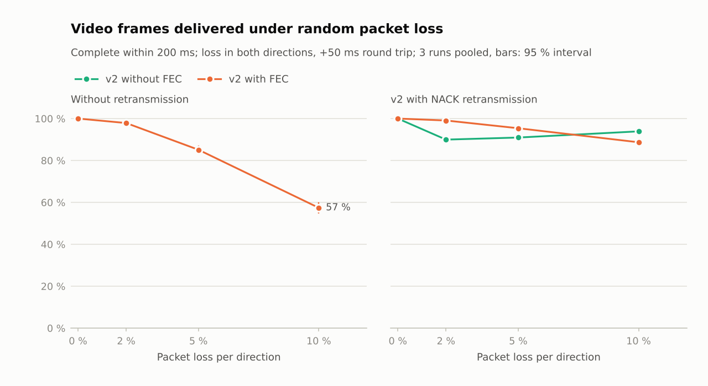
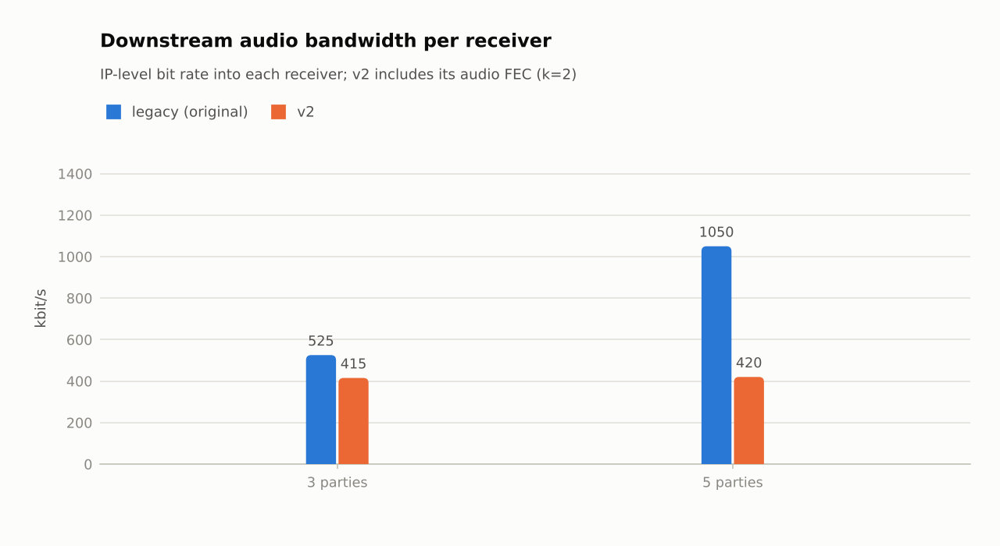

# Benchmarks

Seven experiments compare the 2024 course version (`legacy/`, run unchanged through
`bench/legacy_harness/`, which installs stub devices, feeds the frame corpus and forces
relay mode; "the 2024 version" below) with v2, compare v2 with the same binary with one
mechanism turned off (FEC, NACK, batching or GSO), or compare v2's code before and after
a fix. Each one is a single command that writes JSON to
[`bench/results/`](../bench/results/);
`bench/render.py` turns the JSON into the tables and plots below. The tables between
`BEGIN GENERATED` and `END GENERATED` markers are written by that script; do not edit
them by hand. Every number in the prose below comes from one of the files named next
to it.

| Experiment | Command | Result file | Size of the run below |
|---|---|---|---|
| B1 loss resilience | `sudo bench/run_b1.sh` | `b1_loss.json` | 111 runs of 41 s (75 in one condition, 36 in the other) and one of 300 s |
| B1 lost frames (after B1) | `python3 bench/b1_lost_frames.py bench/tmp/b1/<run ID>` | `b1_lost_frames.txt` | post-processing |
| B1 relay diagnosis | `sudo RELAY_LOG=1 CONDITIONS=both-rtt50 HARD_SYSTEMS="v2-fec-nack v2-nack" HARD_LOSSES=50 REPEATS=1 OUT=bench/results/b1_rtt50_diag.json bench/run_b1.sh`, then `python3 bench/b1_relay_diag.py bench/tmp/b1/<run ID>` | `b1_rtt50_diag.json`, `b1_rtt50_relay_diag.txt` | 2 runs of 41 s |
| B2 multi-talker audio | `sudo bench/run_b2.sh` | `b2_audio.json` | 12 runs; measurement windows of 61 s (3 parties) and 62 s (5 parties) |
| B3 relay capacity | `sudo bench/run_b3.sh` | `b3_capacity.json` | 80 sweep points of 20 s and 12 fixed-load runs of 60 s |
| CPU profiles under the B3 load | `sudo bench/profile_b3.sh` | `pprof_<variant>.{json,txt,pb.gz,metrics}` | 3 profiles of 15 s |
| Forwarding under control-plane churn | `LABEL=after bench/run_churn.sh` (and `LABEL=before` on the code before the fix, with `churn_before_harness.patch`) | `churn_before.json`, `churn_after.json` | 3 runs of 5 configurations x 20 s each (4 before the fix) |
| Jitter buffers, simulated time | `LABEL=after bench/run_jitter.sh` (and `LABEL=before` on the code before the fix) | `jitter_before.json`, `jitter_after.json` | simulated time (no lock) |
| Go microbenchmarks | `bench/run_micro.sh` | `micro.json` (raw: `micro.txt`) | 5 runs of each benchmark |
| Tables and plots | `(cd client && uv run --group bench python ../bench/render.py)` | `plots/`, `tables.md` | post-processing |

B1-B3 and the profiles need root (network namespaces and nftables).

## How these numbers were made

**Machine.** One shared virtual machine: Linux 6.18, 4 vCPUs (Intel Xeon @ 2.10 GHz),
Go 1.24.7, Python 3.13. Other jobs ran on it at the same time. Timing-sensitive
steps of every benchmark here, and of the other jobs that measure time, take one lock
(`flock` on `$BENCH_LOCK`, default `${XDG_RUNTIME_DIR:-/tmp}/cs305-bench.lock`), so no
two measurements overlap; builds, tests and other work did run during measurements, at
`nice -n 19`, mostly on CPU 0 (B3 and the profiles pin the server to CPU 1 and the load
generator to CPUs 2-3). Each result records the load average when it was written. B1,
B3 and the profiles were re-analysed later from their raw files (no new runs), and
`frames.json` was rewritten (the corpus regenerated byte-identical), so in those files
the `environment` block (commit, tree state, load average, time) describes that later
step, while `environment.build` still describes the binaries the runs used.
The kernel accounts CPU time by tick (`CONFIG_TICK_CPU_ACCOUNTING=y`, `CONFIG_HZ=250`)
without IRQ time accounting (`CONFIG_IRQ_TIME_ACCOUNTING=n`): softirq work is charged
to whichever process was running when it ran, which matters on loopback (B3).

**One invocation, one set of files.** Each invocation gets a run ID
(`CS305_RUN_ID`, UTC time plus PID), builds its binaries into `bench/tmp/build/<run ID>/`
with a build record (`build.json`: commit, uncommitted paths and a hash of their diff,
SHA-256 of each binary; records written from now on also have `tree_sha256`, a hash of
every tracked and untracked file of the code, and the lock file, which the published
records predate), creates network namespaces named after its own invocation
only, and writes raw files to `bench/tmp/<benchmark>/<run ID>/`. The result JSON is made
from that directory only and names it (`raw_files`), along with the exact command
(`command`, also in `command.txt`), the build record (`environment.build`) and the
state of the tree when the JSON was written (`environment`). The command is recorded
with every setting spelled out, in the form a user would type it (`sudo ...`); the
runs here were started as root through a wrapper that only set `BENCH_LOCK` to the
lock file this machine's jobs share. A run whose processes
failed is listed under `failed_runs` and left out. Long benchmarks run in chunks of at
most 12 minutes under the lock and release it in between; Ctrl-C stops a run, and
running the same command with the same `CS305_RUN_ID` resumes it with the same binaries
and settings. Raw directories are not committed (`bench/tmp/` is ignored); the result
JSON keeps the per-run values. The runs are repeatable, not reproducible: the nftables
loss (`numgen random`) is not seeded (the userspace relay of B1's both-rtt50 condition
is, `--seed`), and the published build records hash neither the Python code nor
untracked files.

**Repeats and statistics.** Every point of B1, B2 and B3 was run three times, with the
repeats interleaved (all points of repeat 1, then repeat 2, ...), so a slow drift of the
machine's load hits every system alike. Tables give the median of the repeats and their
range (min-max); with three runs the range is not a confidence interval, only the spread
seen. B1 also pools the frames of its three runs and gives a Wilson 95 % score interval
for the delivery ratio. That interval treats frames as independent; losses that come in
bursts (the 2024 version's reassembly queue, below) make it too narrow, so read it
together with the run-to-run range. A single run (B1's 300 s run, the relay-logged runs)
gets no interval; its 30 s bins show its spread. The CPU profiles are one 15 s window
per server variant, and the microbenchmarks five runs each.

**Earlier results (round 2).** The first results of each benchmark, made earlier the
same day with the code of that time, are kept in
[`bench/results/v1/`](../bench/results/v1/). They were made with one run per point;
apart from the churn and jitter files, their build records give only the commit
(`v1/b3_capacity_unbatched.json` has none, from a tree with uncommitted changes), and
for B3 and the profiles loopback carried whole UDP GSO messages (see B3). They are not used below, with one exception: the 2024 version at
a loopback MTU of 1500 (`v1/b3_capacity_mtu1500.json`, commit 25e0e63), which was not
re-run and is labelled "round 2, one run per point" where it is cited. (A stray
unreferenced copy of one B1 run, `v1/b1_v2-fec-0.net.json`, was removed.)

**Changes after the published runs.** These fixes to the harness came after the runs
above, and no benchmark was re-run for them; what each one could affect:

- `bench/v2_client.py` (B1 and B2 senders) passed no camera device, so a v2 participant
  that sent corpus frames told the room its video was off (`media_state`). It now opens
  a stand-in camera that yields no frames and announces video on. The flag reaches only
  the roster and the other clients' tiles; neither the server's forwarding nor the
  receive path that B1 and B2 measure reads it.
- The churn test now reports late and lost packets apart (see that section); the
  published churn runs count a late packet as missing.
- Analyses redone offline from the raw files: `bench/analyze_b1.py` gives a single-run
  group the range of its 30 s bins instead of an interval, splits latency by assembly
  time and leaves out frames that the sender's bitrate cap refused (none in these runs);
  `bench/b1_relay_diag.py` reads only the first downstream video stream (parity shares
  its SSRC), takes the second copy of a packet that passes the relay as its first
  repair and gives whole-run and in-window counts; `bench/analyze_pprof.py` counts
  `syscall.Syscall6` alone (it used to fall back to `internal/runtime/syscall.Syscall6`,
  which includes the netpoller, for two profiles); B3 and the profiles add the CPU
  without the core's softirq. The numbers in this file come from the re-analysed results.
- For future runs: `bench/profile_b3.sh` checks the GSO split (`lo_gso_check.json`), the
  build record has `tree_sha256` and the lock file, the load generator records every
  `/proc/stat` column of the server's core, and `bench/gen_frames.py` records its
  command and a hash of the corpus.

## Test media

`bench/gen_frames.py` renders 1000 frames of a moving synthetic test pattern at the
2024 client's settings (480x480, Pillow JPEG quality 85) into `bench/data/frames/`;
every system sends exactly these bytes. Sizes (`bench/results/frames.json`): mean
31 090 bytes, minimum 29 752, median 31 197, maximum 32 327. In v2 that is 26 fragments
of at most 1200 bytes of JPEG at the median (27 at most); with the RTP and video headers
a fragment is at most 1220 bytes on the wire and a parity packet 1232. `frames.json`
records the command and a SHA-256 of the corpus; it was rewritten from a clean tree
after the runs, and the regenerated corpus is byte-identical to the one they used. Each frame carries a tag in a JPEG
comment segment (frame index, sender, send time) that the receivers read back. Senders
loop over the corpus, so a run longer than 64 s (1000 frames at 15.625 fps) sends each
index more than once; the analyses match each arrival to the latest send of its index
at or before it.

Audio is a tone per talker. Each talker also writes a tag (talker, sequence number, send
time) into four reserved samples of every frame, at a position that only that talker
uses, so the tags survive the server's mix and the receiver can tell which talker's
frame it is playing and how old it is.

## B1: loss resilience

**Setup.** Three network namespaces (sender, server, receiver) connected by two veth
pairs with MTU 1500. The receiver creates a meeting, the sender joins and sends the
corpus at 15.625 fps (one frame per 1024-sample audio chunk, the 2024 client's loop
rate) plus audio, for 41 s per run; every point runs three times. P2P is disabled on
the v2 server so that every system relays through the server, as the 2024 version does
in its relay mode. Systems: the 2024 version's relay and its client's media threads;
v2 without any repair (client `--video-fec-k 0 --audio-fec-k 0`, server
`-audio-fec-k 0`); v2 with FEC (video k = 4, audio k = 2); and both v2 settings again
with NACK retransmission of video (client `--nack`; the server keeps each sender's last
256 video packets). FEC with NACK is the client's default.

Three loss conditions:

- **downlink**, the best case for repair. In the receiver's namespace an nftables rule
  drops UDP packets at random, `numgen random mod 1000 < N`, in a prerouting chain at
  priority -500, which is before IPv4 defragmentation (-400), so individual IP fragments
  are lost as on a lossy link. Only the server -> receiver direction loses packets, so
  the receiver's NACKs and REGISTERs always arrive, and the round trip is well under a
  millisecond. The v2 server sends forwarded video as UDP GSO messages; the server's
  end of the veth pair has `gso_max_segs 1`, so the kernel splits each message into its
  datagrams before they reach the rule, as a NIC would, and the rule drops datagrams,
  not whole messages.
- **both-rtt50**, harder, v2 only. The receiver's media goes through a userspace relay
  in the server's namespace (`bench/lib/udp_impair.py`, reached through a DNAT rule in
  the receiver's namespace). The relay delays each datagram by 25 ms in each direction
  (+50 ms round trip) and drops each one independently with the configured probability
  in both directions, so NACKs, retransmissions, parity packets, REGISTERs and their
  acknowledgements can all be lost. The relay counts what it received and dropped in
  each direction (`relay` in each run's JSON). This kernel has no `netem` qdisc, hence a
  relay in user space; it works on whole datagrams, so the 2024 version, whose 31 kB
  datagrams travel as IP fragments, is not run in this condition. The control
  connection (TCP) is not delayed, and the sender's uplink is never impaired.
- **downlink-long**, the downlink condition for the 2024 version only, at 1 % loss for
  300 s, to show how its delivery changes over time as the receiver's IP reassembly
  queue fills and drains.

**Metrics.** A video frame is delivered when the receiver had the complete frame within
200 ms of the sender handing it to the socket; frames sent in the first second and the
last 1.5 s of a run are not counted, nor frames that the sender's bitrate cap refused
(there were none). Audio lost is the share of the talker's frames whose tag never
reached the receiver's speaker; the 2024 version's frames are 64 ms chunks and v2's
20 ms frames, so compare the two as shares of audio time. For each group (condition, system, loss rate) the frames of the
three runs are pooled into one ratio with a Wilson 95 % interval, next to the median
and range of the three per-run ratios. The "model" value is the delivery that
independent packet loss at the configured rate would give for the same frame sizes
(`model_ratio` in `bench/analyze_b1.py`); for the NACK systems it gives every packet four
independent tries (the first transmission and three retransmissions), ignores FEC and assumes
every loss is noticed in time. "Measured UDP loss" is the nftables drop counter divided
by its match counter (downlink) or the relay's drop counts (both-rtt50). For v2 the
receiver also counts the frames its assembler gave up on: "superseded" (a newer frame
completed first; the assembler shows only the newest frame) and "expired" (still
incomplete 300 ms after its first fragment). For the dynamics of a run, each run's
JSON also has its video delivery and audio loss per 30 s of send time
(`delivery_by_30s`, `audio.lost_by_30s`). Latency percentiles are over the frames that
completed; for v2 they are also split by assembly time (the last generated table of the
downlink part): frames complete within 1.5 ms of their first fragment, too soon for any
retransmission, and the rest.

<picture>
  <source media="(prefers-color-scheme: dark)" srcset="../bench/results/plots/b1_video_delivery_dark.png">
  
</picture>

<picture>
  <source media="(prefers-color-scheme: dark)" srcset="../bench/results/plots/b1_video_delivery_rtt50_dark.png">
  
</picture>

<picture>
  <source media="(prefers-color-scheme: dark)" srcset="../bench/results/plots/b1_audio_loss_dark.png">
  
</picture>

**Downlink loss** (best case for repair):

<!-- BEGIN GENERATED b1 -->
Video frames on time, pooled over 3 runs per cell (1740-1748 frames), with the Wilson 95 % interval:

| Packet loss | 2024 version | v2 without FEC | v2 with FEC | v2 with NACK | v2 with FEC and NACK |
|---|---|---|---|---|---|
| 0 % | 100.0 % [99.8, 100.0] | 100.0 % [99.8, 100.0] | 100.0 % [99.8, 100.0] | 100.0 % [99.8, 100.0] | 100.0 % [99.8, 100.0] |
| 1 % | 67.1 % [64.8, 69.2] | 75.6 % [73.5, 77.6] | 99.1 % [98.6, 99.5] | 99.1 % [98.5, 99.4] | 100.0 % [99.8, 100.0] |
| 2 % | 39.0 % [36.8, 41.3] | 59.2 % [56.9, 61.5] | 97.8 % [97.0, 98.4] | 98.9 % [98.3, 99.3] | 100.0 % [99.8, 100.0] |
| 5 % | 13.2 % [11.7, 14.8] | 24.1 % [22.2, 26.2] | 86.4 % [84.7, 87.9] | 98.7 % [98.0, 99.1] | 99.9 % [99.6, 100.0] |
| 10 % | 2.7 % [2.0, 3.6] | 6.1 % [5.0, 7.3] | 57.3 % [55.0, 59.6] | 98.1 % [97.3, 98.6] | 99.3 % [98.7, 99.6] |

The same per run: median (range), and the independent-loss model:

| Packet loss | 2024 version | v2 without FEC | v2 with FEC | v2 with NACK | v2 with FEC and NACK |
|---|---|---|---|---|---|
| 0 % | 100.0 %; model 100.0 % | 100.0 %; model 100.0 % | 100.0 %; model 100.0 % | 100.0 %; model 100.0 % | 100.0 %; model 100.0 % |
| 1 % | 65.9 % (57.1-78.3); model 80.5 % | 75.4 % (73.8-77.7); model 76.6 % | 99.1 % (98.8-99.5); model 99.4 % | 99.3 % (98.3-99.7); model 100.0 % | 100.0 %; model 100.0 % |
| 2 % | 38.6 % (37.2-41.2); model 64.7 % | 59.6 % (56.9-61.2); model 58.6 % | 97.9 % (96.9-98.5); model 97.5 % | 99.1 % (98.5-99.1); model 100.0 % | 100.0 %; model 100.0 % |
| 5 % | 13.0 % (12.1-14.5); model 33.1 % | 24.1 % (21.5-26.8); model 25.7 % | 86.6 % (85.6-86.9); model 86.3 % | 98.6 % (98.5-99.0); model 100.0 % | 99.8 % (99.8-100.0); model 100.0 % |
| 10 % | 2.8 % (2.1-3.3); model 10.3 % | 6.2 % (5.7-6.4); model 6.2 % | 57.6 % (56.8-57.6); model 57.7 % | 97.9 % (97.9-98.3); model 99.7 % | 99.5 % (98.8-99.5); model 99.7 % |

Audio frames lost, pooled, with the Wilson 95 % interval:

| Packet loss | 2024 version | v2 without FEC | v2 with FEC | v2 with NACK | v2 with FEC and NACK |
|---|---|---|---|---|---|
| 0 % | 0.00 % [0.00, 0.22] | 0.00 % [0.00, 0.07] | 0.00 % [0.00, 0.07] | 0.00 % [0.00, 0.07] | 0.00 % [0.00, 0.07] |
| 1 % | 17.41 % [15.70, 19.27] | 0.88 % [0.66, 1.16] | 0.05 % [0.02, 0.16] | 1.04 % [0.80, 1.34] | 0.00 % [0.00, 0.07] |
| 2 % | 45.00 % [42.68, 47.35] | 1.88 % [1.55, 2.27] | 0.04 % [0.01, 0.13] | 2.31 % [1.95, 2.74] | 0.09 % [0.04, 0.21] |
| 5 % | 67.41 % [65.18, 69.58] | 5.17 % [4.62, 5.78] | 0.29 % [0.18, 0.46] | 4.28 % [3.78, 4.84] | 0.48 % [0.33, 0.70] |
| 10 % | 74.71 % [72.62, 76.70] | 9.32 % [8.59, 10.11] | 1.81 % [1.49, 2.19] | 9.72 % [8.97, 10.52] | 1.86 % [1.54, 2.25] |

Measured UDP packet loss (nftables drops / matches), median (range) of the runs:

| Packet loss | 2024 version | v2 without FEC | v2 with FEC | v2 with NACK | v2 with FEC and NACK |
|---|---|---|---|---|---|
| 0 % | 0.00 % | 0.00 % | 0.00 % | 0.00 % | 0.00 % |
| 1 % | 1.07 % (0.92-1.17) | 1.06 % (0.94-1.12) | 1.03 % (1.01-1.10) | 1.09 % (0.95-1.09) | 1.08 % (0.96-1.11) |
| 2 % | 1.99 % (1.94-2.07) | 1.94 % (1.90-2.10) | 1.92 % (1.87-2.05) | 1.99 % (1.95-2.01) | 2.00 % (1.90-2.04) |
| 5 % | 4.82 % (4.73-5.10) | 5.17 % (4.85-5.28) | 4.95 % (4.88-4.95) | 4.94 % (4.78-5.02) | 5.05 % (4.84-5.11) |
| 10 % | 10.20 % (9.47-10.31) | 10.14 % (9.87-10.33) | 9.95 % (9.88-10.20) | 9.99 % (9.97-10.06) | 9.92 % (9.84-10.20) |

| System | Packet loss | Run | Video on time, first half | second half | IP reassembly failures | Peak reassembly memory |
|---|---|---|---|---|---|---|
| 2024 version | 0 % | 1 | 100.0 % | 100.0 % | 0 | 0.00 MiB |
| 2024 version | 0 % | 2 | 100.0 % | 100.0 % | 0 | 0.00 MiB |
| 2024 version | 0 % | 3 | 100.0 % | 100.0 % | 0 | 0.00 MiB |
| 2024 version | 1 % | 1 | 79.0 % | 52.8 % | 2266 | 4.00 MiB |
| 2024 version | 1 % | 2 | 88.3 % | 68.3 % | 975 | 4.00 MiB |
| 2024 version | 1 % | 3 | 75.5 % | 38.6 % | 3396 | 4.00 MiB |
| 2024 version | 2 % | 1 | 63.4 % | 13.8 % | 5828 | 4.00 MiB |
| 2024 version | 2 % | 2 | 54.1 % | 20.3 % | 5767 | 4.00 MiB |
| 2024 version | 2 % | 3 | 68.6 % | 13.8 % | 5465 | 4.00 MiB |
| 2024 version | 5 % | 1 | 17.9 % | 11.0 % | 8129 | 4.00 MiB |
| 2024 version | 5 % | 2 | 10.3 % | 15.6 % | 8435 | 4.00 MiB |
| 2024 version | 5 % | 3 | 17.2 % | 6.9 % | 8394 | 4.00 MiB |
| 2024 version | 10 % | 1 | 2.7 % | 1.4 % | 8929 | 4.00 MiB |
| 2024 version | 10 % | 2 | 4.8 % | 1.7 % | 8755 | 4.00 MiB |
| 2024 version | 10 % | 3 | 3.1 % | 2.4 % | 8958 | 4.00 MiB |

| System | Packet loss | NACKs sent | Packets requested (with repeats) | Received or rebuilt after a request | Given up | Frames superseded | Frames expired | p99 frame latency, median (range) |
|---|---|---|---|---|---|---|---|---|
| v2 without FEC | 1 % | 0 | 0 | 0 | 0 | 456 | 0 | 1.8 ms (1.5-2.0) |
| v2 without FEC | 2 % | 0 | 0 | 0 | 0 | 748 | 15 | 2.3 ms (1.8-2.5) |
| v2 without FEC | 5 % | 0 | 0 | 0 | 0 | 1044 | 375 | 1.4 ms (1.2-3.0) |
| v2 without FEC | 10 % | 0 | 0 | 0 | 0 | 473 | 1263 | 1.6 ms (1.0-1.6) |
| v2 with FEC | 1 % | 0 | 0 | 0 | 0 | 15 | 0 | 2.5 ms (1.8-2.7) |
| v2 with FEC | 2 % | 0 | 0 | 0 | 0 | 42 | 0 | 2.5 ms (2.3-3.2) |
| v2 with FEC | 5 % | 0 | 0 | 0 | 0 | 252 | 0 | 2.4 ms (2.2-3.3) |
| v2 with FEC | 10 % | 0 | 0 | 0 | 0 | 783 | 6 | 3.0 ms (2.1-5.0) |
| v2 with NACK | 1 % | 469 | 520 | 519 | 0 | 17 | 0 | 16.7 ms (16.5-16.9) |
| v2 with NACK | 2 % | 773 | 980 | 958 | 0 | 21 | 0 | 45.1 ms (44.8-47.6) |
| v2 with NACK | 5 % | 1506 | 2595 | 2475 | 0 | 25 | 0 | 77.6 ms (77.3-78.6) |
| v2 with NACK | 10 % | 2190 | 5495 | 4948 | 5 | 40 | 0 | 79.7 ms (79.3-79.8) |
| v2 with FEC and NACK | 1 % | 14 | 28 | 21 | 0 | 0 | 0 | 6.9 ms (2.7-7.5) |
| v2 with FEC and NACK | 2 % | 46 | 99 | 76 | 0 | 0 | 0 | 12.2 ms (8.8-14.1) |
| v2 with FEC and NACK | 5 % | 245 | 579 | 453 | 0 | 2 | 0 | 16.0 ms (15.5-16.2) |
| v2 with FEC and NACK | 10 % | 794 | 2318 | 1865 | 0 | 14 | 0 | 39.4 ms (17.0-40.7) |

Latency percentiles cover completed frames only, so systems that complete different shares of their frames are compared over different frames. Split by the time from a frame's first fragment to its completion (1.5 ms: too soon for any retransmission), per run, median (range):

| System | Packet loss | Frames completed | Assembled within 1.5 ms: frames | p99 | Assembled later: frames | p50 | p99 |
|---|---|---|---|---|---|---|---|
| v2 without FEC | 1 % | 439 (430-452) | 439 (428-452) | 1.78 ms (1.52-1.91) | 0 (0-2) | 3.5 ms | 4.1 ms |
| v2 without FEC | 2 % | 347 (331-356) | 345 (330-353) | 1.89 ms (1.77-1.95) | 2 (1-3) | 2.7 ms (2.5-3.4) | 3.2 ms (3.0-3.4) |
| v2 without FEC | 5 % | 140 (125-156) | 140 (124-156) | 1.44 ms (1.21-2.93) | 0 (0-1) | 2.4 ms | 2.4 ms |
| v2 without FEC | 10 % | 36 (33-37) | 36 (33-37) | 1.57 ms (1.00-1.62) | 0 | n/a | n/a |
| v2 with FEC | 1 % | 578 (576-579) | 575 (573-577) | 2.24 ms (1.71-2.41) | 3 (2-3) | 3.1 ms (2.5-4.6) | 3.4 ms (2.5-7.4) |
| v2 with FEC | 2 % | 569 (565-573) | 566 (558-570) | 2.24 ms (2.00-2.68) | 3 (3-7) | 3.1 ms (2.4-5.4) | 6.7 ms (3.1-7.6) |
| v2 with FEC | 5 % | 504 (498-506) | 502 (493-504) | 2.23 ms (2.05-2.27) | 2 (2-5) | 3.1 ms (2.8-3.3) | 3.5 ms (3.2-21.1) |
| v2 with FEC | 10 % | 335 (331-335) | 329 | 2.37 ms (1.95-2.56) | 6 (2-6) | 3.0 ms (2.2-4.0) | 11.2 ms (2.2-24.9) |
| v2 with NACK | 1 % | 578 (572-580) | 424 (422-453) | 1.77 ms (1.59-1.86) | 154 (119-158) | 11.4 ms (11.2-12.5) | 41.0 ms (17.6-44.2) |
| v2 with NACK | 2 % | 577 (573-577) | 348 (340-352) | 1.81 ms (1.42-2.93) | 229 (221-237) | 11.6 ms (11.5-11.7) | 67.2 ms (64.0-75.1) |
| v2 with NACK | 5 % | 574 (573-576) | 151 (145-155) | 2.00 ms (1.24-2.55) | 425 (419-428) | 12.1 ms (11.6-12.1) | 78.6 ms (78.0-78.8) |
| v2 with NACK | 10 % | 571 (570-571) | 37 (35-43) | 2.87 ms (2.59-2.90) | 534 (528-535) | 14.5 ms (13.1-14.5) | 79.8 ms (79.4-79.8) |
| v2 with FEC and NACK | 1 % | 582 (581-582) | 574 (572-577) | 2.19 ms (2.11-2.52) | 8 (5-9) | 9.5 ms (5.4-10.8) | 14.9 ms (14.0-15.8) |
| v2 with FEC and NACK | 2 % | 582 (581-583) | 563 (562-566) | 2.09 ms (1.63-2.27) | 19 (16-20) | 10.4 ms (7.6-12.5) | 16.6 ms (13.9-17.5) |
| v2 with FEC and NACK | 5 % | 581 | 500 (492-512) | 2.22 ms (1.98-2.86) | 81 (69-89) | 11.2 ms (11.2-11.7) | 17.7 ms (16.2-36.7) |
| v2 with FEC and NACK | 10 % | 579 (574-580) | 336 (332-345) | 2.29 ms (2.06-2.39) | 242 (235-243) | 11.9 ms (11.7-12.3) | 45.2 ms (44.7-49.5) |
<!-- END GENERATED b1 -->

**Loss in both directions with a 50 ms round trip** (v2 only):

<!-- BEGIN GENERATED b1_hard -->
Video frames on time, pooled, with the Wilson 95 % interval:

| Loss per direction | v2 with FEC | v2 with NACK | v2 with FEC and NACK |
|---|---|---|---|
| 0 % | 100.0 % [99.8, 100.0] | 100.0 % [99.8, 100.0] | 100.0 % [99.8, 100.0] |
| 2 % | 97.9 % [97.1, 98.4] | 90.0 % [88.4, 91.3] | 99.1 % [98.5, 99.4] |
| 5 % | 85.1 % [83.4, 86.7] | 90.9 % [89.5, 92.2] | 95.4 % [94.3, 96.3] |
| 10 % | 57.4 % [55.1, 59.7] | 93.9 % [92.7, 94.9] | 88.7 % [87.1, 90.1] |

Per run, median (range):

| Loss per direction | v2 with FEC | v2 with NACK | v2 with FEC and NACK |
|---|---|---|---|
| 0 % | 100.0 % | 100.0 % | 100.0 % |
| 2 % | 98.1 % (97.2-98.3) | 89.9 % (89.6-90.3) | 99.1 % (98.8-99.3) |
| 5 % | 86.0 % (83.0-86.3) | 91.2 % (90.3-91.3) | 95.8 % (94.1-96.2) |
| 10 % | 57.6 % (54.5-60.1) | 94.6 % (91.5-95.5) | 88.4 % (88.4-89.3) |

| System | Loss per direction | Runs | Frames | Measured loss, receiver to server / server to receiver | p50 / p99 frame latency (median of runs) | Frames superseded / expired | Audio lost |
|---|---|---|---|---|---|---|---|
| v2 with FEC | 0 % | 3 | 1731 | 0.00 % / 0.00 % | 27.2 / 28.8 ms | 0 / 0 | 0.00 % [0.00, 0.07] |
| v2 with FEC | 2 % | 3 | 1733 | 0.00 % / 2.04 % (2.00-2.06) | 27.3 / 29.4 ms | 40 / 0 | 0.04 % [0.01, 0.13] |
| v2 with FEC | 5 % | 3 | 1734 | 0.00 % / 5.03 % (4.86-5.15) | 27.3 / 29.1 ms | 273 / 0 | 0.54 % [0.38, 0.77] |
| v2 with FEC | 10 % | 3 | 1733 | 0.00 % (0.00-25.00) / 10.21 % (9.78-10.29) | 27.5 / 30.3 ms | 774 / 9 | 1.84 % [1.52, 2.23] |
| v2 with NACK | 0 % | 3 | 1732 | 0.00 % / 0.00 % | 27.1 / 29.0 ms | 0 / 0 | 0.02 % [0.00, 0.10] |
| v2 with NACK | 2 % | 3 | 1732 | 2.21 % (2.10-2.32) / 2.03 % (1.97-2.05) | 27.2 / 120.7 ms | 190 / 0 | 2.27 % [1.91, 2.70] |
| v2 with NACK | 5 % | 3 | 1733 | 4.88 % (4.81-5.78) / 4.95 % (4.91-5.18) | 87.4 / 155.4 ms | 167 / 0 | 4.96 % [4.42, 5.56] |
| v2 with NACK | 10 % | 3 | 1734 | 10.88 % (9.44-11.76) / 10.16 % (9.80-10.20) | 91.9 / 157.8 ms | 114 / 0 | 10.18 % [9.41, 11.00] |
| v2 with FEC and NACK | 0 % | 3 | 1731 | 0.00 % / 0.00 % | 27.1 / 28.8 ms | 0 / 0 | 0.00 % [0.00, 0.07] |
| v2 with FEC and NACK | 2 % | 3 | 1732 | 0.00 % (0.00-2.50) / 2.03 % (2.00-2.06) | 27.2 / 84.7 ms | 19 / 0 | 0.11 % [0.05, 0.24] |
| v2 with FEC and NACK | 5 % | 3 | 1732 | 4.04 % (4.00-6.90) / 5.00 % (4.83-5.13) | 27.3 / 91.0 ms | 87 / 0 | 0.38 % [0.25, 0.58] |
| v2 with FEC and NACK | 10 % | 3 | 1732 | 11.40 % (9.72-13.78) / 10.12 % (9.86-10.23) | 27.5 / 122.9 ms | 209 / 0 | 1.57 % [1.27, 1.93] |
<!-- END GENERATED b1_hard -->

**The 2024 version over 300 s at 1 % loss** (downlink condition, one run):

<!-- BEGIN GENERATED b1_long -->
2024 version at 1 % loss, 300 s run (repeat 1): 3147/4627 (68.0 %) of video frames on time and 17.1 % of audio lost over the whole run; reassembly memory first reached 90 % of its 4 MiB limit after 26.7 s.

| Send time | 0-30 s | 30-60 s | 60-90 s | 90-120 s | 120-150 s | 150-180 s | 180-210 s | 210-240 s | 240-270 s | 270-300 s |
|---|---|---|---|---|---|---|---|---|---|---|
| Video frames on time | 78 % | 61 % | 67 % | 63 % | 67 % | 67 % | 68 % | 73 % | 66 % | 69 % |
| Audio frames lost | 5 % | 22 % | 16 % | 25 % | 17 % | 18 % | 18 % | 13 % | 19 % | 18 % |
<!-- END GENERATED b1_long -->

**Reading the results.** Numbers from `b1_loss.json` (run 20261119T112236Z-10546,
binaries built at b06dd9e): the frames of the three runs pooled, with the Wilson 95 %
interval in brackets, unless a range of runs is given. The counts of lost frames and
what followed them come from `b1_lost_frames.txt` (its summary lines) and
`b1_rtt50_relay_diag.txt`.

*Downlink loss, the best case for repair:*

- v2 without FEC follows the independent-loss model: 75.6 % [73.5, 77.6] of frames at
  1 % loss against a model 76.6 %, and 6.1 % [5.0, 7.3] at 10 % against 6.2 %. Splitting
  a frame into about 26 packets does not by itself make it more likely to arrive than a
  datagram of 21-22 IP fragments.
- One XOR parity packet per four fragments: 99.1 % [98.6, 99.5] at 1 % loss, 86.4 %
  [84.7, 87.9] at 5 % and 57.3 % [55.0, 59.6] at 10 %, again as the model predicts (99.4,
  86.3 and 57.7 %). Parity repairs one loss per group, and at 10 % loss groups with two
  losses are common.
- NACK on top of FEC, the client's default: every frame at 1 and 2 % loss (1 745 of
  1 745 and 1 746 of 1 746; the interval's lower end is 99.8 %), 99.9 % [99.6, 100.0] at
  5 % and 99.3 % [98.7, 99.6] at 10 %, so 15 frames lost in 6 982 over the four loss
  rates. At 10 % loss the receivers sent 794 NACK packets asking for 2 318 packets
  (repeated requests included); 1 865 of them were then received or rebuilt from parity,
  and none was given up. The p99 frame latency at 10 % loss was 39.4 ms (17.0-40.7 over
  the runs) with FEC and NACK against 3.0 ms (2.1-5.0) with FEC alone, with medians of
  1.6 and 1.5 ms, but that difference is not the latency cost of NACK: the percentiles
  cover completed frames, 574-580 per run with FEC and NACK and 331-335 with FEC alone.
  Split by assembly time, the frames that FEC and NACK completed within 1.5 ms of their
  first fragment (332-345 per run) have a p99 of 2.29 ms (2.06-2.39), like FEC alone's
  2.37 ms (1.95-2.56); the 235-243 per run that completed later have a p50 of 11.9 ms
  (11.7-12.3) and a p99 of 45.2 ms (44.7-49.5), well inside the 200 ms deadline. The
  client waits 5 ms before it asks, checks every 10 ms, and asks again after 30 ms when a
  repair has not arrived.
- NACK without FEC stays at 98.1-99.1 % at every loss rate, where its model predicts
  99.7 % or more, with a p99 latency of 77.6 ms at 5 % loss and 79.7 ms at 10 %. The
  frames it loses are the ones a newer frame overtakes: the receiver's assembler is
  newest-wins and gives up an incomplete frame as soon as a newer one is complete. A
  loss at the end of a frame shows only when the next frame's first packet arrives, one
  frame interval (64 ms) later; for 72 of the 92 frames that NACK alone lost, the next
  frame was complete within 1.5 ms of its first fragment, too soon for any
  retransmission. With FEC, the parity packet after a frame's last fragment both reveals
  and repairs a lost tail.
- Audio: without FEC v2 loses about the packet loss rate (0.88 % [0.66, 1.16] at 1 %
  loss, 9.32 % [8.59, 10.11] at 10 %), and FEC with k = 2 brings that to 0.05 %
  [0.02, 0.16] and 1.81 % [1.49, 2.19]. NACK covers video only, so the NACK systems'
  audio follows their FEC setting (the server's NACK handler serves only video). The 2024
  version lost 17.41 % [15.70, 19.27] of its 64 ms audio chunks at 1 % loss and 74.71 %
  [72.62, 76.70] at 10 % (see the last part); as the chunks and frames differ in length,
  compare these as shares of audio time.
- Without NACK, frames took about a millisecond whatever the loss (median latency
  0.7-1.5 ms for the 2024 version and for v2 with and without FEC); loss, not delay, is what
  differs.

*Loss in both directions with a 50 ms round trip:*

- FEC alone does as well as with downlink loss (97.9 % [97.1, 98.4] at 2 % loss in each
  direction, 85.1 % [83.4, 86.7] at 5 %, 57.4 % [55.1, 59.7] at 10 %), since it needs
  neither a return path nor a round trip.
- Retransmission does much worse than on the sub-millisecond path. FEC with NACK
  delivered 99.1 % [98.5, 99.4] at 2 % loss, 95.4 % [94.3, 96.3] at 5 % and 88.7 %
  [87.1, 90.1] at 10 %; NACK alone 90.0 % [88.4, 91.3], 90.9 % [89.5, 92.2] and 93.9 %
  [92.7, 94.9]. At 10 % loss NACK alone did better than FEC with NACK, and NACK alone
  did better at 10 % loss than at 2 %.
- Both oddities come from the same newest-wins rule. A repair now takes a round trip
  more, so it arrives about when the next frame does. In the relay-logged runs at 5 %
  loss (run 20261119T134226Z-8769, one 41 s run per system), the first repair of a lost
  packet passed the relay a median of 63.6 ms (FEC and NACK, 139 packets) and 63.8 ms
  (NACK alone, 795 packets) after its frame's first fragment, 56 % and 51 % of them
  within 64 ms, the frame interval, which is when the next frame's first fragment
  arrives. Over the whole runs NACK alone never completed 65 frames (61
  of them inside the window that B1 counts) and FEC with NACK 31 (29 inside it); in those
  frames only, the first repairs passed a median of 66 ms after the frame's first
  fragment, and for 61 of the 65 and all 31 the next frame needed no repair at all,
  against 26.9 % and 86.6 % of all frames. The main runs agree: the frame after a lost
  one was complete within 1.5 ms of its first fragment for 371 of the 437 frames lost
  with NACK alone and for 286 of the 292 lost with FEC and NACK. With NACK alone a frame
  needs no repair only when none of its packets is lost, which gets rarer as loss rises,
  so fewer frames are overtaken (190, 167 and 114 frames superseded at 2, 5 and 10 %
  loss); with FEC most frames need no NACK repair, and more frames that do are overtaken
  as loss rises (19, 87 and 209). Hypothesis, not built or measured: an assembler that
  keeps a frame whose repair is due until the frame's deadline, instead of giving it up
  when a newer frame completes, would recover most of these frames.
- Frames that needed no repair took about 27 ms, the relay's 25 ms plus about 2 ms (the
  median latency of every run with FEC, and of NACK alone at 0 and 2 % loss, was
  27.0-27.6 ms). With NACK alone most frames needed a repair at 5 and 10 % loss, and the
  median rose to 87.4 and 91.9 ms; the highest p99 of any run was 174.4 ms (NACK alone,
  10 % loss).
- The receiver sends little upstream: REGISTER keepalives, plus NACKs where they are on
  (10-12 datagrams per lossy run with FEC alone, 40-617 with FEC and NACK, 518-1 222 with
  NACK alone). A run's measured upstream loss rests on that many datagrams, so it is
  coarse where they are few (0-25 % for FEC alone at 10 %; 25 % is 3 of 12 datagrams).

*The 2024 version under sustained loss:*

- In the three 41 s runs at 1 % loss the 2024 version delivered 67.1 % [64.8, 69.2] of
  frames against a model 80.5 % (39.0 % against 64.7 % at 2 %). The runs ranged from
  57.1 % to 78.3 %, and every one did worse in its second half (38.6-68.3 %) than in its
  first (75.5-88.3 %). The receiver's kernel counted IP reassembly failures in every
  lossy run (975-3 396 per run at 1 % loss).
- The 300 s run (a single run, so no interval) shows where that leads: 78.3 % of frames
  on time in the first 30 s, then 61-73 % in every later 30 s bin, 68.0 % (3 147 of
  4 627) over the run against a model 80.5 %; and 17.1 % of audio lost (5.3 % in the
  first 30 s, then 12.8-25.2 % per bin), where independent loss of its 2-fragment audio
  datagrams would lose 2 %. nftables dropped 1 123 of 109 981 UDP packets (1.02 %). The
  receiver's kernel counted 16 808 reassembly failures (`ReasmFails`, which counts
  kernel events, not frames), 805 reassembly timeouts and 7 055 datagrams reassembled,
  and no receive-buffer drops (`RcvbufErrors` 0).
- The explanation that fits these counters (consistent with them; no experiment changed
  the queue to test it): an incomplete datagram keeps its fragments in the kernel's
  reassembly queue for `ipfrag_time` (30 s). In the 300 s run the queue's memory first
  reached 90 % of `ipfrag_high_thresh` (4 MiB per namespace) after 26.7 s and the limit
  after 30.2 s, then stayed between 3.06 and 4.00 MiB, in 74-104 queues, for the rest of
  the run (`receiver_frag_memory`, sampled from `/proc/net/sockstat` in the receiver's
  namespace). At the threshold the kernel drops new fragments, including those of
  datagrams that would have been complete, until expiring ones free memory, so delivery
  settles at a lower level rather than collapsing. v2 sends no fragmented datagrams, and
  its reassembly counters stayed at zero.
- Because the queue fills at a different moment in each run, the 2024 version's frames are
  not lost independently, and the Wilson interval of its 41 s runs at 1 % loss
  (64.8-69.2 %) is much narrower than their spread (57.1-78.3 %).

## B2: multi-talker audio

**Setup.** One network namespace; the server and 3 or 5 participants on its loopback
interface (each 2024-version participant on its own 127.0.0.x address, because the 2024
relay skips receivers with the sender's IP). Everybody talks and sends video (corpus at
15.625 fps) for the whole run. The measurement window starts 2.5 s after the last
participant joined and ends 1 s before the participants stop: 61 s with three parties
and 62 s with five (`window_seconds`); each configuration runs three times.

Both ends are simulated: the microphones are synthetic tones and the speakers are
stand-ins, and these stand-ins decide the 2024 version's numbers. Its participants run
its own `keep_share` and `keep_recv` threads, and their sound card is
`bench/legacy_harness/stubs.py`, a blocking device with room for one chunk: `read(1024)`
returns when 1024 samples of real time have passed, and `write()` returns only once the
previous chunk has finished playing. That is how PyAudio's blocking stream behaves once
its buffer is full; a receiver handed more than real time of audio blocks in `write()`
for one chunk duration per chunk, and the datagrams queue in its socket's receive
buffer, whose size is this host's default (`net.core.rmem_default`, 212 992 bytes; the
2024 client sets only `SO_SNDBUF`). v2 participants run the real client with the server's
mix-minus stream and the client's 60 ms jitter buffer; their speaker is a thread that
takes one 20 ms frame every 20 ms.

**Metrics.** Capture-to-playout latency: from the end of a frame's capture at the
talker to the moment the receiver's stand-in sound card starts playing it (median over
all frames played in the window, then the median of the three runs). Audio delivered:
share of each talker's frames that were played, worst and best talker shown. Downstream
audio: IP-level bit rate into each receiver (2024 version: nftables counters on the
receiver's port for datagrams under 4000 bytes; v2: client receive counters plus
28 bytes of IP and UDP header per packet). Video frames processed: frames of the other
participants that the receiving application got in the window (2024 version: stored after
decompression; v2: completed by the frame assembler), against frames sent in the
window; a frame sent just before the window and received in it makes the ratio exceed
100 % by one frame. Rise over the window: a receiver's mean latency over the last 5 s
of the window minus its mean over the first 5 s, and the median of that over the
receivers of a run. The JSON also has, per receiver, the
longest gap between two frames of one sender (`longest_gap_s`), the share of the window
covered by gaps longer than 0.5 s (`stalled_fraction`) and the latency series
(`capture_to_playout_series`, 0.5 s bins).

<picture>
  <source media="(prefers-color-scheme: dark)" srcset="../bench/results/plots/b2_audio_latency_dark.png">
  
</picture>

<picture>
  <source media="(prefers-color-scheme: dark)" srcset="../bench/results/plots/b2_downstream_audio_dark.png">
  
</picture>

<picture>
  <source media="(prefers-color-scheme: dark)" srcset="../bench/results/plots/b2_video_shown_dark.png">
  
</picture>

<!-- BEGIN GENERATED b2 -->
| System | Parties | Runs | Capture-to-playout p50 (ms) | p95 (ms) | Rise over the window (ms) | Worst talker's audio played | Video frames processed | Downstream audio per receiver (kbit/s) |
|---|---|---|---|---|---|---|---|---|
| 2024 version | 3 | 3 | 594 (589-614) | 682 (665-684) | 3 (-7 to 5) | 41.3 % (41.3-41.7) | 25.0 % | 525 |
| 2024 version | 5 | 3 | 978 (952-1024) | 1199 (1190-1204) | 364 (157-395) | 15.1 % (15.0-15.7) | 8.2 % (7.8-8.8) | 1050 |
| v2 | 3 | 3 | 119 (117-119) | 128 (126-128) | 0 | 100.0 % | 100.0 % (99.9-100.0) | 415 |
| v2 | 5 | 3 | 119 (119-124) | 135 (131-135) | 0 | 100.0 % | 100.0 % | 420 |
<!-- END GENERATED b2 -->

**Reading the results.** Numbers from `b2_audio.json` (run 20261119T115303Z-29601,
built at 4fe5eca); medians of three runs with the range in brackets.

- The 2024 version's receiver has to play (n - 1) x real time of audio through a
  speaker that plays one. Its receive thread blocks in `write()`, the socket's receive
  buffer fills (the kernel counted 7 522-7 533 receive-buffer drops per 3-party run and
  34 125-34 382 per 5-party run, `Udp.RcvbufErrors` under `kernel`; v2 had none), and
  capture-to-playout latency sits at the depth of that buffer: a median of 594 ms
  (589-614) with three parties and 978 ms (952-1024) with five. With three parties it
  is flat over the window (3 ms, -7 to 5). With five, each receiver's latency sat on
  one of two plateaus, about 650 ms and about 1 050 ms (means over 5 s), and stepped
  between them at different moments; most stepped up during the window and some
  stepped back down. The rise over the window is 364 ms (157-395; 346 ms, 83-394, with
  medians instead of means), but the latency was not still rising at the end: for 13
  of the 15 receivers the mean of the last 5 s was below that of the 5 s before (the
  other two rose by 1.5 and 53 ms). Of each talker's audio, 41.3-58.7 % was played with
  three parties and 15.0-38.2 % with five (every receiver, talker and run); the rest
  was never played.
- Video arrives on the same socket and thread, so it stalls with the audio: each
  receiver processed 25 % of the others' frames with three parties and 6.5-11.9 % with
  five, and in 14 of the 15 five-party receiver runs one sender's video did not arrive
  at all during the 62 s window (`longest_gap_s` 62 s).
- v2 played every talker's audio in every run (100.0 %), with a median
  capture-to-playout latency of 119 ms with three parties (117-119) and with five
  (119-124), flat over the window. That is about the sum of its configured buffering:
  40 ms in the server's per-sender jitter buffer, up to 20 ms of mixer tick phase, the
  client's 60 ms jitter buffer and up to 20 ms of device period (a sum from the
  configuration, not a per-stage measurement). The mix is not what keeps it there:
  mixing on the server adds its 40 ms buffer and tick phase. By design v2's receive
  path never waits for playback and its playout is paced by a clock, the likely reason;
  no experiment isolated it, and mixing separate streams on the client was not
  measured. The downstream audio rate
  (415 and 420 kbit/s per receiver with FEC parity, 275 and 278 without) does not grow
  with the number of talkers, because every receiver gets one mix-minus stream; the
  2024 version's rate, one stream per other talker, doubles from three parties to five
  (525 and 1050 kbit/s).
- v2's video costs more bandwidth than the 2024 version's: 20 580-20 590 kbit/s against
  15 565-15 576 kbit/s per receiver with five parties (`downstream_video`), from FEC
  (one parity packet per group of up to four fragments) and per-fragment headers.

## B3: relay capacity

**Setup.** One network namespace; the server and `server/cmd/loadgen` on its loopback
interface, the server pinned to CPU 1 and the load generator to CPUs 2 and 3 with
`taskset`. The load generator runs N participants in rooms of four; each sends corpus
frames at 15 fps and 256 kbit/s of audio, in each system's own wire format (v2: RTP
fragments with FEC k = 4 and audio k = 2 after a REGISTER; 2024 version: pickled
datagrams, byte-identical to CPython's, from one 127.1.x.y address per participant,
using its port scheme). Each point: a fresh server, 5 s warm-up, 20 s measurement
window, 1 s grace.

Four systems: v2 as shipped (`recvmmsg`/`sendmmsg` batching plus UDP GSO), the same
binary with `-udp-gso=false` (batching only) and with `-udp-batch=1` (one system call
per datagram), and the 2024 version's relay. The v2 variants are swept over 128-320
participants in steps of 16; within one repeat a variant stops after two consecutive
failing sizes. The 2024 version is run at 448 participants only, below the load
generator's limit of 452 in its legacy mode (the 2024 port scheme, UDP port
20000 + 100 x ID, allows IDs up to 455); it passed every size from 8 to 448 in both
round-2 sweeps (one run per point, MTU 65 536 and 1500). Three repeats, interleaved by
repeat, size and system. A separate fixed-load run of 60 s at 16 participants, three
times per system, gives CPU time per participant-minute.

**Loopback and UDP GSO.** Loopback has no NIC. A UDP GSO message sent to lo would go up
the receivers' IP stack whole and be split only at the receiving socket, a receive path
no real network offers, and on loopback that receive work runs in softirq on the
sending CPU, so it is charged to the server. The namespace's lo therefore has
`gso_max_segs 1`: the kernel splits every GSO message into datagrams before lo, as it
does in front of a NIC without UDP segmentation offload, and every variant's datagrams
take the same receive path (`bench/lib/gso_split.py` checks this at the start of each
run; `lo_gso_check.json`, present for this run). The receivers' receive path is still charged to the server's
CPU for every variant, because that is where loopback runs it; the share of the server
core's busy time spent in softirq is recorded per point (`server_core_softirq_share`).
So B3's CPU numbers are loopback numbers: on a real network the server would pay for
its own receive path and not for its receivers'. The round-2 results (`v1/`) were made
with lo's default (whole GSO messages), which flattered GSO.

**Metrics.** Frame delivery: frames received complete by every other member of the
sender's room / (frames sent in the window x 3). The load generator does not repair
frames with FEC, so v2's delivery is a lower bound. Latency: send to complete receipt.
A size passes with delivery >= 99 % and p99 latency < 100 ms; a repeat's capacity is its
largest passing size. Server CPU: utime + stime of the server process from
`/proc/<pid>/stat` over the window, divided by the window (1.0 = the one CPU it is
pinned to); the load generator's CPU is recorded the same way, to show that it was not
the bottleneck. Without IRQ time accounting the kernel charges softirq work, including
the receivers' loopback receive path, to whichever process is running, so each point
also records the pinned core's busy and softirq time from `/proc/stat`
(`server_core`), and "without the core's softirq" is the process CPU minus the core's
softirq time, an estimate of the server's own work. A point whose core was busier than
the server process by more than 0.03 of a core is listed under `flagged_points` (11
points: 6 of v2 as shipped, 2 of one call per datagram, 3 of the 2024 version; none was
re-run), because then something else ran on that core or softirq ran outside the
process. The published points have only the core's busy and softirq totals; the load
generator now also records every `/proc/stat` column of the core (`fields_seconds`). The batching counters come from the server's `/metrics` after each
point: datagrams per read call, video datagrams per send call and per GSO message.

The loopback interface's MTU is the Linux default, 65 536. The 2024 version sends each
frame as one 31 kB datagram, which is never fragmented on that MTU; v2 keeps every UDP
payload at or under 1232 bytes for real networks, so it sends far more packets (counted
below). `MTU=1500 bench/run_b3.sh` repeats the experiment at Ethernet MTU, where the
kernel fragments the 2024 version's datagrams; it was not re-run for these results (the
round-2 result, one run per point, is in `bench/results/v1/b3_capacity_mtu1500.json`).

<picture>
  <source media="(prefers-color-scheme: dark)" srcset="../bench/results/plots/b3_delivery_dark.png">
  
</picture>

<picture>
  <source media="(prefers-color-scheme: dark)" srcset="../bench/results/plots/b3_p99_latency_dark.png">
  
</picture>

<picture>
  <source media="(prefers-color-scheme: dark)" srcset="../bench/results/plots/b3_server_cpu_dark.png">
  
</picture>

<!-- BEGIN GENERATED b3 -->
| Loopback | System | Server flags | Largest size that passed, per repeat | Server CPU-s per participant-minute at 16 participants | the same without the core's softirq | core-seconds per participant-minute | Server CPU at 16 participants | Core busy |
|---|---|---|---|---|---|---|---|---|
| MTU 65536 (Linux default) | 2024 version |  | 448/448/448 (the only size run) | 0.158 (0.152-0.163) | n/a (core busier than the server) | 0.371 (0.331-0.636) | 0.042 (0.041-0.044) | 0.099 (0.088-0.170) |
| MTU 65536 (Linux default) | v2 (batching and GSO, default) | (defaults) | 304/304/272 (first failing: 320/288/288; last pass before the first failure: 304/272/272) | 0.503 (0.479-0.503) | 0.423 (0.411-0.429) | 0.483 (0.475-1.467) | 0.134 (0.128-0.134) | 0.129 (0.127-0.391) |
| MTU 65536 (Linux default) | v2, recvmmsg/sendmmsg without GSO | `-udp-gso=false` | 192/192/192 (first failing: 208/208/208) | 0.565 (0.552-0.570) | 0.458 (0.445-0.461) | 0.583 (0.506-0.613) | 0.151 (0.147-0.152) | 0.155 (0.135-0.164) |
| MTU 65536 (Linux default) | v2, one system call per datagram | `-udp-batch=1` | 160/176/192 (first failing: 176/192/208) | 0.597 (0.572-0.613) | 0.457 (0.428-0.464) | 0.573 (0.542-0.652) | 0.159 (0.152-0.163) | 0.153 (0.145-0.174) |

| Loopback | System | Participants | Runs passed | Frame delivery, median (lowest) | p99 latency, median (highest) | Server CPU | without the core's softirq | Core busy | Softirq share of the server's core | Datagrams per read call | per send call | per GSO message |
|---|---|---|---|---|---|---|---|---|---|---|---|---|
| MTU 65536 (Linux default) | 2024 version | 448 | 3/3 | 100.00 % (100.00 %) | 1.7 (7.0) ms | 0.39 (0.38-0.40) | 0.322 (0.298-0.330) | 0.39 (0.39-0.40) | 19 % (16-21) | n/a | n/a | n/a |
| MTU 65536 (Linux default) | v2 (batching and GSO, default) | 128 | 3/3 | 100.00 % (100.00 %) | 2.2 (3.2) ms | 0.51 (0.50-0.53) | 0.417 (0.402-0.431) | 0.47 (0.46-0.50) | 20 % (20-21) | 19.4 (18.9-20.1) | 83.9 (81.6-89.2) | 10.1 (10.1-10.3) |
| MTU 65536 (Linux default) | v2 (batching and GSO, default) | 144 | 3/3 | 100.00 % (100.00 %) | 2.2 (3.4) ms | 0.54 (0.54-0.55) | 0.439 (0.424-0.451) | 0.52 (0.48-0.53) | 21 % (20-22) | 20.5 (20.5-20.9) | 85.9 (85.7-87.5) | 10.2 (10.1-10.3) |
| MTU 65536 (Linux default) | v2 (batching and GSO, default) | 160 | 3/3 | 100.00 % (100.00 %) | 2.8 (8.6) ms | 0.59 (0.57-0.61) | 0.504 (0.460-0.504) | 0.52 (0.52-0.54) | 20 % (17-21) | 20.7 (16.6-21.4) | 86.3 (71.9-91.1) | 10.1 (9.6-10.3) |
| MTU 65536 (Linux default) | v2 (batching and GSO, default) | 176 | 3/3 | 100.00 % (99.98 %) | 5.8 (6.5) ms | 0.62 | 0.505 (0.504-0.510) | 0.57 | 21 % (20-21) | 21.4 (21.3-21.9) | 88.7 (88.6-92.6) | 10.2 (10.2-10.3) |
| MTU 65536 (Linux default) | v2 (batching and GSO, default) | 192 | 3/3 | 99.98 % (99.90 %) | 6.7 (29.2) ms | 0.67 (0.67-0.69) | 0.541 (0.534-0.576) | 0.65 (0.64-0.74) | 20 % (16-21) | 22.0 (18.3-22.2) | 88.0 (76.4-91.4) | 10.3 (9.8-10.3) |
| MTU 65536 (Linux default) | v2 (batching and GSO, default) | 208 | 3/3 | 100.00 % (99.95 %) | 14.8 (25.1) ms | 0.71 (0.70-0.73) | 0.595 (0.574-0.596) | 0.65 (0.63-0.70) | 20 % (18-20) | 24.0 (19.0-25.0) | 94.7 (79.3-107.2) | 10.4 (10.0-10.6) |
| MTU 65536 (Linux default) | v2 (batching and GSO, default) | 224 | 3/3 | 100.00 % (100.00 %) | 11.4 (17.6) ms | 0.74 (0.73-0.75) | 0.609 (0.601-0.615) | 0.69 (0.66-0.69) | 19 % (19-21) | 26.1 (25.1-26.1) | 107.7 (103.7-109.3) | 10.6 (10.6-10.7) |
| MTU 65536 (Linux default) | v2 (batching and GSO, default) | 240 | 3/3 | 99.81 % (99.73 %) | 17.7 (18.7) ms | 0.79 (0.78-0.80) | 0.647 (0.643-0.666) | 0.76 (0.75-0.77) | 18 % (18-19) | 26.2 (24.3-30.6) | 100.2 (98.3-123.8) | 10.6 (10.5-10.7) |
| MTU 65536 (Linux default) | v2 (batching and GSO, default) | 256 | 3/3 | 99.64 % (99.57 %) | 20.7 (21.8) ms | 0.84 (0.82-0.85) | 0.697 (0.670-0.701) | 0.83 (0.79-0.99) | 19 % (14-19) | 29.6 (28.3-30.1) | 111.2 (106.2-116.5) | 10.7 (10.7-10.9) |
| MTU 65536 (Linux default) | v2 (batching and GSO, default) | 272 | 3/3 | 99.57 % (99.28 %) | 20.7 (22.0) ms | 0.87 (0.86-0.87) | 0.718 (0.709-0.720) | 0.85 (0.81-0.99) | 18 % (15-18) | 38.5 (30.4-43.8) | 130.4 (113.1-152.9) | 10.9 (10.8-10.9) |
| MTU 65536 (Linux default) | v2 (batching and GSO, default) | 288 | 1/3 | 98.83 % (96.89 %) | 24.1 (35.2) ms | 0.90 (0.88-0.90) | 0.742 (0.731-0.748) | 0.90 (0.88-0.97) | 17 % (16-18) | 45.1 (39.5-47.1) | 151.2 (136.7-156.9) | 10.9 (10.8-10.9) |
| MTU 65536 (Linux default) | v2 (batching and GSO, default) | 304 | 2/3 | 99.07 % (97.70 %) | 35.0 (35.6) ms | 0.92 (0.92-0.94) | 0.761 (0.760-0.769) | 0.91 (0.91-0.97) | 18 % (16-19) | 46.4 (41.9-49.4) | 147.3 (137.6-150.4) | 10.9 |
| MTU 65536 (Linux default) | v2 (batching and GSO, default) | 320 | 0/2 | 98.84 % (98.69 %) | 48.2 (60.6) ms | 0.96 | 0.786 (0.781-0.791) | 0.95 (0.94-0.96) | 18 % (18-19) | 50.8 (47.5-54.1) | 152.5 (146.1-159.0) | 11.0 (10.9-11.0) |
| MTU 65536 (Linux default) | v2, recvmmsg/sendmmsg without GSO | 128 | 3/3 | 100.00 % (100.00 %) | 6.4 (16.3) ms | 0.63 (0.61-0.66) | 0.481 (0.473-0.503) | 0.59 (0.56-0.62) | 25 % (24-25) | 22.0 (22.0-22.5) | 90.9 (90.3-91.2) | 1.0 |
| MTU 65536 (Linux default) | v2, recvmmsg/sendmmsg without GSO | 144 | 3/3 | 100.00 % (100.00 %) | 6.1 (12.9) ms | 0.67 (0.66-0.68) | 0.511 (0.505-0.518) | 0.64 (0.62-0.66) | 25 % | 24.1 (22.4-24.5) | 95.1 (90.1-96.4) | 1.0 |
| MTU 65536 (Linux default) | v2, recvmmsg/sendmmsg without GSO | 160 | 3/3 | 100.00 % (99.43 %) | 9.9 (29.9) ms | 0.73 (0.73-0.76) | 0.549 (0.547-0.574) | 0.72 (0.71-0.74) | 26 % (24-26) | 25.2 (25.0-25.8) | 97.9 (97.9-98.6) | 1.0 |
| MTU 65536 (Linux default) | v2, recvmmsg/sendmmsg without GSO | 176 | 3/3 | 99.97 % (99.95 %) | 17.1 (17.6) ms | 0.81 (0.79-0.82) | 0.627 (0.600-0.640) | 0.79 (0.79-0.81) | 23 % (23-24) | 27.7 (26.6-32.6) | 101.9 (99.1-118.8) | 1.0 |
| MTU 65536 (Linux default) | v2, recvmmsg/sendmmsg without GSO | 192 | 3/3 | 99.49 % (99.39 %) | 28.5 (30.8) ms | 0.86 (0.86-0.92) | 0.657 (0.657-0.703) | 0.87 (0.87-0.91) | 24 % | 33.1 (29.5-49.6) | 113.0 (104.8-160.0) | 1.0 |
| MTU 65536 (Linux default) | v2, recvmmsg/sendmmsg without GSO | 208 | 0/3 | 98.93 % (97.67 %) | 32.6 (35.3) ms | 0.95 | 0.727 (0.723-0.749) | 0.96 (0.94-0.96) | 23 % (21-23) | 51.2 (48.7-51.4) | 150.4 (149.9-153.6) | 1.0 |
| MTU 65536 (Linux default) | v2, recvmmsg/sendmmsg without GSO | 224 | 0/3 | 98.08 % (97.91 %) | 36.2 (43.6) ms | 0.98 (0.95-0.98) | 0.751 (0.739-0.754) | 0.99 (0.95-0.99) | 23 % (21-25) | 60.5 (43.3-60.7) | 165.7 (135.6-165.9) | 1.0 |
| MTU 65536 (Linux default) | v2, one system call per datagram | 128 | 3/3 | 100.00 % (99.90 %) | 6.3 (26.6) ms | 0.68 (0.66-0.69) | 0.491 (0.487-0.506) | 0.67 (0.66-0.68) | 27 % (27-28) | 1.0 | 1.0 | 1.0 |
| MTU 65536 (Linux default) | v2, one system call per datagram | 144 | 3/3 | 100.00 % (99.97 %) | 13.3 (15.0) ms | 0.73 (0.72-0.75) | 0.540 (0.517-0.542) | 0.75 (0.74-0.76) | 27 % (26-28) | 1.0 | 1.0 | 1.0 |
| MTU 65536 (Linux default) | v2, one system call per datagram | 160 | 3/3 | 100.00 % (99.93 %) | 8.8 (22.9) ms | 0.78 (0.77-0.79) | 0.574 (0.570-0.575) | 0.80 (0.78-0.81) | 25 % (25-27) | 1.0 | 1.0 | 1.0 |
| MTU 65536 (Linux default) | v2, one system call per datagram | 176 | 2/3 | 99.07 % (98.55 %) | 38.2 (42.3) ms | 0.82 (0.82-0.85) | 0.619 (0.614-0.636) | 0.82 (0.81-0.85) | 25 % | 1.0 | 1.0 | 1.0 |
| MTU 65536 (Linux default) | v2, one system call per datagram | 192 | 1/3 | 98.53 % (97.07 %) | 36.5 (38.3) ms | 0.89 (0.88-0.91) | 0.690 (0.663-0.693) | 0.90 (0.89-0.91) | 24 % (23-24) | 1.0 | 1.0 | 1.0 |
| MTU 65536 (Linux default) | v2, one system call per datagram | 208 | 0/2 | 97.58 % (97.38 %) | 34.0 (34.1) ms | 0.96 | 0.732 (0.713-0.751) | 0.97 (0.97-0.98) | 24 % (22-26) | 1.0 | 1.0 | 1.0 |
| MTU 65536 (Linux default) | v2, one system call per datagram | 224 | 0/1 | 91.32 % (91.32 %) | 36.1 (36.1) ms | 0.99 | 0.765 | 1.00 | 22 % | 1.0 | 1.0 | 1.0 |
<!-- END GENERATED b3 -->

**Reading the results.** Numbers from `b3_capacity.json` (run 20261119T110241Z-2243,
built at 472e0e5); CPU figures are medians of three runs with the range in brackets.

- v2 is CPU-bound and the 2024 version is not. Every repeat of v2 as shipped passed up
  to 272 participants (delivery 99.57 %, lowest run 99.28 %; p99 20.7 ms); its repeats'
  largest passing sizes were 304, 304 and 272, and they first failed at 320, 288 and
  288, with the server process at 0.90 (288), 0.92 (304) and 0.96 (320) of the CPU it is
  pinned to. Repeat 2 failed 288 (98.83 % delivered) and then passed 304, so by the
  rule "last pass before the first failure" the repeats read 304, 272 and 272. Every
  failing point failed on delivery; no point reached the latency limit (highest p99
  60.6 ms). The 2024 version passed at 448 participants in all three repeats (100 %
  delivery, p99 1.7 ms) with its server at 0.39 (0.38-0.40) of a CPU. 448 was the only
  size it was run at, below the load generator's legacy-mode limit of 452 (the port
  scheme would allow 455), so its capacity was not reached: "at least 448". On loopback
  it handles more participants per core than v2.
- The difference is packet count. In each 66 s fixed-load run with 16 participants the
  load generator sent 609 296 packets for v2 and 32 340 for the 2024 version (18.8 times
  as many; `packets_sent` of the fixed runs). v2 sends each frame as about 26 fragments
  of at most 1200 bytes of JPEG plus 7 parity packets, every UDP payload at most 1232
  bytes, and audio as 50 frames plus 25 parity packets a second, so that no packet is
  IP-fragmented on a real network; the 2024 version sends one datagram per frame and
  per 1024-sample audio chunk, and on loopback's 64 KiB MTU its 31 kB frame datagram
  crosses the kernel once. At that load v2's server process used 0.503 (0.479-0.503)
  CPU-seconds per participant-minute and the 2024 version's 0.158 (0.152-0.163): 3.2
  times as much for v2. That is process CPU, and for the 2024 version it is not the
  whole story: in all three of its fixed runs the pinned core was busy 2.2-3.9 times
  its process CPU (0.0988, 0.0883 and 0.1695 of the core against 0.0420, 0.0405 and
  0.0435), while in eight of v2's nine fixed runs the core's busy time was within 10 %
  of the process CPU (ratios 0.92-1.09; in the ninth, run 1 of v2 as shipped, the core
  was busy 0.391 against 0.134, other work on the core). By core time, 0.483 against
  0.371 core-seconds per participant-minute, v2 uses 1.30 times as much. The gap is
  unexplained: the published points fold the core's `/proc/stat` columns into one busy
  figure (the load generator now records them separately).
- System-call batching and UDP GSO, compared on one binary with server flags. At 128
  participants, where every variant passed every repeat, the server used 0.680
  (0.664-0.685) of its CPU with one system call per datagram, 0.628 (0.607-0.657) with
  `recvmmsg`/`sendmmsg` (7.6 % less) and 0.508 (0.496-0.535) with GSO as well (19.1 %
  less than batching alone, 25.3 % less than one call per datagram). Paired by repeat,
  batching saved 7.6, 4.2 and 8.5 %, GSO a further 19.1, 18.5 and 18.3 %, and the two
  together 25.3, 22.0 and 25.2 %; the repeats of one setting spread by up to 7.8 % of
  their median, so the batching step is close to the noise. About half of the saving is
  softirq, the receivers' loopback receive path charged to the server: the core's
  softirq time fell from 0.179 to 0.148 and 0.095 of the core, 48.8 % of the median
  saving (49-57 % per repeat), and the process CPU without it went from 0.491 to 0.481
  and 0.417, 15.1 % less in all (15.1, 14.9 and 17.6 % per repeat). At the fixed load
  of 16 participants the three used 0.597, 0.565 and 0.503 CPU-seconds per
  participant-minute (5.3 % and 11.1 % less; 15.8 % in all). Capacity follows: every
  repeat passed up to 160, 192 and 272 participants respectively (largest passing sizes
  per repeat 160/176/192, 192/192/192 and 304/304/272). The profiles below show where
  the saving comes from.
- These are loopback numbers. The receivers' receive path runs in softirq on the
  sending CPU and is charged to the server: 17-27 % of the server core's busy time was
  softirq at the sweep points (medians per point, `server_core_softirq_share`). On a
  real network the server would pay for its own receive path instead, and for none of
  its receivers'.
- The ranges are the spread of three runs. The 2024 version's code did not change
  between its runs, yet its fixed-load CPU ranged over 0.152-0.163 CPU-seconds per
  participant-minute, 7 %; differences of that size are noise on this shared machine.

**Ethernet MTU (round 2, one run per point).** `MTU=1500` was not re-run for these
results. In the round-2 sweep (`bench/results/v1/b3_capacity_mtu1500.json`: one 20 s run
per point, a build record with the commit only, lo passing whole GSO messages, so its
v2 numbers are not comparable with the ones above) the 2024 version's frame datagrams
were split into 21 or 22 IP fragments and it still passed every size up to 448:
99.85 % delivery (402 579 of 403 200 frames) and p99 14.5 ms at 448, with its server at
0.70 of a CPU (0.37 at MTU 65 536 in the same set). On loopback, IP fragmentation runs in the sending
process's system call and reassembly in the softirq on the sender's CPU, so that 0.70
covers fragmenting the three copies of each frame the server sends and its receivers'
reassembly of them, but not the reassembly of the frames it receives (charged to the
load generator). A real server would pay for the reassembly of its own incoming frames
and not for its receivers'.

### Where the v2 server's CPU goes

CPU profiles of the three v2 variants under the B3 load at 128 participants
(`bench/profile_b3.sh`: the same namespace setup as B3, lo with `gso_max_segs 1`, the
server pinned to CPU 1 and the load generator to CPUs 2-3; 15 s of
`/debug/pprof/profile` per variant, all three in one hold of the lock), summarised by
`bench/analyze_pprof.py`. Each profile has a provenance file next to it
(`pprof_<variant>.json`: run ID, command, server flags, build record with binary
hashes, the load generator's result and the server's counters). The published run
(20261119T114714Z-23555) predates two changes to `bench/profile_b3.sh`: its
`command.txt` was written after the run, from the settings it recorded, and it has no
`lo_gso_check.json` (the script set `gso_max_segs 1` but did not yet check the split).
The code-path columns are cumulative shares of the profiled CPU time (paths nest, so they do not add up); the
system-call columns come from the server's own counters over the whole run. A profile
is a single 15 s window per variant, so read its CPU column next to the B3 sweeps at the
same size, which have three repeats.

<!-- BEGIN GENERATED b3_profile -->
| Server | Server CPU | Core softirq | Core busy | p99 latency | Forwarding | Reading | Audio mixers | of which mixer sends | `syscall.Syscall6` | Datagrams per read call | Copies per send call | Datagrams per message | Built from | Files |
|---|---|---|---|---|---|---|---|---|---|---|---|---|---|---|
| `-udp-batch=1` | 0.698 | 0.175 | 0.689 | 4.9 ms | 75.9 % | 13.4 % | 5.4 % | 3.1 % | 84.6 % | 1.0 | 1.0 | 1.0 | `4fe5eca` | `pprof_v2-unbatched.{json,txt,pb.gz}` |
| `-udp-gso=false` | 0.645 | 0.165 | 0.605 | 7.2 ms | 70.8 % | 9.1 % | 10.1 % | 5.8 % | 82.7 % | 23.0 | 95.0 | 1.0 | `4fe5eca` | `pprof_v2-sendmmsg.{json,txt,pb.gz}` |
| defaults (batching + GSO) | 0.522 | 0.081 | 0.839 | 3.0 ms | 58.6 % | 19.9 % | 8.2 % | 4.0 % | 79.4 % | 18.9 | 80.6 | 10.1 | `4fe5eca` | `pprof_v2-gso.{json,txt,pb.gz}` |
<!-- END GENERATED b3_profile -->

- pprof sampled 9.43, 8.45 and 5.97 s of CPU in its 15.15, 15.17 and 15.06 s windows,
  0.62, 0.56 and 0.40 of a core, less than the process CPU from `/proc` (0.698, 0.645
  and 0.522; the difference was not investigated). The shares below are shares of the
  sampled time; the CPU figures are from `/proc`.
- With one system call per datagram (`-udp-batch=1`), 84.6 % of the profiled time is
  under `syscall.Syscall6`, and the forwarding path (one `sendto` per copy) has 75.9 %.
- `recvmmsg`/`sendmmsg` read 23.0 datagrams per call and send 95.0 per call, so the
  server made 18.6 times fewer system calls (6 351 179 against 341 580 over each
  server's run, counting one per audio and control datagram, which are still sent one
  at a time). Its CPU fell only from 0.698 to 0.645 of a core, 7.6 %, and the share
  under `syscall.Syscall6` stayed at 82.7 %: it is the kernel's per-packet work below
  the system call, which batching does not reduce. The B3 sweeps at 128 participants
  agree: medians 0.680 and 0.628 (ranges 0.664-0.685 and 0.607-0.657, three repeats
  each), also 7.6 %.
- With GSO as well, each sender's consecutive datagrams for one receiver go down the
  UDP/IP send path as one message (10.1 datagrams per message): 7.05 times fewer
  messages (4 652 553 against 659 489). The server's CPU fell to 0.522, 19.0 % below
  `sendmmsg` alone and 25.1 % below one call per datagram; the sweeps give 0.508
  (0.496-0.535), 19.1 % and 25.3 %. Of the 25.1 % of the one-call-per-datagram CPU that
  batching and GSO save together in the profiles, 7.6 points come from batching and 17.5
  from GSO. As in B3, about half of it is softirq: the core's softirq time was 0.175,
  0.165 and 0.081 of the core (54 % of the saving), and the process CPU without it
  0.522, 0.479 and 0.441, 15.5 % less in all (other work also ran on the core during
  the GSO profile, below, so not all of its softirq need be the server's).
  `syscall.Syscall6` had 79.4 % of the GSO profile.
- What that saving is: lo here splits every GSO message into datagrams before the
  receive path, so every datagram is still received one by one (and on loopback that
  receive work is charged to the server); GSO saves the per-datagram work of the send
  path above the device (UDP and IP headers, routing, netfilter), and segmentation
  happens once per message. The round-2 profiles, made with lo passing whole GSO
  messages, gave GSO 0.48 of a core, partly because the receivers then skipped their
  per-datagram receive work.
- The server core's busy time (`server_core` in the provenance files) was 0.69, 0.61
  and 0.84 of the core for the three profiles, against the server process's 0.70, 0.65
  and 0.52. During the GSO profile something else also ran on CPU 1: the gap is far
  more than the core's softirq time (1.38 s of 14.26 s busy), and the B3 points at 128
  participants show no such gap (core 0.46-0.50, process 0.50-0.54). The process's own
  CPU time is the measure used here.

## Forwarding under control-plane churn

**What and why.** In the code before the fix, REGISTER keepalives took the room
registry's lock on the media goroutine, and every control-plane change rebuilt the
routing table there, so control traffic could stall forwarding. `TestChurnForwarding`
(`server/internal/media/churn_test.go`, run by `bench/run_churn.sh`) holds 64 rooms of
16 members (1024, the default `-max-clients`); every member sends a REGISTER keepalive
every 5 s (about 204/s in all) and member A streams 50 video packets/s to member B of
the same room for 20 s, 1000 packets, while other members churn the control plane:
20 members each toggling `media_state` 50 times a second (1 000 changes a second; 50 a
second is the per-connection request budget, and the test calls the registry directly,
not over TCP), 4 members moving their binding every 100 ms, or one member sending 1500
REGISTERs/s. After the fix a fifth configuration repeats the third with the per-member
rebind limit raised to 1000/s (`RebindsPerSec`, `RebindBurst`), because the fixed
server refuses most of those moves. Latency is A's send to B's receipt, both on
loopback. Each configuration ran three times, pinned to CPUs 1-2 with `GOMAXPROCS=2`,
under the bench lock.
"Before" is commit 34c714a (the code before the fix) with the measurement harness of
the later commits applied (`bench/results/churn_before_harness.patch`); "after" is the
current code, where a separate goroutine rebuilds the routing table and the media
goroutine never takes the registry's lock. "Delivered" counts the packets that arrived
by 1 s after the send phase ended, so a packet still queued then counts as missing:
in the "before" runs it mixes lost and late packets. The test now keeps reading after
that deadline and reports late and lost packets apart (`late`, `lost`,
`late_latency_ms_max`); the published runs predate that and cannot be split.

<!-- BEGIN GENERATED churn -->
Median (min-max) of 3 runs of 1000 packets each.

| Control-plane load besides the stream | Delivered, before | after | p50 ms, before | after | p99 ms, before | after |
|---|---|---|---|---|---|---|
| keepalives only (about 204/s) | 1000 | 1000 | 0.103 (0.0993-0.106) | 0.11 (0.109-0.11) | 0.222 (0.213-0.257) | 0.224 (0.224-0.241) |
| + 20 members toggling media_state 50 times/s | 207 (195-220) | 1000 | 5,881 (4,817-6,347) | 0.131 (0.128-0.141) | 6,397 (6,127-6,700) | 3.03 (2.64-4.69) |
| + media_state toggles + 4 members rebinding every 100 ms | 179 (178-181) | 1000 | 6,120 (6,114-6,126) | 0.143 (0.137-0.145) | 6,464 (6,425-6,543) | 4.29 (2.23-4.94) |
| + one member sending 1500 REGISTERs/s | 670 (639-705) | 1000 | 198 (189-238) | 0.104 (0.104-0.113) | 265 (241-316) | 0.3 (0.256-0.31) |
| as the third row, per-member rebind limit raised to 1000/s | not measured | 1000 | not measured | 0.159 (0.146-0.161) | not measured | 3.39 (2.99-6.54) |
<!-- END GENERATED churn -->

**Reading the results.** "After" is `churn_after.json` (raw lines in
`bench/tmp/churn/after-20261119T125115Z/`, test binary built at a408133 with no
uncommitted changes; the server code is the same as at the final commit), "before" is
`churn_before.json`; median (min-max) of three runs.

- Before the fix, 20 members toggling `media_state` stalled forwarding for every room:
  of the 1000 packets of the measured stream, 207 (195-220) arrived, with a median
  latency of 5.9 s and a p99 of 6.4 s. After it, all 1000 arrived in every run, with a
  median of 0.13 ms and a p99 of 3.0 ms (2.6-4.7). With keepalives alone the p99 was
  0.22 ms before and after.
- One member sending 1500 REGISTERs a second cut delivery to 670 (639-705) of 1000
  before, with a p99 of 265 ms. After, all 1000 arrived with a p99 of 0.30 ms. The
  gain here comes mainly from the REGISTER rate limits added with the fix (10 a second
  per member, 20 per source address and port), not from moving the registry work: the
  fixed server refused 31 366-31 401 REGISTERs per run (`register_limited`), about 99 %
  of the flood.
- With `media_state` toggles and four members moving their binding every 100 ms, 179
  (178-181) packets arrived before and 1000 after (p99 4.3 ms, 2.2-4.9), but the loads
  are not equal: the fixed server completed 96 moves per run and refused the rest at
  its rebind and REGISTER limits, and the old server read only part of what was sent
  (in its first run, 237 of the stream's 1000 video packets reached it at all). With
  the rebind limit raised to 1000/s, 268 moves completed per run, every packet still
  arrived, and the p99 was 3.4 ms (3.0-6.5).
- Hypothesis, not measured: the milliseconds of p99 that remain with the `media_state`
  load come from sharing the two CPUs with the signaling work (1000 requests a
  second), since the forwarding goroutine no longer waits for the registry.

## Jitter buffers under clock drift, bursts and delay steps

**What and why.** In the code before the fix, neither audio jitter buffer re-aligned to
a sender whose clock runs slower or faster than the receiver's, or after a change in
network delay, so the buffer drained into long gaps or kept latency it did not need. `bench/run_jitter.sh` replays the streams of
`bench/jitter_scenarios.json` through the server mixer's per-sender buffer (its default
delay, 2 frames) and the client's playout buffer (its default, 3 frames = 60 ms), in
simulated time, so the results are exact and repeatable: sender clocks 100 or 1000 ppm
slow or fast, uniform jitter up to 10 or 40 ms, 50 frames arriving at once at start-up,
delay steps of +60 and +100 ms and -100 ms, and a 300 ms spike of +100 ms. "Before" is
commit d4eacfd, "after" 97479e4 (identical to the first "after" run at 8805d37, kept in
`bench/results/v1/jitter_after.json`).

<!-- BEGIN GENERATED jitter -->
**Server mixer**, before -> after:

| Scenario | longest gap in played frames (silent or concealed ticks), ms | gaps > 60 ms | late frames | median latency in the last 10 s, ms |
|---|---|---|---|---|
| `steady` | 0 -> 0 | 0 -> 0 | 0 -> 0 | 87 -> 87 |
| `jitter_0_10ms` | 0 -> 0 | 0 -> 0 | 0 -> 0 | 87 -> 87 |
| `jitter_0_40ms` | 0 -> 0 | 0 -> 0 | 0 -> 0 | 107 -> 107 |
| `slow_sender_1000ppm` | 540 -> 20 | 5 -> 0 | 120 -> 0 | 34.7 -> 74.3 |
| `fast_sender_1000ppm` | 0 -> 0 | 0 -> 0 | 0 -> 0 | 161.8 -> 81.9 |
| `slow_sender_1000ppm_jitter_0_10ms` | 540 -> 20 | 79 -> 0 | 1248 -> 0 | 87.1 -> 74.3 |
| `fast_sender_1000ppm_jitter_0_10ms` | 0 -> 0 | 0 -> 0 | 0 -> 0 | 161.8 -> 84.7 |
| `slow_sender_100ppm` | 540 -> 20 | 1 -> 0 | 24 -> 0 | 57.5 -> 77.5 |
| `startup_burst_50` | 0 -> 0 | 0 -> 0 | 0 -> 0 | 167 -> 87 |
| `delay_step_up_60ms` | 540 -> 60 | 1 -> 0 | 24 -> 2 | 147 -> 147 |
| `delay_step_up_100ms` | 540 -> 100 | 1 -> 1 | 22 -> 2 | 187 -> 187 |
| `delay_step_down_100ms` | 0 -> 0 | 0 -> 0 | 0 -> 0 | 167 -> 87 |
| `delay_spike_100ms_for_300ms` | 300 -> 100 | 1 -> 1 | 15 -> 2 | 87 -> 87 |

**Client**, before -> after:

| Scenario | longest gap in played frames (silent or concealed ticks), ms | gaps > 60 ms | late frames | median latency in the last 10 s, ms |
|---|---|---|---|---|
| `steady` | 0 -> 0 | 0 -> 0 | 0 -> 0 | 107 -> 107 |
| `jitter_0_10ms` | 0 -> 0 | 0 -> 0 | 0 -> 0 | 107 -> 107 |
| `jitter_0_40ms` | 0 -> 0 | 0 -> 0 | 0 -> 0 | 127 -> 127 |
| `slow_sender_1000ppm` | 560 -> 20 | 3 -> 0 | 72 -> 0 | 52.1 -> 94.4 |
| `fast_sender_1000ppm` | 0 -> 0 | 0 -> 0 | 0 -> 0 | 201.8 -> 101.9 |
| `slow_sender_1000ppm_jitter_0_10ms` | 560 -> 20 | 55 -> 0 | 731 -> 0 | 52.1 -> 94.4 |
| `fast_sender_1000ppm_jitter_0_10ms` | 0 -> 0 | 0 -> 0 | 0 -> 0 | 201.8 -> 104.7 |
| `slow_sender_100ppm` | 560 -> 20 | 1 -> 0 | 24 -> 0 | 97.5 -> 97.5 |
| `startup_burst_50` | 0 -> 0 | 0 -> 0 | 0 -> 0 | 207 -> 107 |
| `delay_step_up_60ms` | 0 -> 20 | 0 -> 0 | 0 -> 0 | 107 -> 167 |
| `delay_step_up_100ms` | 560 -> 100 | 1 -> 1 | 23 -> 2 | 207 -> 207 |
| `delay_step_down_100ms` | 0 -> 0 | 0 -> 0 | 0 -> 0 | 207 -> 107 |
| `delay_spike_100ms_for_300ms` | 300 -> 100 | 1 -> 1 | 15 -> 2 | 107 -> 107 |
<!-- END GENERATED jitter -->

- Clock drift: with a sender 1000 ppm slow, the server's buffer used to drain, then
  leave gaps of up to 540 ms at a time (five gaps over 60 ms, 120 silent ticks, 120 late
  frames; the client's buffer 560 ms and 75 silent ticks); now the longest gap is one
  20 ms concealed frame, there are no silent ticks and nothing is late. A 100 ppm slow
  sender gave the same 540 and 560 ms gaps before and 20 ms after. The gap measure
  (`longest_unplayed_ms`) counts concealed as well as silent ticks. With a sender 1000 ppm fast, latency used to grow (to a median of 161.8 ms at
  the server and 201.8 ms at the client in the last 10 s); now it stays at 81.9 and
  101.9 ms.
- Bursts and delay drops: after 50 frames at once at start-up, or after the delay fell
  by 100 ms, the old buffers kept the extra latency (167 and 207 ms); the new ones drain
  back to their target (87 and 107 ms).
- Delay increases: after a +100 ms step the old buffers had a gap of 540-560 ms; the
  new ones of 100 ms, then re-anchor. The new client buffer handles a +60 ms step
  differently from the old one: the old one absorbed it with no gap and no change in
  latency, by playing with less cushion; the new one inserts one 20 ms gap and moves its
  latency up by 60 ms (107 -> 167 ms) to restore its cushion.
- Steady streams and jitter up to 40 ms: unchanged (no gaps; 87-107 ms at the server,
  107-127 ms at the client).

## Go microbenchmarks

`bench/run_micro.sh` runs `go test -bench . -benchmem -count 5 -cpu 1` for the
protocol, media and udpio packages, each test binary pinned to CPU 1 under the bench
lock; the table shows the median and range of the five runs, and `micro.json` records
the build. One `BenchmarkForwardVideo` operation is one full-size video fragment routed
to the three other members of a four-member room over real loopback sockets:
`unbatched` sends each copy with its own `sendto`, as the server did before batching;
`sendmmsg/batch=N` sends the copies of N packets with one `sendmmsg`, as the server does
when a read returns N datagrams; `gso/batch=N` also merges each receiver's copies into
UDP GSO messages; `gso+nack-buffer` also copies every packet into the sender's
retransmission buffer (the server's default). `udpio.BenchmarkSendFrame` sends one
frame's worth of datagrams (24 x 1220 bytes) to one receiver with each mechanism. The
other benchmarks do no I/O.

**The send benchmarks are loopback-only numbers.** Their receivers are loopback
sockets, so each time includes the receivers' IP receive path, which on lo runs in
softirq on the sending CPU, and a UDP GSO message goes up that path whole, split only
at the receiving socket (these benchmarks do not split GSO messages before lo as B3
does). A GSO variant therefore skips most of the per-datagram receive work that the
other variants pay, so its speed-up is an upper bound that a real network path, where
the receive side is another machine, would not show. The receiving sockets are not
read; the kernel drops datagrams once their buffers are full. The allocation counts and
the benchmarks without I/O are not affected by this.

<!-- BEGIN GENERATED micro -->
| Benchmark | ns/op, median (5 runs) | range | MB/s | B/op | allocs/op |
|---|---|---|---|---|---|
| `protocol.BenchmarkParseRTPVideoFragment` | 8.1 | 7.0-9.1 |  | 0 | 0 |
| `protocol.BenchmarkMarshalRTPHeader` | 6.8 | 6.3-8.1 |  | 0 | 0 |
| `protocol.BenchmarkFECEncodeVideoGroup` | 290.2 | 262.0-362.7 | 16816 | 0 | 0 |
| `protocol.BenchmarkFECRecoverVideoFragment` | 266.4 | 215.2-297.7 | 4579 | 0 | 0 |
| `media.BenchmarkMixerTick/members=3` (4.50 packets/op) | 5749.0 | 4998.0-5959.0 |  | 0 | 0 |
| `media.BenchmarkMixerTick/members=4` (6.00 packets/op) | 7393.0 | 5238.0-8637.0 |  | 0 | 0 |
| `media.BenchmarkMixerTick/members=5` (7.50 packets/op) | 8553.0 | 6419.0-10631.0 |  | 0 | 0 |
| `media.BenchmarkMixerTick/members=16` (24.00 packets/op) | 22842.0 | 20129.0-23494.0 |  | 0 | 0 |
| `media.BenchmarkMixMinus` | 2030.0 | 1928.0-3050.0 |  | 0 | 0 |
| `media.BenchmarkForwardVideo/unbatched` | 6285.0 | 5951.0-8260.0 | 582 | 0 | 0 |
| `media.BenchmarkForwardVideo/sendmmsg/batch=1` | 5937.0 | 5201.0-6623.0 | 617 | 0 | 0 |
| `media.BenchmarkForwardVideo/sendmmsg/batch=16` | 5120.0 | 4404.0-6319.0 | 715 | 0 | 0 |
| `media.BenchmarkForwardVideo/sendmmsg/batch=64` | 4914.0 | 4652.0-5780.0 | 745 | 0 | 0 |
| `media.BenchmarkForwardVideo/gso/batch=16` | 1142.0 | 1118.0-1583.0 | 3204 | 0 | 0 |
| `media.BenchmarkForwardVideo/gso/batch=64` | 1038.0 | 1003.0-1058.0 | 3528 | 0 | 0 |
| `media.BenchmarkForwardVideo/gso+nack-buffer/batch=64` | 1059.0 | 1042.0-1160.0 | 3457 | 0 | 0 |
| `udpio.BenchmarkSendFrame/sendto` | 31682.0 | 31042.0-38467.0 | 924 | 0 | 0 |
| `udpio.BenchmarkSendFrame/sendmmsg` | 30648.0 | 27315.0-31446.0 | 955 | 0 | 0 |
| `udpio.BenchmarkSendFrame/sendmmsg+gso` | 7917.0 | 7838.0-8805.0 | 3699 | 0 | 0 |
<!-- END GENERATED micro -->

Every line shows 0 B/op and 0 allocs/op (95 lines: 19 benchmarks x 5 runs). These are
per-operation averages rounded down, so they show that nothing is allocated per
operation in steady state; the test that guards the batch paths is `udpio`'s
`TestNoAllocations` (`testing.AllocsPerRun`). A short check run of 2 000 iterations
(`bench/results/ci/forward_video_datagrams_per_msg.txt`) shows up to 184 B/op on the
batched variants, one-time allocations that the default run length amortises to 0. On
loopback, sending the three copies of a forwarded packet took a median of 6 285 ns with
one `sendto` each, 4 914 ns with `sendmmsg` in batches of 64 and 1 038 ns with GSO in
batches of 64, where a GSO message carries about 32 datagrams (31.75 in that check
run, which reports `datagrams/msg`), against 10.1 under the B3 load. With the
retransmission buffer as well the median was 1 059 ns, 21 ns more but within the
run-to-run ranges (1 003-1 058 ns without it, 1 042-1 160 ns with it). Sending one frame (24 datagrams) to one receiver took
31 682 ns with `sendto`, 30 648 ns with `sendmmsg` and 7 917 ns with `sendmmsg` and
GSO. Against `sendmmsg` alone, GSO took 4.7 times less time per forwarded packet and
3.9 times less per frame, far more than the 19 % less CPU that B3 measured for the
whole server, because here a GSO message goes up the loopback receive path whole. A
mixer tick (mix-minus for every member) took 7.4 us with four members (range
5.2-8.6 us) and 22.8 us with sixteen, and `MixMinus` alone 2.0 us; the benchmark writes
the tick's packets to a writer that discards them, so these times exclude the socket
sends.

## Earlier result sets (v1)

`bench/results/v1/` keeps the first results of every benchmark, made earlier the same
day with the code of that time (round 2; most build records with the commit only; B1
and B2 with one run per point; B3, the profiles and the microbenchmarks
with lo passing whole UDP GSO messages and one sweep per variant; the "after" runs of
the churn and jitter measurements at earlier commits). The B3 results at MTU 1500
(`b3_capacity_mtu1500.json`) exist only in that set. Apart from B3's paragraph on
Ethernet MTU, which says so, nothing above is taken from that set.
