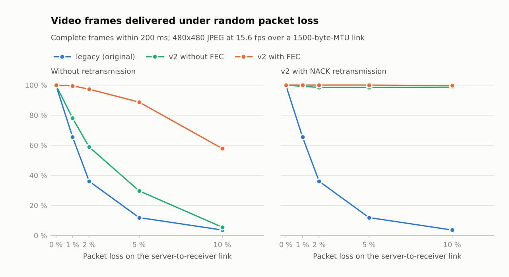
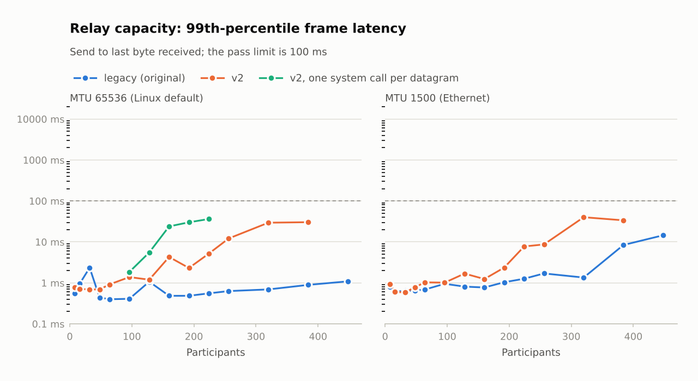

# Benchmarks

Four experiments compare the original course implementation (`legacy/`, run unmodified
through `bench/legacy_harness/`) with v2. Each one is a single command, writes JSON to
[`bench/results/`](../bench/results/), and `bench/render.py` turns the JSON into the
tables and plots below. The tables between `BEGIN GENERATED` and `END GENERATED` markers
are written by that script; do not edit them by hand.

| Experiment | Command | Result file | Takes |
|---|---|---|---|
| B1 loss resilience | `sudo bench/run_b1.sh` | `bench/results/b1_loss.json` | about 18 min |
| B1 lost frames (after B1) | `python3 bench/b1_lost_frames.py > bench/results/b1_lost_frames.txt` | `bench/results/b1_lost_frames.txt` | seconds |
| B2 multi-talker audio | `sudo bench/run_b2.sh` | `bench/results/b2_audio.json` | about 5 min |
| B3 relay capacity | `sudo bench/run_b3.sh` and `sudo MTU=1500 bench/run_b3.sh` | `bench/results/b3_capacity.json`, `bench/results/b3_capacity_mtu1500.json` | about 15 min each |
| B3 batching ablations | `sudo WIRES=v2 SIZES="96 128 160 192 224" SERVER_ARGS="-udp-batch 1" TAG=nobatch bench/run_b3.sh` and `sudo WIRES=v2 SIZES="128 160 192 224 256 320" SERVER_ARGS="-udp-gso=false" TAG=nogso bench/run_b3.sh`; repeated with `SIZES="160 192 224"` and `TAG=nobatch_repeat`, `TAG=nogso_repeat` | `bench/results/b3_capacity_nobatch.json`, `b3_capacity_nogso.json`, `b3_capacity_nobatch_repeat.json`, `b3_capacity_nogso_repeat.json` | 3-4 min each |
| CPU profiles under the B3 load | `sudo LABEL=v2-gso bench/profile_b3.sh`, and with `LABEL=v2-sendmmsg SERVER_ARGS="-udp-gso=false"` or `LABEL=v2-unbatched SERVER_ARGS="-udp-batch 1"` | `bench/results/pprof_<label>.pb.gz`, `.txt`, `.metrics` | about 1 min each |
| Go microbenchmarks | `bench/run_micro.sh` | `bench/results/micro.json` (raw: `micro.txt`) | about 2 min |
| Tables and plots | `(cd client && uv run --group bench python ../bench/render.py)` | `bench/results/plots/`, `bench/results/tables.md` | seconds |

B1-B3 need root (network namespaces and nftables). Every script runs its timing-sensitive
part under `flock /home/user/work/bench.lock` (override with `BENCH_LOCK=...`), so only
one benchmark runs on the machine at a time, and removes its namespaces (and with them
the nftables rules) on exit.

## Environment

All results were measured in one container: Linux 6.18, 4 vCPUs (Intel Xeon @ 2.10 GHz),
Go 1.24.7, Python 3.13. Other jobs ran on the machine at the same time (the bench lock
only serialises benchmarks), so treat small differences as noise. Each point is a single
run; there are no repetitions or confidence intervals, except two repeated B3 ablation
sweeps noted below. The `environment` object in each JSON file records the kernel, CPU
and versions, the git commit and any uncommitted paths under `server/`, `client/`,
`bench/` and `legacy/` when the results were written, and in `environment.build` the
same for the moment the binaries were built (`bench/lib/common.sh`). The B1, B2, B3 and
microbenchmark results were built from clean trees (commit 25e0e63; the B3 ablations
also ff94edb, which only fixed how `run_b3.sh` passes flags to its analysis).
`b3_capacity_unbatched.json`, the pre-batching cross-check, was run at 8e80e8d with two
untracked files present (`server/Dockerfile`, `server/.dockerignore`) that are not part
of the binaries.

## Test media

`bench/gen_frames.py` renders 1000 frames of a moving synthetic test pattern at the
original client's settings (480x480, Pillow JPEG quality 85) into `bench/data/frames/`;
every system sends exactly these bytes. Sizes (`bench/results/frames.json`): mean
31 090 bytes, minimum 29 752, median 31 197, maximum 32 327. In v2 that is 26 fragments
of at most 1200 bytes at the median (27 at most). Each frame carries a tag in a JPEG
comment segment (frame index, sender, send time) that the receivers read back.

Audio is a tone per talker. Each talker also writes a tag (talker, sequence number, send
time) into four reserved samples of every frame, at a position that only that talker
uses, so the tags survive the server's mix and the receiver can tell which talker's
frame it is playing and how old it is.

## B1: loss resilience

**Setup.** Three network namespaces (sender, server, receiver) connected by two veth
pairs with MTU 1500. In the receiver's namespace an nftables rule drops UDP packets at
random, `numgen random mod 1000 < N`, in a prerouting chain at priority -500, which is
before IPv4 defragmentation (-400), so individual IP fragments are lost as on a lossy
link. Only the server -> receiver direction is impaired; TCP is not. The v2 server sends
forwarded video as UDP GSO messages of up to 64 datagrams, which veth would carry into
the receiver's namespace whole, so that the rule would drop a whole message at a time;
the server's end of the veth pair is set to `gso_max_segs 1`, which makes the kernel
split each message into its datagrams as it transmits them, as a real NIC would. In the
loss-free v2-with-FEC run the rule matched 23 848 datagrams, exactly the receiver's UDP
`InDatagrams`, while the server's namespace counted 4 649 UDP sends
(`bench/results/b1_v2-fec-0.net.json`, copied from that run's raw files). The receiver creates
a meeting, the sender joins and sends the corpus at 15.625 fps (one frame per 1024-sample
audio chunk, the original client's loop rate) plus audio, for 41 s per run.

Systems: the original relay and the original client media threads; v2 without FEC
(client `--video-fec-k 0 --audio-fec-k 0`, server `-audio-fec-k 0`); v2 with FEC (video
k = 4, audio k = 2); and both v2 settings again with NACK retransmission of video (client
`--nack`; the server keeps each sender's last 256 video packets, its default). P2P is
disabled on the v2 server so every system relays. Because only the server -> receiver
direction loses packets, NACKs always reach the server while retransmissions can be lost
again, and the round trip between the namespaces is well under a millisecond: these runs
show NACK on a short path. On a longer one every repaired frame arrives one round trip
later, and the client's fixed 30 ms retry interval assumes a round trip shorter than
that.

**Metrics.** A video frame is delivered when the receiver had the complete frame within
200 ms of the sender handing it to the socket; frames sent in the first second and the
last 1.5 s are not counted. Audio lost is the share of the talker's frames whose tag
never reached the receiver's speaker (the original's frames are 64 ms chunks, v2's are
20 ms frames). The "model" value is the delivery that independent packet loss at the
configured rate would give for the same frame sizes (`model_ratio` in
`bench/analyze_b1.py`); for the NACK systems it gives every packet four independent
tries (the original and three retransmissions), ignores FEC and assumes every loss is
noticed in time. "Measured UDP loss" is the nftables drop counter divided by its match
counter.

<picture>
  <source media="(prefers-color-scheme: dark)" srcset="../bench/results/plots/b1_video_delivery_dark.png">
  
</picture>

<picture>
  <source media="(prefers-color-scheme: dark)" srcset="../bench/results/plots/b1_audio_loss_dark.png">
  
</picture>

<!-- BEGIN GENERATED b1 -->
| Packet loss | legacy (original): video frames on time (model) | v2 without FEC: video frames on time (model) | v2 with FEC: video frames on time (model) | v2 with NACK: video frames on time (model) | v2 with FEC and NACK: video frames on time (model) |
|---|---|---|---|---|---|
| 0 % | 100.0 % (100.0 %) | 100.0 % (100.0 %) | 100.0 % (100.0 %) | 100.0 % (100.0 %) | 100.0 % (100.0 %) |
| 1 % | 65.5 % (80.5 %) | 78.0 % (76.6 %) | 99.5 % (99.4 %) | 99.1 % (100.0 %) | 100.0 % (100.0 %) |
| 2 % | 36.0 % (64.7 %) | 58.8 % (58.6 %) | 97.3 % (97.5 %) | 98.5 % (100.0 %) | 100.0 % (100.0 %) |
| 5 % | 11.9 % (33.1 %) | 29.7 % (25.7 %) | 88.7 % (86.3 %) | 98.5 % (100.0 %) | 100.0 % (100.0 %) |
| 10 % | 3.6 % (10.3 %) | 5.5 % (6.2 %) | 57.8 % (57.7 %) | 98.6 % (99.7 %) | 99.7 % (99.7 %) |

| Packet loss | legacy (original): audio lost | v2 without FEC: audio lost | v2 with FEC: audio lost | v2 with NACK: audio lost | v2 with FEC and NACK: audio lost | measured UDP loss |
|---|---|---|---|---|---|---|
| 0 % | 0.00 % | 0.00 % | 0.00 % | 0.00 % | 0.00 % | 0.00 % / 0.00 % / 0.00 % / 0.00 % / 0.00 % |
| 1 % | 20.00 % | 0.70 % | 0.00 % | 0.64 % | 0.05 % | 1.03 % / 0.98 % / 0.91 % / 0.90 % / 1.03 % |
| 2 % | 46.90 % | 1.77 % | 0.05 % | 2.20 % | 0.05 % | 1.79 % / 1.94 % / 2.01 % / 2.12 % / 1.91 % |
| 5 % | 69.14 % | 4.18 % | 0.64 % | 4.78 % | 0.48 % | 4.95 % / 4.79 % / 4.95 % / 5.02 % / 4.75 % |
| 10 % | 74.35 % | 10.18 % | 1.93 % | 10.02 % | 2.36 % | 9.69 % / 10.81 % / 9.93 % / 10.34 % / 10.02 % |

| System | Packet loss | Video frames on time, first half | second half | IP reassembly failures | peak reassembly memory |
|---|---|---|---|---|---|
| legacy (original) | 0 % | 100.0 % | 100.0 % | 0 | 0.00 MiB |
| legacy (original) | 1 % | 80.7 % | 50.3 % | 2444 | 4.00 MiB |
| legacy (original) | 2 % | 58.6 % | 13.4 % | 5982 | 4.00 MiB |
| legacy (original) | 5 % | 13.8 % | 10.0 % | 8429 | 4.00 MiB |
| legacy (original) | 10 % | 3.1 % | 4.1 % | 8824 | 4.00 MiB |
| v2 without FEC | 0 % | 100.0 % | 100.0 % | 0 | 0.00 MiB |
| v2 without FEC | 1 % | 78.1 % | 78.0 % | 0 | 0.00 MiB |
| v2 without FEC | 2 % | 60.3 % | 57.4 % | 0 | 0.00 MiB |
| v2 without FEC | 5 % | 27.1 % | 32.3 % | 0 | 0.00 MiB |
| v2 without FEC | 10 % | 6.2 % | 4.8 % | 0 | 0.00 MiB |
| v2 with FEC | 0 % | 100.0 % | 100.0 % | 0 | 0.00 MiB |
| v2 with FEC | 1 % | 99.7 % | 99.3 % | 0 | 0.00 MiB |
| v2 with FEC | 2 % | 97.6 % | 96.9 % | 0 | 0.00 MiB |
| v2 with FEC | 5 % | 87.0 % | 90.4 % | 0 | 0.00 MiB |
| v2 with FEC | 10 % | 59.9 % | 55.7 % | 0 | 0.00 MiB |
| v2 with NACK | 0 % | 100.0 % | 100.0 % | 0 | 0.00 MiB |
| v2 with NACK | 1 % | 99.3 % | 99.0 % | 0 | 0.00 MiB |
| v2 with NACK | 2 % | 99.0 % | 97.9 % | 0 | 0.00 MiB |
| v2 with NACK | 5 % | 97.6 % | 99.3 % | 0 | 0.00 MiB |
| v2 with NACK | 10 % | 98.3 % | 99.0 % | 0 | 0.00 MiB |
| v2 with FEC and NACK | 0 % | 100.0 % | 100.0 % | 0 | 0.00 MiB |
| v2 with FEC and NACK | 1 % | 100.0 % | 100.0 % | 0 | 0.00 MiB |
| v2 with FEC and NACK | 2 % | 100.0 % | 100.0 % | 0 | 0.00 MiB |
| v2 with FEC and NACK | 5 % | 100.0 % | 100.0 % | 0 | 0.00 MiB |
| v2 with FEC and NACK | 10 % | 99.7 % | 99.7 % | 0 | 0.00 MiB |

| System | Packet loss | NACK packets sent | Packets requested (with repeats) | Received or rebuilt after a request | Given up | Video frames on time | p99 frame latency |
|---|---|---|---|---|---|---|---|
| v2 without FEC | 0 % | 0 | 0 | 0 | 0 | 100.0 % | 1.8 ms |
| v2 without FEC | 1 % | 0 | 0 | 0 | 0 | 78.0 % | 1.2 ms |
| v2 without FEC | 2 % | 0 | 0 | 0 | 0 | 58.8 % | 1.6 ms |
| v2 without FEC | 5 % | 0 | 0 | 0 | 0 | 29.7 % | 1.6 ms |
| v2 without FEC | 10 % | 0 | 0 | 0 | 0 | 5.5 % | 2.8 ms |
| v2 with FEC | 0 % | 0 | 0 | 0 | 0 | 100.0 % | 2.3 ms |
| v2 with FEC | 1 % | 0 | 0 | 0 | 0 | 99.5 % | 2.0 ms |
| v2 with FEC | 2 % | 0 | 0 | 0 | 0 | 97.3 % | 1.6 ms |
| v2 with FEC | 5 % | 0 | 0 | 0 | 0 | 88.7 % | 2.1 ms |
| v2 with FEC | 10 % | 0 | 0 | 0 | 0 | 57.8 % | 2.6 ms |
| v2 with NACK | 0 % | 0 | 0 | 0 | 0 | 100.0 % | 1.7 ms |
| v2 with NACK | 1 % | 144 | 155 | 153 | 0 | 99.1 % | 16.5 ms |
| v2 with NACK | 2 % | 283 | 357 | 350 | 0 | 98.5 % | 43.5 ms |
| v2 with NACK | 5 % | 494 | 873 | 832 | 0 | 98.5 % | 79.5 ms |
| v2 with NACK | 10 % | 747 | 1911 | 1713 | 1 | 98.6 % | 79.7 ms |
| v2 with FEC and NACK | 0 % | 0 | 0 | 0 | 0 | 100.0 % | 1.7 ms |
| v2 with FEC and NACK | 1 % | 44 | 53 | 53 | 0 | 100.0 % | 3.1 ms |
| v2 with FEC and NACK | 2 % | 102 | 125 | 125 | 0 | 100.0 % | 11.0 ms |
| v2 with FEC and NACK | 5 % | 212 | 335 | 323 | 0 | 100.0 % | 16.0 ms |
| v2 with FEC and NACK | 10 % | 485 | 1061 | 1004 | 1 | 99.7 % | 17.0 ms |
<!-- END GENERATED b1 -->

**Reading the results.**

- v2 without FEC follows the independent-loss model closely (78.0 % of frames at 1 %
  loss against a model 76.6 %, 5.5 % at 10 % against 6.2 %): fragmenting at the
  application layer does not by itself make a frame of 26 packets more likely to arrive
  than a datagram of 22 IP fragments.
- FEC changes the picture: with one parity packet per four fragments, 99.5 % of frames
  arrive at 1 % loss and 88.7 % at 5 %. XOR parity repairs one loss per group, so at
  10 % loss (57.8 %) two losses in a group become common.
- NACK on top of FEC repairs what parity cannot: 100.0 % of frames at 1, 2 and 5 % loss
  and 99.7 % at 10 %. At 10 % loss the receiver sent 485 NACK packets asking for 1 061
  packets (counting repeated requests); 1 004 of those were then received or rebuilt from
  parity, and one packet was given up. The price is latency for the frames that needed a retransmission: p99 17.0 ms
  at 10 % loss against 2.6 ms with FEC alone (medians 1.3 ms for both), mostly the
  client's 5 ms wait and 10 ms request interval on this sub-millisecond round trip.
- NACK without FEC reaches only 98.5-99.1 % at every loss rate, where its model predicts
  99.7 % or more, and its p99 latency is 79.5-79.7 ms at 5 and 10 % loss. A loss at the
  end of a frame shows only when the next frame's first packet arrives, one frame
  interval (64 ms) later; if that frame is complete before the retransmission arrives,
  the receiver's newest-wins assembler discards the older one. In all 31 frames that
  NACK alone lost the next frame arrived complete, in 28 cases within 0.6 ms of its first
  fragment, so without needing any retransmission
  ([`bench/results/b1_lost_frames.txt`](../bench/results/b1_lost_frames.txt), from
  `bench/b1_lost_frames.py`). With FEC, the parity packet after a frame's last fragment
  both reveals and repairs a lost tail.
- The original does worse than its own independent-loss model, and worse in the second
  half of each run than in the first (80.7 % against 50.3 % at 1 % loss). The receiver
  counted IP reassembly failures in every lossy run. Incomplete datagrams keep their
  fragments in the kernel's reassembly queue for `ipfrag_time` (30 s); once the queue
  memory reaches `ipfrag_high_thresh` (4 MiB per namespace; the peak sampled in every
  lossy run was 4.00 MiB), new fragments are dropped, including fragments of audio
  datagrams (2 IP fragments each), which is why 20.0 % of the original's audio was lost
  at 1 % packet loss. The peak-memory column comes from sampling `/proc/net/sockstat` in
  the receiver's namespace during the run.
- Frames that arrived without needing a retransmission took about 1 ms for every system
  (the `latency_ms` fields in the JSON); without NACK, loss, not delay, is what differs.

## B2: multi-talker audio

**Setup.** One network namespace; the server and 3 or 5 participants on its loopback
interface (each original participant on its own 127.0.0.x address, because the original
relay skips receivers with the sender's IP). Everybody talks and sends video (corpus at
15.625 fps) for the whole run. The measurement window starts 2.5 s after the last
participant joined and lasts about 61 s.

The original participants run the original `keep_share` and `keep_recv` threads. Their
sound card is a stand-in (`bench/legacy_harness/stubs.py`) that models a blocking audio
device: `read(1024)` returns when 1024 samples of real time have passed, and `write()`
returns only once the previous chunk has finished playing, so a receiver that is handed
more than real time of audio blocks in `write()` for one chunk duration per chunk. That
is how PyAudio's blocking stream behaves once its buffer is full, and it is the
assumption behind the original's numbers here. v2 participants run the real client with
the server's mix-minus stream and the client's 60 ms jitter buffer; their speaker is a
thread that pulls one 20 ms frame every 20 ms.

**Metrics.** Audio latency: from the end of a frame's capture at the talker to the
moment the receiver's (fake) sound card starts playing it. Audio delivered: share of
each talker's frames that were played, worst talker shown. Downstream audio: IP-level
bit rate into each receiver (original: nftables counters on the receiver's port for
datagrams under 4000 bytes; v2: client receive counters plus 28 bytes of IP and UDP
header per packet). Video frames processed: frames of the other participants that the
receiving application got (original: stored after decompression; v2: completed by the
frame assembler), against frames sent. Video frozen: per sender, the time covered by gaps
longer than 0.5 s between consecutive frames, as a share of the window.

<picture>
  <source media="(prefers-color-scheme: dark)" srcset="../bench/results/plots/b2_audio_latency_dark.png">
  
</picture>

<picture>
  <source media="(prefers-color-scheme: dark)" srcset="../bench/results/plots/b2_downstream_audio_dark.png">
  
</picture>

<picture>
  <source media="(prefers-color-scheme: dark)" srcset="../bench/results/plots/b2_video_shown_dark.png">
  
</picture>

<!-- BEGIN GENERATED b2 -->
| System | Parties | Audio latency p50 / p95 (ms) | Audio delivered (worst talker) | Downstream audio per receiver (kbit/s) | Video frames processed | Longest video freeze | Video time frozen > 0.5 s |
|---|---|---|---|---|---|---|---|
| legacy (original) | 3 | 593 / 671 | 41.4 % | 525 | 25.0 % | 0.64 s | 19.5 % |
| legacy (original) | 5 | 999 / 1210 | 15.2 % | 1050 | 8.1 % | 61.98 s | 70.9 % |
| v2 | 3 | 119 / 125 | 100.0 % | 415 (275 without FEC) | 100.0 % | 0.10 s | 0.0 % |
| v2 | 5 | 131 / 152 | 100.0 % | 420 (278 without FEC) | 100.0 % | 0.09 s | 0.0 % |
<!-- END GENERATED b2 -->

**Reading the results.**

- The original receiver has to play (n - 1) x real time of audio. Its receive thread
  blocks in `write()`, the socket buffer fills (the kernel counted 7 532 receive-buffer
  drops in the 3-party run and 34 315 in the 5-party run), and latency settles at the
  depth of that buffer: a median of 593 ms with three parties and 999 ms with five,
  while 41-59 % (three parties) and 63-85 % (five parties) of each talker's audio is
  never played.
- Because video arrives on the same socket and thread, video stalls with it: with five
  parties each receiver processed 7.0-10.2 % of the others' frames, and every receiver
  had a sender whose video did not arrive during the whole 62 s window (`longest_gap_s`).
- v2's median latency (119 ms with three parties, 131 ms with five) is what its
  configured buffers add up to: 40 ms in the server's per-sender jitter buffer, up to
  20 ms of mixer tick phase, the client's 60 ms jitter buffer and up to 20 ms of device
  period. It does not grow with the number of talkers, and neither does the downstream
  audio rate, because every receiver gets one mixed stream.
- v2's video costs more bandwidth than the original's: 20 587-20 590 kbit/s against
  15 564-15 569 kbit/s per receiver with five parties (the `downstream_video` fields), from FEC
  (25 %) and per-fragment headers.

## B3: relay capacity

**Setup.** One network namespace; the server and `server/cmd/loadgen` on its loopback
interface, the server pinned to CPU 1 and the load generator to CPUs 2 and 3 with
`taskset`. The load generator runs N participants in rooms of four; each sends corpus
frames at 15 fps and 256 kbit/s of audio, in each system's own wire format (v2: RTP
fragments with FEC k = 4 and audio k = 2 after a REGISTER; original: pickled datagrams,
byte-identical to CPython's, from one 127.1.x.y address per participant, using the
original port scheme). Each point: 5 s warm-up, 20 s measurement window, 1 s grace.
Participant counts are swept upwards until two consecutive sizes fail.

**Metrics.** Frame delivery: frames received complete by every other member of the
sender's room / (frames sent in the window x 3). The load generator does not repair
frames with FEC, so v2's delivery is a lower bound. Latency: send to complete receipt.
A size passes with delivery >= 99 % and p99 latency < 100 ms. Server CPU: utime + stime
of the server process from `/proc/<pid>/stat` over the window, divided by the window
(1.0 = the one CPU it is pinned to); CPU seconds per participant-minute come from a
separate 60 s run at 16 participants. Load generator CPU is recorded the same way, to
show that it was not the bottleneck.

The loopback interface's MTU matters for the original, which sends each frame as one
31 kB datagram: with Linux's default loopback MTU of 65 536 that datagram is never
fragmented, so the original sends 26 times fewer packets than v2, which keeps every
packet under 1232 bytes for real networks. The second set of runs uses MTU 1500, where
the kernel fragments the original's datagrams as it would on Ethernet.

<picture>
  <source media="(prefers-color-scheme: dark)" srcset="../bench/results/plots/b3_delivery_dark.png">
  
</picture>

<picture>
  <source media="(prefers-color-scheme: dark)" srcset="../bench/results/plots/b3_p99_latency_dark.png">
  
</picture>

<picture>
  <source media="(prefers-color-scheme: dark)" srcset="../bench/results/plots/b3_server_cpu_dark.png">
  
</picture>

<!-- BEGIN GENERATED b3 -->
| Loopback MTU | System | Built from | Capacity (participants) | First failing | CPU s per participant-minute (fixed run) | Server CPU in fixed run | Load generator CPU in fixed run |
|---|---|---|---|---|---|---|---|
| MTU 65536 (Linux default) | legacy (original) | `25e0e63` | >= 448 (largest size swept: 448) | none | 0.138 (N=16) | 0.037 | 0.14 |
| MTU 65536 (Linux default) | v2 | `25e0e63` | 256 | 320 | 0.464 (N=16) | 0.124 | 0.22 |
| MTU 65536 (Linux default) | v2, recvmmsg/sendmmsg without GSO | `ff94edb` | 160 | 192 | 0.529 (N=16) | 0.141 | 0.23 |
| MTU 65536 (Linux default) | v2, recvmmsg/sendmmsg without GSO (repeat) | `ff94edb` | 192 | 224 | 0.520 (N=16) | 0.139 | 0.22 |
| MTU 65536 (Linux default) | v2, one system call per datagram | `25e0e63` | 192 | 224 | 0.552 (N=16) | 0.147 | 0.27 |
| MTU 65536 (Linux default) | v2, one system call per datagram (repeat) | `ff94edb` | 192 | 224 | 0.611 (N=16) | 0.163 | 0.30 |
| MTU 65536 (Linux default) | v2 before batching existed | `8e80e8d` | 160 | 192 | 0.595 (N=16) | 0.159 | 0.26 |
| MTU 1500 (Ethernet) | legacy (original) | `25e0e63` | >= 448 (largest size swept: 448) | none | 0.190 (N=16) | 0.051 | 0.16 |
| MTU 1500 (Ethernet) | v2 | `25e0e63` | 256 | 320 | 0.437 (N=16) | 0.116 | 0.22 |

| Loopback MTU | System | Participants | Offered upstream (Mbit/s) | Frame delivery | p50 / p99 latency (ms) | Audio delivery | Server CPU | Load generator CPU | Pass |
|---|---|---|---|---|---|---|---|---|---|
| MTU 65536 (Linux default) | legacy (original) | 8 | 32 | 100.00 % | 0.2 / 0.6 | 100.0 % | 0.02 | 0.08 | yes |
| MTU 65536 (Linux default) | legacy (original) | 16 | 64 | 100.00 % | 0.2 / 1.0 | 100.0 % | 0.04 | 0.14 | yes |
| MTU 65536 (Linux default) | legacy (original) | 32 | 128 | 99.97 % | 0.2 / 2.3 | 100.0 % | 0.07 | 0.23 | yes |
| MTU 65536 (Linux default) | legacy (original) | 48 | 191 | 100.00 % | 0.2 / 0.4 | 100.0 % | 0.08 | 0.28 | yes |
| MTU 65536 (Linux default) | legacy (original) | 64 | 255 | 100.00 % | 0.2 / 0.4 | 100.0 % | 0.09 | 0.31 | yes |
| MTU 65536 (Linux default) | legacy (original) | 96 | 383 | 100.00 % | 0.2 / 0.4 | 100.0 % | 0.12 | 0.35 | yes |
| MTU 65536 (Linux default) | legacy (original) | 128 | 510 | 99.86 % | 0.2 / 1.1 | 100.0 % | 0.14 | 0.40 | yes |
| MTU 65536 (Linux default) | legacy (original) | 160 | 638 | 100.00 % | 0.2 / 0.5 | 100.0 % | 0.16 | 0.44 | yes |
| MTU 65536 (Linux default) | legacy (original) | 192 | 765 | 100.00 % | 0.2 / 0.5 | 100.0 % | 0.18 | 0.47 | yes |
| MTU 65536 (Linux default) | legacy (original) | 224 | 893 | 100.00 % | 0.2 / 0.6 | 100.0 % | 0.20 | 0.51 | yes |
| MTU 65536 (Linux default) | legacy (original) | 256 | 1021 | 100.00 % | 0.2 / 0.6 | 100.0 % | 0.23 | 0.53 | yes |
| MTU 65536 (Linux default) | legacy (original) | 320 | 1276 | 100.00 % | 0.2 / 0.7 | 100.0 % | 0.28 | 0.64 | yes |
| MTU 65536 (Linux default) | legacy (original) | 384 | 1531 | 100.00 % | 0.2 / 0.9 | 100.0 % | 0.32 | 0.69 | yes |
| MTU 65536 (Linux default) | legacy (original) | 448 | 1786 | 100.00 % | 0.2 / 1.1 | 100.0 % | 0.37 | 0.78 | yes |
| MTU 65536 (Linux default) | v2 | 8 | 32 | 100.00 % | 0.3 / 0.8 | 100.0 % | 0.07 | 0.15 | yes |
| MTU 65536 (Linux default) | v2 | 16 | 64 | 100.00 % | 0.3 / 0.7 | 100.0 % | 0.13 | 0.22 | yes |
| MTU 65536 (Linux default) | v2 | 32 | 128 | 100.00 % | 0.3 / 0.7 | 100.0 % | 0.20 | 0.31 | yes |
| MTU 65536 (Linux default) | v2 | 48 | 191 | 100.00 % | 0.3 / 0.7 | 100.0 % | 0.25 | 0.41 | yes |
| MTU 65536 (Linux default) | v2 | 64 | 255 | 100.00 % | 0.3 / 0.9 | 100.0 % | 0.32 | 0.49 | yes |
| MTU 65536 (Linux default) | v2 | 96 | 383 | 100.00 % | 0.3 / 1.4 | 100.0 % | 0.41 | 0.62 | yes |
| MTU 65536 (Linux default) | v2 | 128 | 510 | 100.00 % | 0.4 / 1.2 | 100.0 % | 0.50 | 0.76 | yes |
| MTU 65536 (Linux default) | v2 | 160 | 638 | 100.00 % | 0.4 / 4.3 | 100.0 % | 0.58 | 0.86 | yes |
| MTU 65536 (Linux default) | v2 | 192 | 765 | 100.00 % | 0.4 / 2.3 | 100.0 % | 0.66 | 1.00 | yes |
| MTU 65536 (Linux default) | v2 | 224 | 893 | 100.00 % | 0.5 / 5.2 | 100.0 % | 0.73 | 1.10 | yes |
| MTU 65536 (Linux default) | v2 | 256 | 1021 | 100.00 % | 0.8 / 12.1 | 100.0 % | 0.82 | 1.17 | yes |
| MTU 65536 (Linux default) | v2 | 320 | 1276 | 97.70 % | 5.7 / 29.5 | 98.8 % | 0.97 | 1.33 | no |
| MTU 65536 (Linux default) | v2 | 384 | 1531 | 81.49 % | 13.3 / 30.3 | 97.1 % | 0.99 | 1.42 | no |
| MTU 65536 (Linux default) | v2, recvmmsg/sendmmsg without GSO | 128 | 510 | 99.98 % | 0.4 / 15.0 | 100.0 % | 0.61 | 0.85 | yes |
| MTU 65536 (Linux default) | v2, recvmmsg/sendmmsg without GSO | 160 | 638 | 99.53 % | 0.5 / 34.6 | 99.2 % | 0.73 | 1.00 | yes |
| MTU 65536 (Linux default) | v2, recvmmsg/sendmmsg without GSO | 192 | 765 | 98.39 % | 0.8 / 40.2 | 92.0 % | 0.86 | 1.17 | no |
| MTU 65536 (Linux default) | v2, recvmmsg/sendmmsg without GSO | 224 | 893 | 97.22 % | 10.9 / 35.5 | 61.9 % | 0.98 | 1.33 | no |
| MTU 65536 (Linux default) | v2, recvmmsg/sendmmsg without GSO (repeat) | 160 | 638 | 99.29 % | 0.5 / 38.0 | 99.2 % | 0.73 | 1.03 | yes |
| MTU 65536 (Linux default) | v2, recvmmsg/sendmmsg without GSO (repeat) | 192 | 765 | 99.72 % | 0.7 / 25.7 | 97.2 % | 0.86 | 1.21 | yes |
| MTU 65536 (Linux default) | v2, recvmmsg/sendmmsg without GSO (repeat) | 224 | 893 | 98.20 % | 9.3 / 30.8 | 68.9 % | 0.97 | 1.32 | no |
| MTU 65536 (Linux default) | v2, one system call per datagram | 96 | 383 | 100.00 % | 0.5 / 1.8 | 100.0 % | 0.59 | 0.93 | yes |
| MTU 65536 (Linux default) | v2, one system call per datagram | 128 | 510 | 100.00 % | 0.6 / 5.5 | 100.0 % | 0.69 | 1.10 | yes |
| MTU 65536 (Linux default) | v2, one system call per datagram | 160 | 638 | 99.93 % | 1.1 / 23.9 | 99.9 % | 0.80 | 1.23 | yes |
| MTU 65536 (Linux default) | v2, one system call per datagram | 192 | 765 | 99.56 % | 0.9 / 30.1 | 96.9 % | 0.91 | 1.35 | yes |
| MTU 65536 (Linux default) | v2, one system call per datagram | 224 | 893 | 86.42 % | 23.9 / 36.2 | 77.5 % | 0.99 | 1.44 | no |
| MTU 65536 (Linux default) | v2, one system call per datagram (repeat) | 160 | 638 | 99.70 % | 0.7 / 20.1 | 99.9 % | 0.76 | 1.21 | yes |
| MTU 65536 (Linux default) | v2, one system call per datagram (repeat) | 192 | 765 | 99.07 % | 0.7 / 33.8 | 98.0 % | 0.86 | 1.39 | yes |
| MTU 65536 (Linux default) | v2, one system call per datagram (repeat) | 224 | 893 | 93.10 % | 18.8 / 37.2 | 89.7 % | 0.98 | 1.45 | no |
| MTU 65536 (Linux default) | v2 before batching existed | 8 | 32 | 100.00 % | 0.4 / 1.5 | 100.0 % | 0.09 | 0.16 | yes |
| MTU 65536 (Linux default) | v2 before batching existed | 16 | 64 | 100.00 % | 0.4 / 0.9 | 100.0 % | 0.16 | 0.26 | yes |
| MTU 65536 (Linux default) | v2 before batching existed | 32 | 128 | 100.00 % | 0.4 / 1.1 | 100.0 % | 0.26 | 0.41 | yes |
| MTU 65536 (Linux default) | v2 before batching existed | 48 | 191 | 100.00 % | 0.4 / 1.1 | 100.0 % | 0.35 | 0.57 | yes |
| MTU 65536 (Linux default) | v2 before batching existed | 64 | 255 | 100.00 % | 0.4 / 1.3 | 100.0 % | 0.43 | 0.70 | yes |
| MTU 65536 (Linux default) | v2 before batching existed | 96 | 383 | 100.00 % | 0.5 / 14.2 | 99.9 % | 0.59 | 0.95 | yes |
| MTU 65536 (Linux default) | v2 before batching existed | 128 | 510 | 100.00 % | 0.8 / 19.8 | 99.9 % | 0.67 | 1.10 | yes |
| MTU 65536 (Linux default) | v2 before batching existed | 160 | 638 | 99.38 % | 8.2 / 36.2 | 97.2 % | 0.79 | 1.23 | yes |
| MTU 65536 (Linux default) | v2 before batching existed | 192 | 765 | 96.89 % | 15.4 / 37.8 | 86.1 % | 0.94 | 1.37 | no |
| MTU 65536 (Linux default) | v2 before batching existed | 224 | 893 | 87.41 % | 23.2 / 41.9 | 75.0 % | 0.98 | 1.43 | no |
| MTU 1500 (Ethernet) | legacy (original) | 8 | 32 | 100.00 % | 0.3 / 0.8 | 100.0 % | 0.03 | 0.09 | yes |
| MTU 1500 (Ethernet) | legacy (original) | 16 | 64 | 100.00 % | 0.3 / 0.6 | 100.0 % | 0.05 | 0.15 | yes |
| MTU 1500 (Ethernet) | legacy (original) | 32 | 128 | 100.00 % | 0.3 / 0.6 | 100.0 % | 0.09 | 0.26 | yes |
| MTU 1500 (Ethernet) | legacy (original) | 48 | 191 | 100.00 % | 0.3 / 0.7 | 100.0 % | 0.13 | 0.34 | yes |
| MTU 1500 (Ethernet) | legacy (original) | 64 | 255 | 100.00 % | 0.3 / 0.7 | 100.0 % | 0.16 | 0.39 | yes |
| MTU 1500 (Ethernet) | legacy (original) | 96 | 383 | 100.00 % | 0.3 / 1.0 | 100.0 % | 0.24 | 0.53 | yes |
| MTU 1500 (Ethernet) | legacy (original) | 128 | 510 | 100.00 % | 0.3 / 0.8 | 100.0 % | 0.26 | 0.53 | yes |
| MTU 1500 (Ethernet) | legacy (original) | 160 | 638 | 100.00 % | 0.3 / 0.8 | 100.0 % | 0.30 | 0.60 | yes |
| MTU 1500 (Ethernet) | legacy (original) | 192 | 765 | 100.00 % | 0.3 / 1.0 | 100.0 % | 0.35 | 0.68 | yes |
| MTU 1500 (Ethernet) | legacy (original) | 224 | 893 | 99.99 % | 0.3 / 1.3 | 100.0 % | 0.41 | 0.74 | yes |
| MTU 1500 (Ethernet) | legacy (original) | 256 | 1021 | 100.00 % | 0.3 / 1.7 | 100.0 % | 0.45 | 0.79 | yes |
| MTU 1500 (Ethernet) | legacy (original) | 320 | 1276 | 99.99 % | 0.3 / 1.3 | 100.0 % | 0.55 | 0.95 | yes |
| MTU 1500 (Ethernet) | legacy (original) | 384 | 1531 | 99.99 % | 0.5 / 8.4 | 99.9 % | 0.62 | 0.96 | yes |
| MTU 1500 (Ethernet) | legacy (original) | 448 | 1786 | 99.85 % | 1.3 / 14.5 | 99.9 % | 0.70 | 1.03 | yes |
| MTU 1500 (Ethernet) | v2 | 8 | 32 | 100.00 % | 0.3 / 0.9 | 100.0 % | 0.07 | 0.14 | yes |
| MTU 1500 (Ethernet) | v2 | 16 | 64 | 100.00 % | 0.3 / 0.6 | 100.0 % | 0.12 | 0.21 | yes |
| MTU 1500 (Ethernet) | v2 | 32 | 128 | 100.00 % | 0.3 / 0.6 | 100.0 % | 0.19 | 0.30 | yes |
| MTU 1500 (Ethernet) | v2 | 48 | 191 | 100.00 % | 0.3 / 0.8 | 100.0 % | 0.25 | 0.41 | yes |
| MTU 1500 (Ethernet) | v2 | 64 | 255 | 100.00 % | 0.3 / 1.0 | 100.0 % | 0.31 | 0.48 | yes |
| MTU 1500 (Ethernet) | v2 | 96 | 383 | 100.00 % | 0.3 / 1.0 | 100.0 % | 0.40 | 0.61 | yes |
| MTU 1500 (Ethernet) | v2 | 128 | 510 | 100.00 % | 0.3 / 1.7 | 100.0 % | 0.49 | 0.74 | yes |
| MTU 1500 (Ethernet) | v2 | 160 | 638 | 100.00 % | 0.4 / 1.2 | 100.0 % | 0.57 | 0.86 | yes |
| MTU 1500 (Ethernet) | v2 | 192 | 765 | 99.92 % | 0.4 / 2.4 | 100.0 % | 0.63 | 0.97 | yes |
| MTU 1500 (Ethernet) | v2 | 224 | 893 | 100.00 % | 0.6 / 7.7 | 100.0 % | 0.73 | 1.06 | yes |
| MTU 1500 (Ethernet) | v2 | 256 | 1021 | 99.91 % | 0.7 / 8.7 | 100.0 % | 0.81 | 1.17 | yes |
| MTU 1500 (Ethernet) | v2 | 320 | 1276 | 91.50 % | 11.0 / 40.1 | 100.3 % | 0.96 | 1.35 | no |
| MTU 1500 (Ethernet) | v2 | 384 | 1531 | 93.35 % | 8.1 / 33.7 | 93.4 % | 0.98 | 1.47 | no |
<!-- END GENERATED b3 -->

**Reading the results (loopback MTU 65 536).**

- The original relay passed every size up to 448 participants, the most its port
  scheme allows in one sweep (UDP port 20000 + 100 x ID), with its server process at
  0.37 of a CPU. v2 passed up to 256 participants (100.00 % delivery, p99 12.1 ms) and
  failed at 320 (97.70 %, p99 29.5 ms) with its server at 0.97 of the CPU it is pinned
  to: v2 is CPU-bound, the original was not.
- At the fixed load of 16 participants v2 used 0.464 CPU-seconds per participant-minute
  against 0.138 for the original. The reason is packet count, not bytes: in the same
  66 s run the load generator sent 609 296 packets for the 16 v2 participants and
  32 340 for the 16 original ones (`packets_sent` in the fixed-run JSON). v2 sends every
  frame as about 26 MTU-sized fragments plus 7 parity packets, and audio as 50 frames
  plus 25 parity packets per second, and the server forwards each video packet to three
  receivers; on a 64 KiB-MTU loopback the original's 31 kB datagram crosses the kernel
  once.
- System-call batching and UDP GSO, compared on one binary with server flags (the rows
  "v2, ..."; both ablations were swept twice). With one system call per datagram
  (`-udp-batch 1`) v2 passed up to 192 participants in both sweeps, its server at 0.80
  and 0.76 of the CPU at 160 participants. With `recvmmsg`/`sendmmsg` but no GSO
  (`-udp-gso=false`) it passed up to 160 and 192, at 0.73 in both sweeps. With GSO, the
  default, it passed up to 256, at 0.58. At 16 participants the default used 0.464
  CPU-seconds per participant-minute, against 0.552 and 0.611 with `-udp-batch 1` and
  0.529 and 0.520 without GSO. v2 at commit 8e80e8d, before batching existed, behaved
  like the one-call-per-datagram rows (160 participants; 0.79 at 160; 0.595). Batching
  alone saved a few percent, within the spread of the repeated sweeps; GSO, which cuts
  the number of packets the IP stack handles rather than the number of system calls,
  is what raised the capacity (the profiles below show why).
- Run-to-run variation is visible in the original, whose code did not change: 0.147
  CPU-seconds per participant-minute in the run at commit 8e80e8d and 0.138 in this one.
  Differences of that size (about 7 %) are noise on this shared machine.

**Reading the results (loopback MTU 1500).**

- v2 is unaffected, as its packets are all smaller than 1500 bytes: it passed up to 256
  participants and failed at 320 again, at 0.437 CPU-seconds per participant-minute.
- The original's frame datagrams are now split into 21 or 22 IP fragments each. Its server
  process used 0.70 of a CPU at 448 participants (0.37 at MTU 65 536) and 0.190
  CPU-seconds per participant-minute (0.138); it still passed every size up to 448, with
  p99 latency rising to 14.5 ms at 448.
- Where the fragmentation and reassembly time is charged: IP fragmentation runs in the
  sending process's system call. On loopback the receive path of a packet, IP reassembly
  included, normally runs in the softirq that the sender's system call raises on the
  sender's CPU (or in that CPU's `ksoftirqd` thread when softirq work piles up, charged
  to neither process). So the original's server is charged for fragmenting the three
  copies it sends of each frame and for the receivers' reassembly of them, but not for
  reassembling the frame it received, which is charged to the load generator. A real
  server would reassemble its incoming datagrams itself, in softirq on the CPU that
  handles the NIC's interrupts (usually not charged to the process either), and would
  not pay for its receivers' reassembly. Read the MTU 1500 CPU figures as the cost of
  the traffic the server sends, not as what a deployment would measure.

### Where the v2 server's CPU goes

CPU profiles of the server under the B3 load at 128 participants (`bench/profile_b3.sh`,
15 s of `/debug/pprof/profile`, server pinned to one CPU), summarised by
`bench/analyze_pprof.py`. The code-path columns are cumulative shares of the profiled
CPU time (paths nest, so they do not add up); the system-call columns come from the
server's own counters over the whole run. The profiles' samples cover less time than
the process's CPU counters (5.58 s of samples in 15.16 s against a measured 0.48 of a
CPU for the default build), so the shares are of profiled time.

<!-- BEGIN GENERATED b3_profile -->
| Server | Server CPU | p99 latency | Forwarding | Reading | Audio mixers | of which mixer sends | All system calls | Datagrams per read call | Copies per send call | Datagrams per message | File |
|---|---|---|---|---|---|---|---|---|---|---|---|
| before batching (commit ef8982e) | 0.69 | 4.2 ms | 77.7 % | 10.9 % | 5.5 % | 3.6 % | 87.6 % | n/a | n/a | n/a | `pprof_v2.txt` |
| `-udp-batch 1` | 0.68 | 5.6 ms | 74.7 % | 12.2 % | 7.7 % | 4.9 % | 86.6 % | 1.0 | 1.0 | 1.00 | `pprof_v2-unbatched.txt` |
| `-udp-gso=false` | 0.65 | 6.4 ms | 79.1 % | 8.8 % | 6.7 % | 5.1 % | 92.5 % | 22.7 | 90.3 | 1.00 | `pprof_v2-sendmmsg.txt` |
| default (batching + GSO) | 0.48 | 1.2 ms | 50.0 % | 19.4 % | 21.3 % | 13.4 % | 80.5 % | 19.2 | 81.8 | 10.08 | `pprof_v2-gso.txt` |
<!-- END GENERATED b3_profile -->

- Before batching (and with `-udp-batch 1`) most of the time is under `Syscall6` in the
  forwarding path: one `sendto` per copy.
- `recvmmsg`/`sendmmsg` cut the read calls 23-fold and the send calls 90-fold but
  saved little CPU (0.65 against 0.68): the time under `Syscall6` is the kernel's
  per-packet network stack work, which batching does not reduce.
- UDP GSO sends 10 datagrams per message on average, so the IP stack runs once per
  message rather than per datagram: the server's CPU fell to 0.48 and forwarding's share
  of the samples from 75 % to 50 %. The audio mixers' share rose (8 % to 21 %) because on
  loopback a datagram's receive work is charged to whichever system call on that CPU
  runs the softirq, so the split between forwarding and mixing is approximate; the
  whole-process CPU is the reliable number.

## Go microbenchmarks

`go test -bench . -benchmem -count 5 -cpu 1`, pinned to one CPU; the table shows the
median of the five runs. One `BenchmarkForwardVideo` operation is one full-size video
fragment routed to the three other members of a four-member room over real loopback
sockets: `unbatched` sends each copy with its own `sendto`, as the server did before
batching; `sendmmsg/batch=N` sends the copies of N packets with one `sendmmsg`, as the
server does when a read returns N datagrams; `gso/batch=N` also merges each receiver's
copies into UDP GSO messages; `gso+nack-buffer` also copies every packet into the
sender's retransmission buffer (the server's default). `udpio.BenchmarkSendFrame`
sends one frame's worth of datagrams (24 x 1220 bytes) to one receiver with each
mechanism. The receiving sockets are not read, so the kernel drops datagrams once their
buffers are full; every variant pays the same receive-side cost up to that point. The
other benchmarks do no I/O.

Per forwarded packet, sending the three copies with GSO in batches of 64 took 1 009 ns
against 3 946 ns with one `sendto` each and 2 950 ns with plain `sendmmsg`; for a whole
frame to one receiver, 7 546 ns against 30 768 ns and 27 516 ns. The retransmission
buffer adds 146 ns per packet (1 155 ns).

<!-- BEGIN GENERATED micro -->
| Benchmark | ns/op (median of 5) | MB/s | B/op | allocs/op |
|---|---|---|---|---|
| `protocol.BenchmarkParseRTPVideoFragment` | 6.1 |  | 0 | 0 |
| `protocol.BenchmarkMarshalRTPHeader` | 5.9 |  | 0 | 0 |
| `protocol.BenchmarkFECEncodeVideoGroup` | 198.1 | 24629 | 0 | 0 |
| `protocol.BenchmarkFECRecoverVideoFragment` | 159.9 | 7629 | 0 | 0 |
| `media.BenchmarkMixerTick/members=3` (4.50 packets/op) | 3725.0 |  | 0 | 0 |
| `media.BenchmarkMixerTick/members=4` (6.00 packets/op) | 5164.0 |  | 0 | 0 |
| `media.BenchmarkMixerTick/members=5` (7.50 packets/op) | 6389.0 |  | 0 | 0 |
| `media.BenchmarkMixerTick/members=16` (24.00 packets/op) | 21121.0 |  | 0 | 0 |
| `media.BenchmarkMixMinus` | 1895.0 |  | 0 | 0 |
| `media.BenchmarkForwardVideo/unbatched` | 3946.0 | 928 | 0 | 0 |
| `media.BenchmarkForwardVideo/sendmmsg/batch=1` | 3774.0 | 970 | 0 | 0 |
| `media.BenchmarkForwardVideo/sendmmsg/batch=16` | 3475.0 | 1053 | 0 | 0 |
| `media.BenchmarkForwardVideo/sendmmsg/batch=64` | 2950.0 | 1241 | 0 | 0 |
| `media.BenchmarkForwardVideo/gso/batch=16` | 1088.0 | 3365 | 0 | 0 |
| `media.BenchmarkForwardVideo/gso/batch=64` | 1009.0 | 3628 | 0 | 0 |
| `media.BenchmarkForwardVideo/gso+nack-buffer/batch=64` | 1155.0 | 3170 | 0 | 0 |
| `udpio.BenchmarkSendFrame/sendto` | 30768.0 | 952 | 0 | 0 |
| `udpio.BenchmarkSendFrame/sendmmsg` | 27516.0 | 1064 | 0 | 0 |
| `udpio.BenchmarkSendFrame/sendmmsg+gso` | 7546.0 | 3880 | 0 | 0 |
<!-- END GENERATED micro -->
